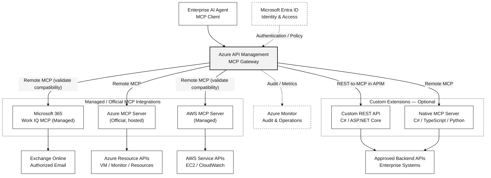

# Enterprise MCP Gateway & Server Implementation & Integration

> **IP-09 | Customer Service Brochure**  
> **Microsoft 365 (Exchange Online Email) · Azure · AWS · Custom MCP Extensions**

**Reference Pilot: 15 Person-Days** — 1 Microsoft 365 Tenant, 1 Azure Subscription, 1 AWS Account, **ไม่เกิน 8 Approved MCP Tools** และ 1 Primary Hosting Environment โดยมี Identity, API Permissions และ Infrastructure Prerequisites พร้อมใช้งาน

## 1. About This Service

บริการออกแบบและติดตั้ง **Enterprise MCP Integration** เพื่อให้ AI Assistants / AI Agents เรียกใช้ข้อมูลและความสามารถของ **Microsoft 365 Email, Microsoft Azure และ AWS** ผ่าน Model Context Protocol (MCP) โดยมี Authentication, Authorization, Resource-level Access Control, Audit และ Operations ที่ตรวจสอบได้

**Design principle: Managed-first, Custom-when-needed.** ประเมินและนำ MCP Server / MCP Tools ของผู้ผลิตมาใช้ก่อน ไม่พัฒนา Connector ซ้ำโดยไม่จำเป็น แล้วเพิ่ม **Custom MCP Tools** เฉพาะ Use Cases หรือ Business Logic ที่องค์กรต้องการ

Custom Tools **ไม่จำกัดเฉพาะ Microsoft 365, Azure หรือ AWS**: สามารถเชื่อมต่อ Approved REST APIs, Enterprise Applications, Databases ผ่าน Service API หรือระบบอื่นได้ หากมี Network Connectivity, Backend API/SDK และสิทธิ์ที่เหมาะสม ทั้งนี้การเชื่อมต่อระบบนอกเหนือจากสาม Workloads หลัก **ไม่รวมอยู่ใน Reference Pilot** เว้นแต่ตกลงใน SOW

**Service Outcome:** ได้ MCP Gateway / Endpoint Configuration, Approved Tool Catalog, Selected Workload Integrations, Access & Permission Matrix, End-to-end Test Evidence และ Operations Runbook พร้อมแนวทางขยาย Custom Tools ในอนาคต

## 2. Reference Architecture & Product Selection

| Component | Recommended approach | Engineering considerations |
|---|---|---|
| **MCP Gateway** | **Azure API Management (APIM)**; ประเมิน Standard v2 สำหรับ Production | Managed Gateway; กำหนด Client Access, Policy, Routing, Monitoring และค่าใช้จ่ายตาม Tier/Region |
| **Microsoft 365 Email** | **Microsoft Work IQ remote MCP** เป็นตัวเลือกแรก; **Custom Graph API** เป็นทางเลือก | Work IQ ใช้ Delegated User Context และอาจมี Usage-based Charges; ต้องทดสอบ Scope, Tenant Policy, OAuth และ Client Compatibility |
| **Azure** | **Microsoft Azure MCP Server** | Official MCP Server Implementation; อาจต้อง Deploy/Operate บน Azure Container Apps หรือ Hosting ที่รองรับ — ไม่ใช่ Managed Hosted Service โดยอัตโนมัติ |
| **AWS** | **AWS Managed MCP Server** | AWS-hosted Remote MCP; ตรวจ Authentication (OAuth / SigV4), Region, Quotas และการเชื่อมกับ Gateway ก่อนเลือก Production |
| **Custom Tools** | **ASP.NET Core REST API → APIM REST-to-MCP**, หรือ **Native MCP Server** | พัฒนาเฉพาะ Tool/Business Logic ที่ไม่มีใน Standard Product; Host บน Azure Container Apps / Azure Functions หรือ Hosting ที่อนุมัติ |
| **Identity & Observability** | Microsoft Entra ID, Azure RBAC, AWS IAM/STS, Azure Monitor / Application Insights | แยก Caller Authorization จาก Backend Authorization, ใช้ Least Privilege, Logging/Trace และ Recovery Procedure |

**Product selection เป็น Reference Architecture ไม่ใช่คำรับรองว่า Managed MCP ทุกตัว Proxy ผ่าน APIM ได้ทันที** ต้องทดสอบ MCP Protocol/Transport, OAuth/OBO, SigV4, User Identity Propagation, Tool Discovery, Network Access และ Licensing/Quota ก่อนยืนยัน Solution Design

### Architecture — Managed MCP + Custom Extensions (Black & White Mermaid)

**Diagram notes:** แสดง Logical Integration เท่านั้น — ในเส้นทาง **REST-to-MCP** นั้น APIM เป็นผู้ Expose Tool จาก REST API โดยตรง ไม่ใช่การเพิ่ม MCP Server อีกตัว และ APIM อาจแยก MCP Endpoint ตาม Integration โดยไม่ได้รวม Tools ทั้งหมดเป็น Endpoint เดียวโดยอัตโนมัติ. เส้นทาง **Work IQ และ AWS Managed MCP ผ่าน APIM** ต้องทดสอบ OAuth/Identity Propagation, Protocol Compatibility และ Backend Authorization ก่อนใช้ Production

**[View trust-boundary architecture diagram (conceptual)](../../assets/diagrams/ip-09-enterprise-mcp-architecture.svg)** — ภาพเดิมอธิบาย Identity/Authorization/Backend Boundary; แผนภาพด้านบนเป็นแนวทาง Product Deployment สำหรับโครงการนี้

**Existing network context:** ลูกค้ามี On-premises เชื่อม Azure และ AWS ผ่าน Site-to-Site VPN อยู่แล้ว แต่ **ไม่ติดตั้ง On-prem MCP Server และไม่เปลี่ยน S2S VPN** ใน Scope นี้ การเรียก Cloud APIs ไม่จำเป็นต้องวิ่งผ่าน VPN เดิม เว้นแต่ Network/Security Policy กำหนด

## 3. Custom MCP Tools — Extend to Approved Systems

สามารถเพิ่ม Tools ได้ **โดยไม่แก้ Source Code ของ Managed MCP Server** และไม่ต้องสร้าง MCP Gateway ใหม่

| Extension Pattern | วิธีดำเนินงาน | เหมาะกับ |
|---|---|---|
| **A. REST API → MCP** (**Preferred for simple tools**) | พัฒนา ASP.NET Core REST API → Deploy → Import API เข้า APIM → เลือก REST Operations เพื่อ **Expose as MCP Tools** | Enterprise APIs ที่มีอยู่แล้ว, Operations แบบ Request/Response, Tool จำนวนไม่มาก |
| **B. Native MCP Server** | พัฒนา MCP Server ด้วย Official MCP SDK → Deploy Remote MCP Endpoint → ให้ APIM Expose/Govern Existing MCP Server | ต้องใช้ MCP-native Features, Custom Runtime, Complex Tool Orchestration |

**Programming languages:** แนะนำ **C# / ASP.NET Core (.NET)** สำหรับ Integration ที่ใช้ Microsoft Graph, Azure SDK และ Enterprise APIs; สามารถใช้ **TypeScript/Node.js หรือ Python** ได้เช่นกันตามทีมที่ดูแลระบบ

**ตัวอย่าง Custom Tool (Illustrative):**

| Tool | Example outcome | Backend |
|---|---|---|
| **get_enterprise_health** | รวม VM/Alert Health จาก Azure และ AWS | Azure Monitor + AWS CloudWatch |
| **check_vm_compliance** | ตรวจสอบ VM Configuration ตาม Baseline ขององค์กร | Azure APIs + Approved Policy/CMDB |
| **get_aws_cost_summary** | สรุปค่าใช้จ่าย AWS ตาม Account/Business Unit | AWS Cost Explorer / Approved Metadata |
| **get_m365_license_summary** | ดู License Usage ภายใต้สิทธิ์ที่กำหนด | Microsoft Graph / Reporting APIs |
| **search_internal_case** | ค้นหา Case ในระบบ ITSM ที่องค์กรอนุมัติ | Approved Internal/Third-party REST API |

**Scope boundary:** รายการข้างต้นเป็นตัวอย่างการขยายระบบ ไม่ได้หมายความว่า Reference Pilot ต้องพัฒนาทุก Tool; หากเลือก Custom Tool จะนับรวมใน **8 Tools สูงสุด** และประเมิน Complexity / Backend Readiness ก่อนยืนยัน Effort. การเพิ่มระบบอื่นหรือ Workflow ที่ซับซ้อนต้องทำ Change Request หรือ SOW แยก

**Security boundary:** Tools ไม่สามารถเข้าถึงระบบปลายทางได้โดยอัตโนมัติ ต้องผ่าน Backend Permissions, Network Rules และ Resource-level Authorization จริง; ไม่เปิด Arbitrary PowerShell, Generic Cloud API Execution หรือ Administrative Write Operations ให้ Agent เป็น Default

## 4. Initial Integration Scope — Microsoft 365 Email, Azure & AWS

| Integration | Initial Read-only Use Cases | Access boundary |
|---|---|---|
| **Exchange Online Email** | Search Messages, Read Approved Message Metadata/Content ตาม Use Case | Work IQ Delegated User Permission / Tenant Policy หรือ Custom Microsoft Graph Delegated Access / Scoped Application Access |
| **Azure** | List Resources/VMs, Get VM/Resource Status, Query Azure Monitor Alerts | Azure RBAC ตาม Subscription/Resource Group, Managed Identity หรือ Supported User Delegation |
| **AWS** | List EC2 Instances, Get Instance Status, Query CloudWatch Alarms | AWS IAM Least Privilege, Account/Region Scope และ Temporary Credentials / Approved Auth Model |

**Out of initial scope:** Microsoft Teams, SharePoint, OneDrive, On-prem AD/DNS/DHCP และ Custom Integration ที่ไม่ได้อนุมัติใน Tool Catalog; สามารถเพิ่มเป็น Future Phase ได้โดยไม่เปลี่ยน Design Principle

### Example Pilot Tool Catalog (Illustrative — up to 8)

| # | Tool / Capability | Workload |
|---:|---|---|
| 1 | Search authorized emails | Microsoft 365 Email |
| 2 | Read authorized email details | Microsoft 365 Email |
| 3 | List scoped Azure resources | Azure |
| 4 | Get Azure VM / Resource status | Azure |
| 5 | Get Azure Monitor alerts | Azure |
| 6 | List EC2 instances | AWS |
| 7 | Get CloudWatch alarms | AWS |
| 8 | One approved customer-specific read-only tool (**optional**, in place of a standard tool) | Custom |

ชื่อและจำนวน Tools จริงขึ้นกับ Provider MCP Tool Catalog และ Approved API Contracts; Work IQ อาจใช้ Generic Tools/Resource Paths แทนชื่อ Tool ตาม Use Case ดังนั้นตารางนี้ไม่ใช่รายการ Tool Names ที่ยืนยันว่ามีอยู่ในผลิตภัณฑ์ทุกตัว

## 5. Security, Reliability & Operations

| Control | Implementation requirement |
|---|---|
| **Authentication** | ตรวจ Client Identity, Token Issuer/Audience/Expiry; ยืนยัน Support สำหรับ MCP Client และ Provider OAuth Flow |
| **Authorization** | Per-tool Access + Backend Resource Authorization; เลือก Delegated/OBO, Managed Identity หรือ AWS IAM ตาม Workload |
| **Least Privilege** | Allowlisted Operations, Approved Resource Scope, Read-only by Default; ไม่มี Shared Admin Identity เพื่อข้ามสิทธิ์ผู้ใช้ |
| **Guardrails & Approval** | Sensitive Write Actions เช่น Send Mail, Restart VM, Delete Resources ต้องมี Business Approval และ Negative Tests แยก |
| **Secrets & Data Protection** | เก็บ Secrets ใน Approved Vault; ไม่ Log Full Tokens, Raw Email Body หรือ Sensitive Payload โดยไม่จำเป็น |
| **Observability** | Gateway/Tool Audit, Correlation IDs, Latency, Errors, Retry/Throttling, Alerts และ Cost Monitoring |
| **Reliability & Lifecycle** | Health Checks, Version Pinning, Upgrade/Rollback, Recovery Runbook และ Capacity/Quota Assessment |

**Important:** MCP Gateway ไม่ได้แทน Backend Authorization; ต้องทดสอบว่า Unauthorized Tool Calls ถูกปฏิเสธจริง และไม่เกิด Data Exposure ข้าม User/Subscription/Account

## 6. Implementation Agenda (Reference Pilot)

| Phase | Activities | Effort |
|---|---|---:|
| **1. Discovery & Product Fit** | Confirm AI Client, Use Cases, Identity, Existing MCP Products, Cost/Quota, Hosting Readiness และ 8-Tool Candidate List | 2 วัน |
| **2. Architecture & Security Design** | Define Gateway/Endpoints, AuthN/AuthZ, Backend Permissions, Trust Boundaries, Tool Contracts และ Test Plan | 2 วัน |
| **3. Gateway & MCP Foundation** | Configure Selected MCP Gateway, Provider MCP Endpoints หรือ Required Hosting, Secrets, Access Policies และ Basic Observability | 3 วัน |
| **4. Selected Integrations & Tools** | Configure Microsoft 365 Email, Azure, AWS และพัฒนา Custom Read-only Tool เฉพาะเมื่ออยู่ใน Approved Scope | 5 วัน |
| **5. Functional & Security Validation** | End-to-end Integration, Positive/Negative Permissions, Identity Propagation, Throttling, Errors และ Audit Evidence | 2 วัน |
| **6. Documentation & Handover** | Configuration/Source Code (where applicable), Tool Matrix, Runbook, Findings และ Rollout Roadmap | 1 วัน |
| **Total** | | **15 Person-Days** |

*Reference Pilot ไม่เท่ากับ Full Production Rollout* — หาก APIM/Entra/Cloud Prerequisites ยังไม่พร้อม, Work IQ/AWS Managed MCP Proxy ต้องพัฒนา Adapter, มี Complex Multi-user Delegation, Custom Backend ใหม่ หรือ HA/DR และ Write Approval Workflows ต้องปรับ Scope/Estimate ก่อนดำเนินงาน

## 7. Deliverables

| Deliverable | Description |
|---|---|
| **1. Architecture & Product Decision Record** | Managed vs Custom Decision, Gateway/Server Topology, Identity Flows, Network/Trust Boundaries และ Compatibility Findings |
| **2. Approved Tool Catalog & Contract** | Tool Purpose, Workload, Read/Write Classification, JSON Input/Output Contract, Owner และ Scope |
| **3. MCP Integration Configuration / Custom Code** | APIM Policies/Endpoints, Provider MCP Configuration และ Custom REST API / Native MCP Source Code เฉพาะที่พัฒนา |
| **4. Identity & Authorization Matrix** | AI Client/Principal → MCP Tool → Backend Identity → Resource Scope → Allowed/Denied Operations |
| **5. Functional & Security Test Evidence** | End-to-end Test Cases, Negative Access Tests, Identity/Backend Failures, Observability และ Open Risks |
| **6. Deployment & Operations Runbook** | Deployment/Upgrade/Recovery, Ownership, Credential Rotation, Gateway/Server Monitoring และ Future Custom Tools |

## 8. Tools & Technologies

| Area | Primary technologies |
|---|---|
| **MCP Gateway** | Azure API Management (candidate: Standard v2) |
| **Microsoft 365** | Microsoft Work IQ remote MCP; Microsoft Graph / Custom Graph API เมื่อเหมาะสม |
| **Azure** | Microsoft Azure MCP Server, Azure Resource Manager/SDK, Azure RBAC |
| **AWS** | AWS Managed MCP Server, AWS IAM/STS, AWS Service APIs |
| **Custom Tool Development** | C# / ASP.NET Core (.NET); optional TypeScript/Node.js, Python; REST-to-MCP or MCP SDK |
| **Hosting (if needed)** | Azure Container Apps / Azure Functions / Approved Hosting |
| **Security & Operations** | Microsoft Entra ID, Azure Key Vault, Azure Monitor / Application Insights; AWS-side CloudTrail/CloudWatch ตาม Integration |

**Licensing / Consumption:** APIM Tier, Work IQ Usage, Azure Container Apps, Cloud Monitoring, AWS Cloud Services และ AI Model/Agent มีค่าใช้จ่ายแยกตามการใช้งานและ Region; ไม่รวมในค่า Person-Days และควรประเมินตาม Call Volume, Concurrency และ Data Access Pattern จริง

## 9. Sample Outcome & Service Boundaries

**[View Sample Enterprise MCP Outcome — Expanded Fictional Demonstration](../examples/enterprise-mcp-m365-azure-aws-outcome.md)**

*ตัวอย่างรายงานที่เชื่อมโยงเป็น DEMO DATA ซึ่งรวม Teams, SharePoint และ OneDrive เพื่อแสดงการขยายระบบในอนาคต; **ไม่ใช่ Scope 3 Workloads ของ Initial Pilot ที่ระบุใน Brochure นี้***

**Reference Pilot Assumptions:** 1 M365 Tenant, 1 Azure Subscription, 1 AWS Account, up to 8 Tools, Read-only Default, Approved APIs, Ready Credentials/Consents และ 1 Primary Hosting Environment

**Not included by default:** AI Agent/Chat UI Development, On-premises MCP Deployment, Existing S2S VPN Modification, Organization-wide Email/File Access, Teams/SharePoint/OneDrive Integration, Privileged Write Actions, Additional Backend APIs, 24×7 Operations, Production HA/DR หรือ Multi-cloud Active-Active

**[View Technical Service IP-09](../ip-09-enterprise-mcp-server.md)** · **[Contact In The Cloud](../../contact.md)**

### References

- [Azure API Management — About MCP Servers](https://learn.microsoft.com/azure/api-management/mcp-server-overview)
- [Azure API Management — Expose REST APIs as MCP Tools](https://learn.microsoft.com/azure/api-management/export-rest-mcp-server)
- [Azure API Management — Expose Existing MCP Servers](https://learn.microsoft.com/azure/api-management/expose-existing-mcp-server)
- [Microsoft Work IQ — MCP Overview](https://learn.microsoft.com/en-us/microsoft-365/copilot/extensibility/work-iq/mcp/overview)
- [Microsoft — Azure MCP Server Tools](https://learn.microsoft.com/en-us/azure/developer/azure-mcp-server/tools/)
- [AWS — Managed AWS MCP Server Setup](https://docs.aws.amazon.com/agent-toolkit/latest/userguide/getting-started-aws-mcp-server.html)
- [Microsoft Graph — Permissions Reference](https://learn.microsoft.com/en-us/graph/permissions-reference)
- [AWS — IAM Temporary Security Credentials](https://docs.aws.amazon.com/IAM/latest/UserGuide/id_credentials_temp.html)
