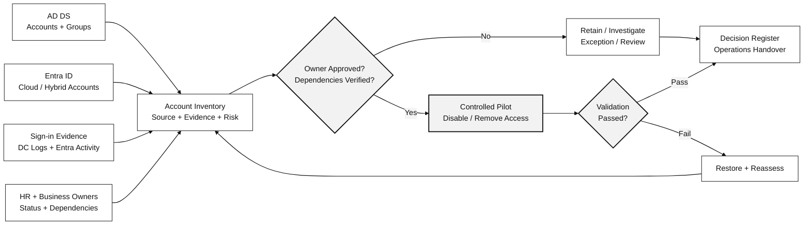

# User Account Hygiene Assessment & Remediation

> **AR-ID-UAH (IP-19) | Customer Service Brochure**  
> **Active Directory · Microsoft Entra ID · Hybrid User Lifecycle & Security**

**Reference Duration: 6 Person-Days** — Scoped User Account Assessment + Approved Reversible Cleanup Pilot. ขนาดอ้างอิง: **1 AD Domain + 1 Microsoft Entra Tenant, สูงสุด 1,000 Human User Accounts สำหรับ Inventory, Deep Review สูงสุด 20 Priority Candidates และ Pilot Remediation สูงสุด 5 Accounts** เมื่อมีข้อมูล/Owner/Approval พร้อม ทั้งหมดเป็น Reference Sizing ที่ต้องยืนยันใน SOW

## 1. About This Service

บริการตรวจสอบ ประเมิน และปรับปรุงความปลอดภัยและความถูกต้องของ **Human User Accounts** ใน Active Directory Domain Services, Microsoft Entra ID และ Hybrid Identity Environment ครอบคลุม Inactive/Stale Accounts, Orphaned Accounts, Disabled Accounts, Group Memberships, Application Access และ Account Ownership

บริการจะใช้ **Account Inventory + Sign-in Evidence + HR/Account Owner Confirmation + Access Dependencies** ร่วมกัน เพื่อตรวจหาบัญชีที่ไม่จำเป็นหรือยังคงสิทธิ์เกินความจำเป็น โดยไม่สรุปว่าไม่ใช้งานแล้วจาก Last Logon เพียงค่าเดียว พร้อมจัดลำดับการ Cleanup และดำเนินการ **Selected Reversible Remediation** เฉพาะรายการที่ได้รับอนุมัติ

**Customer Outcome:** มีข้อมูลบัญชีและการเข้าถึงที่ตรวจสอบได้, รู้ว่าบัญชีใดควร Retain / Investigate / Disable / Review Access, มีหลักฐานก่อน-หลังการแก้ไข และได้แนวทาง Account Lifecycle Governance เพื่อไม่ให้ปัญหาสะสมอีก

## 2. Who Is This For?

- องค์กรที่มีผู้ใช้งานสะสมใน AD DS / Microsoft Entra ID แต่ไม่มี Account Inventory หรือ Ownership ที่ชัดเจน
- องค์กรที่มีพนักงานลาออก ย้ายตำแหน่ง พ้นสัญญาจ้าง หรือเปลี่ยนหน่วยงาน แต่ Account/Group/Application Permissions ยังไม่ถูกทบทวน
- องค์กรที่มี Hybrid Accounts และต้องแยกว่าแก้ไขข้อมูลที่ AD DS หรือ Microsoft Entra ID จึงจะถูกต้อง
- ทีม Identity, Security, IT Operations, HR และ Compliance ที่ต้องการระบุความเสี่ยงจาก Stale/Orphaned Accounts พร้อม Evidence และ Audit Trail
- องค์กรที่ต้องการทดลอง Account Cleanup อย่างปลอดภัยก่อนขยายผลเป็น Periodic Governance Process

## 3. Scope & Approach

### A. User Account Discovery, Usage & Security Assessment

| # | Capability | Assessment Activities |
|---|---|---|
| **1** | **Identity Inventory & Source-of-Authority Mapping** | รวบรวมบัญชีจาก AD DS, Microsoft Entra ID และ Hybrid Sync ที่อยู่ใน Scope พร้อม UPN, Account Status, Created Date, Identity Source, Sync State, OU/Department และข้อมูล Owner เท่าที่มี แยกจุดที่ต้องแก้ไขบัญชีตาม Source of Authority |
| **2** | **Sign-in & Inactivity Evidence Analysis** | วิเคราะห์ AD Last Logon/lastLogonTimestamp, Per-DC Events (เมื่อมี), Entra `signInActivity`, Last Successful Sign-in และ Historical Sign-in Logs ตาม Retention; บันทึก Observation Window, Data Quality และข้อจำกัดก่อนจัดเป็น Review Candidate |
| **3** | **Ownership & HR Lifecycle Verification** | ตรวจ Account Owner, Employee/Contractor Status, Employment State, Last Working Date และ Joiner/Mover/Leaver Workflow กับ HR หรือ Business Owner ตามข้อมูลที่ได้รับอนุมัติ เพื่อแยก Accounts ที่ยังมี Business Purpose ออกจาก Orphaned Accounts |
| **4** | **Group, Application & License Dependency Mapping** | ตรวจ Direct/Nested Group Membership, Entra Enterprise Application Assignments, Microsoft 365 Licenses และ Dependencies ต่อ Mailbox, OneDrive, SharePoint, Teams หรือ Business Applications เท่าที่ข้อมูลพร้อม เพื่อประเมินผลกระทบหาก Disable/Remove Access |
| **5** | **Privileged & Special Identity Exclusion Review** | ระบุ Privileged Administrators, Break-glass/Emergency Users, Service/Automation Accounts, Guests และ Special Identities เพื่อแยกเข้ากระบวนการเฉพาะหรือ Approved Exception ก่อนพิจารณา Cleanup; ไม่สั่งปิดบัญชีเหล่านี้ด้วยเกณฑ์ Inactivity ทั่วไป |
| **6** | **Risk Classification & Candidate Prioritization** | วิเคราะห์ Orphaned/Inconsistent Status, Inactivity Signals, Excess Group Membership, Unowned Access และ Offboarding Gaps; จัด Risk Level, Evidence Confidence, Required Owner Decision และ Remediation Priority |
| **7** | **Account Disposition & Retention Decision** | จำแนกบัญชีเป็น **Retain/Active, Owner Review, Investigate, Approved Remediation, Accepted Exception และ Retention/Deletion Candidate** โดยบันทึก Decision Owner, Justification, Retention Requirements และ Approval ก่อน Change |

### B. Controlled Remediation, Validation & Governance

| # | Capability | Implementation Activities |
|---|---|---|
| **8** | **Reversible Account & Access Cleanup Pilot** | ดำเนินการ Selected Account Disable, Group Membership/Access Cleanup หรือ License Review ตาม Approved Change Scope เฉพาะรายการที่ Owner/HR ยืนยันแล้ว ใช้ Authoritative Directory ที่ถูกต้อง และเตรียม Recovery Method ก่อนเปลี่ยนแปลง |
| **9** | **Post-change Validation & Recovery Readiness** | ตรวจ Before/After Account Status, Sync Effect, Effective Group/App Access และ Business Impact; เก็บ Approval/Change/Evidence พร้อมทดสอบ Re-enable/Restore Access เมื่อเกิด Unexpected Impact |
| **10** | **User Lifecycle Governance & Monitoring Roadmap** | กำหนด Account Owner, Periodic Inactivity/Access Review, Joiner-Mover-Leaver Controls, Exception Expiry, Data Retention/Deletion Decision Gates และ Monitoring/Reporting Responsibilities เพื่อใช้ดำเนินงานต่อหลังจบโครงการ |

### C. Architecture — Evidence-based Identity Disposition (Black & White)

**Decision Boundary:** การไม่พบ Sign-in ไม่ได้ยืนยันว่า Account เลิกใช้งานแล้ว บัญชีที่ไม่มี Owner หรือข้อมูล Dependencies ไม่ครบต้องพักการเปลี่ยนแปลงไว้ก่อน ไม่ใช่ Auto-disable

### D. Reference Scope, Prerequisites & Acceptance

| Area | Proposed Reference Boundary | Acceptance Evidence |
|---|---|---|
| Inventory | สูงสุด 1 AD Domain + 1 Entra Tenant / 1,000 Human Accounts | Account Population + Source-of-Authority + Data Coverage |
| Deep Review | สูงสุด 20 Priority Review Candidates | Inactivity/Ownership/Access Evidence + Proposed Disposition |
| Pilot Cleanup | สูงสุด 5 Approved Reversible Actions | Change Approval + Before/After + Business Validation |
| Special Identities | Privileged/Break-glass/Service/Guest แยกหรือ Exclude | Exception/Exclusion Register พร้อม Owner |
| Governance | Review Cadence, Future Cleanup Waves, Retention Decision | Operations Guide + Residual Risk Register |

จำนวน Accounts ข้างต้นเป็น **Reference Estimation Boundary ไม่ใช่จำนวนผลลัพธ์ที่รับประกัน**; ลูกค้าเป็นผู้ยืนยัน HR/Ownership, Change Approvals, Maintenance Window และ Data/Retention Policies

### E. Implementation Agenda

| Phase | Activities | Effort |
|---|---|---:|
| **1. Environment Review & Inventory** | ยืนยัน AD/Entra Scope, Source of Authority, Export Access และ Initial Account/Group Inventory | 1 วัน |
| **2. Activity, Ownership & Access Assessment** | วิเคราะห์ Sign-in History, HR/Owner Signals, Dependencies, Privileged Exclusions และ Evidence Coverage | 2 วัน |
| **3. Candidate Decisions & Remediation Planning** | จัด Risk/Disposition, Prioritized Review Register, Change & Exception Plan | 1 วัน |
| **4. Approved Reversible Remediation Pilot** | Disable / Access Cleanup เฉพาะรายการที่อนุมัติ พร้อม Rollback Preparation | 1 วัน |
| **5. Validation & Handover** | Verify Account/Group/App Access, Confirm Outcomes, Prepare Reports, Residual Risks & Lifecycle Roadmap | 1 วัน |
| **Total** | | **6 Person-Days** |

**Operational Boundary:** 6 Person-Days ครอบคลุม Scoped Assessment และ Selected Pilot ไม่รวม Full Organization-wide Cleanup, Unlimited Owner Interviews, HR System Integration, Permanent Deletion หรือการย้าย Mailbox/OneDrive Data

## 4. Deliverables

| Deliverable | Description |
|---|---|
| **1. User Account Inventory & Coverage Matrix** | Account/UPN, Identity Source, Status, OU/Department, Sync State, Privileged Exclusions และ Data Completeness |
| **2. Inactivity & Ownership Evidence Register** | Observed Sign-ins, Last Successful Sign-in, HR/Owner Confirmation, Review Window, Confidence และ Missing Evidence |
| **3. Access & Dependency Assessment** | Group/App/License Access, Relevant Data/Business Dependencies และ Impact Considerations |
| **4. Risk, Disposition & Remediation Register** | Risk, Recommended Decision, Owner, Approvals, Exceptions, Retention Flags และ Priority |
| **5. Approved Change & Validation Report** | Pilot Disable/Access Cleanup Actions, Before/After State, Functional Checks, Recovery/Exception Evidence |
| **6. Lifecycle Governance & Cleanup Roadmap** | Ongoing Review Process, Ownership Matrix, JML/Offboarding Improvements และ Pending Cleanup Waves |

## 5. Tools & Technologies

| Microsoft Tool | Role |
|---|---|
| **Active Directory DS + AD PowerShell** | On-prem Account/OU/Group Inventory, Attributes, Group Membership, Disable/Access Cleanup |
| **Windows Security Event Logs** | DC Sign-in/Audit Evidence เพิ่มเติมเมื่อเปิด Logging และมี Retention |
| **Microsoft Entra Admin Center + Microsoft Graph PowerShell/Graph API** | Cloud-only/Hybrid User Inventory, `signInActivity`, App Assignments, Status และ Identity Ownership Evidence |
| **Microsoft Entra Connect Sync / Cloud Sync (Existing)** | Source of Authority, Synchronization Scope, Attribute/Status Propagation Validation |
| **Microsoft 365 Admin Center / Entra Licensing Views** | License Assignment, Access Dependencies และ Potential Data Ownership Impacts |
| **Microsoft Entra ID Governance / Access Reviews (Optional Licensed)** | Periodic Access Review / Governance Workflows เมื่อมี License และ Scope เหมาะสม |
| **Excel / CSV Review Registers** | Evidence, HR/Owner Attestation, Risk Priority, Approved Actions และ Exceptions |

**Licensing & Evidence:** Microsoft Entra `lastSuccessfulSignInDateTime` ผ่าน Microsoft Graph ต้องมี Entra ID P1 หรือ P2 และ Permissions ที่รองรับ; Audit Log Retention, Graph Access, HR Source Availability และ `lastLogonTimestamp` (ไม่ใช่ Real-time) อาจทำให้บาง Findings ต้องจัดเป็น *Insufficient Evidence*

## 6. Sample Report

> **Fictional data only** — แสดงรูปแบบ Executive Summary และ Remediation Decisions ไม่ใช่ผลการตรวจสอบจริง

**[View Full User Account Hygiene Sample Outcome — 1,000 Users / 134 Review Candidates](../examples/user-account-hygiene-assessment-outcome.md)**  
**[Download Sample 134-Candidate CSV Register](../../assets/examples/user-account-hygiene-candidates-demo.csv)**

### A. Example Assessment Summary

| Metric | Fictional Sample |
|---|---:|
| Human Accounts in Scope | 1,000 |
| Accounts Requiring Review | 134 |
| Owner Reviews Completed | 76 |
| Approved Reversible Disable Actions | 38 |
| Validated Pilot Disable Actions | 10 |

**ตัวเลขใน Sample Report แสดงขนาดสมมติของผลการประเมิน ไม่ใช่ Workload ที่รับประกันใน Reference 6 Person-Days**; ความพร้อมในการ Review/Remediate ขึ้นกับผู้อนุมัติและ Scope จริง

### B. Example Candidate Disposition (134 Accounts)

| Disposition | Accounts | Status / Decision |
|---|---:|---|
| Validated Reversible Disable | 10 | Completed / Validated ในตัวอย่าง |
| Approved, Awaiting Change Window | 28 | ยังไม่ได้ Apply |
| Retain / Exception | 21 | คงไว้พร้อม Review Date |
| Further Investigation | 17 | ต้องหา Evidence เพิ่ม |
| Awaiting Owner Review | 58 | ยังไม่อนุมัติ |
| **Total** | **134** | 10 + 28 + 21 + 17 + 58 |

### C. Example Account-level Risk & Action Register

| Account (Fictional) | Identity Source | Example Finding | Recommended Action | Status |
|---|---|---|---|---|
| `demo_user_0017` | Hybrid | HR Confirmed Exit, Sign-in Review Complete | Approved Disable in AD Source | Pending Window |
| `demo_user_0054` | AD DS | Retention Exception | Retain + Reassessment Date | Exception |
| `demo_user_0074` | Hybrid | Application Ownership Unclear | Investigate Dependencies | On Hold |
| `demo_user_0110` | Entra Cloud-only | Missing Business Owner | Obtain Owner Attestation | Awaiting Review |

### D. Example Before / After Validation Evidence

| Control | Before | Target / Evidence |
|---|---|---|
| Account Status | Enabled | Disabled only after Approval; Record Changes |
| Group / App Access | Residual Permissions | Remove Approved Group/Assignment; Confirm Effective Access |
| Hybrid Sync | AD-controlled status | Observe Expected Entra Status after Synchronization |
| Unexpected Impact | Access/Business Risk | Re-enable / Restore Approved Access; Document Recovery |
| Retention / Deletion | No decision | Escalate to Data Owner/Legal; no automatic permanent deletion |

**Reporting Rule:** `Candidate`, `Reviewed`, `Approved`, `Applied`, `Validated` และ `Exception` เป็นคนละสถานะ ห้ามนำยอด Candidate ไปแสดงว่าเป็นจำนวนบัญชีที่ Cleanup สำเร็จแล้ว

---

### Assumptions & Boundaries

- ครอบคลุม **Human Accounts** เท่านั้น; Privileged/Emergency/Service/Automation/Guest Accounts ต้องใช้ Scope หรือ Exception แยก
- ไม่ถือว่า Inactivity Signal หรือ `lastLogonTimestamp` รายการเดียวพิสูจน์ว่า Account ไม่จำเป็นแล้ว
- การเปลี่ยน Hybrid Identity ต้องทำที่ Authoritative Directory ตาม Sync Design ไม่แก้ Cloud Object ที่ถูก Sync โดยไม่มีเหตุผล
- ไม่รวม Permanent Delete, HR Provisioning Redesign, Mailbox/OneDrive Data Deletion/Transfer, Legal Hold Change หรือ Organization-wide Remediation ใน Reference Package
- ต้องได้รับสิทธิ์ Read-only สำหรับ Assessment, Owner/HR Confirmation, Retention Decision และ Approved Change Window ก่อนทำ Pilot

**[View Technical Service AR-ID-UAH (IP-19)](../ip-19-user-account-hygiene.md)** · **[Contact In The Cloud](../../contact.md)**

### References

- [Microsoft — Detect and Investigate Inactive User Accounts](https://learn.microsoft.com/en-us/entra/identity/monitoring-health/howto-manage-inactive-user-accounts)
- [Microsoft Graph — signInActivity](https://learn.microsoft.com/en-us/graph/api/resources/signinactivity)
- [Microsoft — Microsoft Entra Access Reviews](https://learn.microsoft.com/en-us/entra/id-governance/access-reviews-overview)
- [Microsoft — Hybrid Identity / Cloud Sync](https://learn.microsoft.com/en-us/entra/identity/hybrid/cloud-sync/what-is-cloud-sync)
