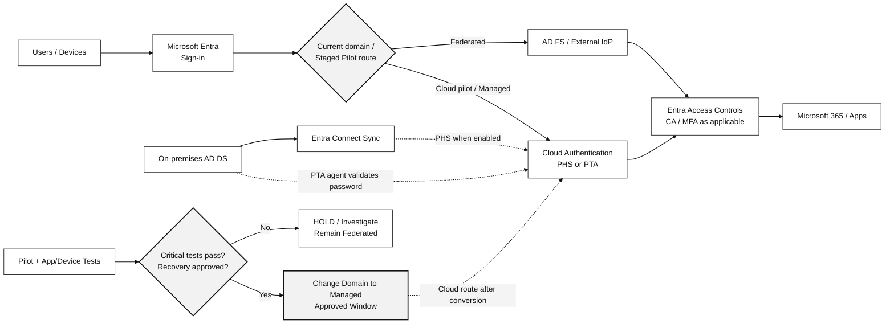

# Federation to Cloud Authentication Migration

> **IM-ID-FCA (IP-20) | Customer Service Brochure**  
> **AD FS / Third-party Federation → Microsoft Entra Cloud Authentication (PHS / PTA)**

**Reference Duration: 10 Person-Days** — Current-state Assessment, Target Authentication Design, Staged Rollout Pilot, Go/No-Go Decision และ **Conditional Domain Cutover** หลังผ่าน Approval Gates โดยใช้ Reference Scope **1 Entra Tenant, 1 Federated Domain, สูงสุด 50 Pilot Users และ 12 Sign-in Test Scenarios**; Scope และ Change Windows ต้องยืนยันใน SOW

## 1. About This Service

บริการออกแบบและดำเนินการย้ายระบบ Authentication ของผู้ใช้องค์กรจาก **AD FS หรือ Third-party Federation** ไปสู่ **Microsoft Entra Cloud Authentication** โดยเลือก Password Hash Synchronization (PHS) หรือ Pass-through Authentication (PTA) ตาม Business, Security และ Availability Requirements

ครอบคลุมการตรวจสอบ Federation Settings, Entra Connect, Claims Rules, Sign-in Dependencies, Applications/Devices, Conditional Access, MFA, Emergency Access และการทดสอบ **Staged Rollout** สำหรับผู้ใช้ที่กำหนด ก่อนตัดสินใจเปลี่ยน Domain จาก Federated เป็น Managed

บริการให้ความสำคัญกับ **Application Continuity, Supported Device Sign-in, Go/No-Go Criteria และ Rollback Readiness** เพื่อลดความเสี่ยงที่ผู้ใช้ Microsoft 365 หรือ Applications อื่นจะ Sign in ไม่ได้หลังเปลี่ยน Authentication Method

**Customer Outcome:** มี Cloud Authentication Architecture ที่ผ่านการประเมิน, Pilot Results พร้อม Evidence, Domain Cutover/Recovery Plan และ Post-cutover Validation & Operations Guide โดยจะดำเนินการ Cutover เฉพาะเมื่อ Conditions และ Approvals ครบถ้วน

## 2. Who Is This For?

- องค์กรที่ใช้ AD FS หรือ Third-party Federation สำหรับ Sign-in เข้า Microsoft 365 / Microsoft Entra ID
- องค์กรที่ต้องการลด On-premises Federation Dependencies หรือมีแผนปรับปรุง Authentication Availability และ Security Operations
- องค์กรที่ต้องการใช้ Microsoft Entra Conditional Access, MFA และ Identity Security Controls ให้เป็นมาตรฐานกลาง
- องค์กรที่มี Hybrid Users/Devices, Windows Hello for Business, Smartcard, VDI หรือ Critical Applications ซึ่งต้องตรวจสอบ Compatibility ก่อน Domain Cutover
- ทีม Identity, Security, Workplace และ IT Operations ที่ต้องการ Migration Plan พร้อม Pilot, Change Approval และ Recovery Procedure ที่ตรวจสอบได้

## 3. Scope & Approach

### A. Federation, Identity & Dependency Assessment

| # | Capability | Assessment & Implementation Activities |
|---|---|---|
| **1** | **Current Federation & Domain Configuration Assessment** | ตรวจ Entra Federated Domains, AD FS/Third-party IdP Topology, Federation Metadata, Claims Rules, Certificates, Endpoints, MFA/Access Rules, Customized Sign-in Behaviors, Relying Parties และ Current Sign-in Traffic เพื่อจัดทำ Recoverable Configuration Baseline |
| **2** | **Hybrid Identity Synchronization & Cloud Authentication Readiness** | ตรวจ Entra Connect Sync/Identity Scope, UPN/Source Anchor, Password Hash Sync Status หรือ PTA Agent Readiness, Password Change Behavior, Agent/Server Health และ Monitoring; ยืนยันว่า PHS/PTA ใช้งานได้ก่อนเริ่ม Pilot |
| **3** | **Application, Device & Authentication Dependency Mapping** | สำรวจ Microsoft 365 Apps, Entra/Hybrid-joined Windows, Browser/Desktop/Mobile, VDI, Windows Hello for Business, Smartcard, Certificates, Legacy Protocols และ Federation-specific Claims เพื่อระบุ Supported/Unsupported Scenarios และ Application Owners ที่ต้องยืนยัน |
| **4** | **Authentication Architecture & PHS/PTA Decision** | เปรียบเทียบ PHS (Cloud Password Verification) และ PTA (Validation ผ่าน On-prem Agents) ตาม Security, Availability, Regulatory, Troubleshooting และ On-prem AD Dependency พร้อมจัดทำ Architecture Decision และ Exception List |
| **5** | **Conditional Access, MFA & Emergency Access Assessment** | ตรวจ Existing Entra Conditional Access/MFA, IdP Access Rules, Identity Protection (หากมี License), Session Controls, Legacy Authentication, Cloud-only Emergency Admins และ Helpdesk/Support Processes เพื่อกำหนด Security Policy Parity และ Independent Recovery Path |

### B. Staged Rollout, Cutover & Transition

| # | Capability | Assessment & Implementation Activities |
|---|---|---|
| **6** | **Staged Rollout & Pilot Design** | เลือก Pilot Users/Groups ตาม Departments, Applications, Device Types และ Sign-in Methods; กำหนด Success Criteria, Test Plan, Communications, Escalation, Rollback Preparation และ Observation Window ก่อนทดสอบจริง |
| **7** | **Cloud Authentication Pilot & Sign-in Validation** | กำหนด Staged Rollout PHS/PTA สำหรับ Approved Pilot Cohort และทดสอบ Microsoft 365 Sign-in, Password Change, SSO/PRT, WHfB, CA/MFA, Critical Applications, Device/VDI Scenarios และ Negative Tests พร้อมบันทึก Pass/Fail/Exception |
| **8** | **Cutover Readiness & Go/No-Go Assessment** | ตรวจ Test Results, Critical Blockers, Federation Configuration Backup, Emergency Access, Agent/Sync Health, User Communications, Change Approval, Maintenance Window และ Recovery Authority แล้วสรุป Go/No-Go Decision โดยไม่เปลี่ยน Domain หากยังมี Critical Failure |
| **9** | **Approved Domain Cutover & Recovery Readiness** | เมื่อผ่าน Gate แล้วจึงเปลี่ยน Domain จาก Federated เป็น Managed ด้วยวิธีที่ Microsoft รองรับ ตรวจ Domain Authentication State, Post-change User Sign-in, CA/MFA และเตรียม Restore Federation Settings/Claims/Domain Federation State ตาม Rollback Plan หากจำเป็น |
| **10** | **Post-cutover Monitoring & Operational Handover** | ติดตาม Sign-in Errors, User Impact, Sync/PHS/PTA Agent Health, Token/Session Issues, Support Incidents และ Residual Dependencies; ส่งมอบ Configuration/Validation Evidence, Recovery Runbook และ AD FS Retirement Readiness โดย **ไม่ Decommission AD FS เป็นส่วนหนึ่งของ Cutover โดยอัตโนมัติ** |

### C. Authentication Architecture — Federated vs Cloud (Black & White)

*Conceptual Architecture เท่านั้น การใช้ PHS/PTA และ Federation Claims/Device Authentication ขึ้นกับ Configuration และ Supported Scenarios จริง; ไม่ได้แสดงว่า Entra Conditional Access ถูกข้ามใน Federated Route*

### D. Authentication Method Decision

| Option | Identity/Availability Considerations | Design Decision |
|---|---|---|
| **PHS — Password Hash Synchronization** | Microsoft Entra ID ตรวจการ Sign-in แบบ Cloud จาก Password Hash ที่ผ่านกระบวนการ Sync; ลด On-prem Authentication Runtime Dependency; ต้องตรวจ Password Sync Health และ Sign-in Behavior | Preferred Option เมื่อสอดคล้องกับ Requirements |
| **PTA — Pass-through Authentication** | Password Validation ผ่าน PTA Agents และ On-prem AD DS; ต้องวาง Agent Availability/Monitoring และตรวจ Network/Firewall/Failure Scenarios | เลือกเมื่อจำเป็นต้องตรวจ Password กับ On-prem |
| **Federation Exception / Remain Federated** | อาจมี Application/Claims/Authentication Dependencies ที่ยังไม่ได้ Migration หรือ Workloads ที่ทดสอบไม่ผ่าน | Hold Cutover จนมี Supported Solution |

**Pilot Rule:** Staged Rollout เป็น **Temporary Testing Mechanism** ไม่ใช่ Permanent Split-Domain Design หรือการเปลี่ยน Domain เป็น Managed ทันที และ **PHS Sync Scope ≠ Staged Rollout User Group**. ต้องตรวจ Pilot Group Direct Membership, Supported Device/Auth Scenarios และ Constraints ตาม Microsoft Documentation ปัจจุบัน

### E. Reference Scope, Prerequisites & Acceptance

| Area | Proposed Reference Boundary | Required Evidence |
|---|---|---|
| Federation Scope | 1 Entra Tenant / 1 Federated Domain / 1 Primary Federation Provider | Current Config + Claim Rules + Backup/Restore Plan |
| Pilot Users | สูงสุด 50 Users กระจายตาม Critical Personas/Device Types | User/Device/App Matrix, Owner Sign-off |
| Sign-in Scenarios | สูงสุด 12 Representative Tests | Expected vs Observed Sign-in, CA/MFA, SSO and Critical Apps |
| Cloud Authentication | เลือก PHS หรือ PTA 1 Target Method | Sync/Agent Health, Password Change Evidence |
| Cutover Gate | 1 Domain Go/No-Go and Conditional Cutover | Approved Window, No Unresolved Critical Blockers, Recovery Route |

จำนวนเป็น **Reference Sizing สำหรับประเมิน Effort ไม่ใช่การรับประกัน Domain Cutover** หาก Pilot พบ Blockers ให้บันทึก **No-Go** และส่งมอบ Remediation Plan แทนการเปลี่ยน Production Domain

### F. Implementation Agenda

| Phase | Activities | Effort |
|---|---|---:|
| **1. Federation & Dependency Discovery** | Baseline Federation/Identity Sync, Apps/Devices/Claims, CA/MFA และ Emergency Access | 2 วัน |
| **2. Cloud Authentication Design & Readiness** | Select PHS/PTA, Validate Prerequisites, Pilot Cohort, Success Criteria, Change/Rollback Plan | 2 วัน |
| **3. Staged Rollout Pilot & Validation** | Configure Supported Pilot, Test Representative Sign-in Scenarios, Collect Evidence | 2 วัน |
| **4. Go/No-Go & Conditional Cutover** | Review Blockers, Secure Change Approval, Execute Conversion only if Go; else produce No-Go/Remediation Plan | 2 วัน |
| **5. Post-change Validation & Handover** | Monitor/Verify if Cutover, Final Test/Risk Summary, Recovery Readiness, AD FS Dependencies and Operations Runbook | 2 วัน |
| **Total** | | **10 Person-Days** |

*10 Person-Days เป็น Reference Plan สำหรับสภาพแวดล้อมที่มี Prerequisites และ Change Owners พร้อม ไม่รวม Remediate ทุก Legacy Application, Rebuild Federation Provider, การเปลี่ยน Device Trust Design หรือ AD FS Decommission; ปฏิทินจริงขึ้นกับ Observation Period และ Change Windows*

## 4. Deliverables

| Deliverable | Description |
|---|---|
| **1. Federation & Hybrid Identity Baseline** | Domain/Federation Configuration, IdP Topology, Claims, Certificates, Sync/PHS/PTA Health และ Recoverable Configuration Evidence |
| **2. Application & Device Dependency Matrix** | Critical User/Device/Application Sign-in Scenarios, Supported/Unsupported Risks, Owners และ Migration Exceptions |
| **3. Cloud Authentication Architecture & Decision Record** | PHS/PTA Choice, Security/Availability Considerations, Target Auth Flow, CA/MFA Parity และ Emergency Access |
| **4. Pilot Sign-in & Security Validation Report** | Test Cohorts, 12-scenario Test Register (Reference), Success/Failure, Sign-in/SSO/CA/MFA Evidence และ Blockers |
| **5. Cutover & Rollback / Go-No-Go Package** | Change Plan, Maintenance Window, Federation Backup, Go/No-Go Criteria, Approval, Rollback/Recovery Procedure |
| **6. Post-cutover & Operations Handover** | Implemented/Not-Implemented Decision, Domain State, Validation & Monitoring Results, Support Procedures, Residual Risks และ AD FS Retirement Readiness Checklist |

## 5. Tools & Technologies

| Microsoft Tool / Platform | Role |
|---|---|
| **Microsoft Entra ID / Microsoft Graph PowerShell** | Domain Federation State/Configuration, Sign-in, CA/MFA, Domain Conversion and Validation |
| **Microsoft Entra Connect Sync** | Identity Synchronization, PHS/PTA Configuration/Readiness, UPN Matching และ Monitoring ตาม Environment |
| **AD FS Management & PowerShell (เมื่อใช้งาน)** | Relying Party Trusts, Claim Rules, Certificates, Federation/Backup Evidence |
| **PTA Authentication Agents (เมื่อเลือก PTA)** | On-prem Password Validation, Health/HA/Monitoring |
| **Microsoft Entra Staged Rollout** | Pilot Cloud Authentication สำหรับ Supported User Groups ก่อน Domain Cutover |
| **Entra Sign-in Logs / Audit Logs** | Authentication, Conditional Access, MFA, Device/Session Result และ Incident Evidence |
| **Microsoft 365 / Intune / Device Validation Tools** | Office Clients, Browser/Desktop/Mobile, Hybrid Windows, WHfB, VDI และ Critical App Testing |
| **Entra Cloud-only Emergency Accounts** | Independent Sign-in Recovery ตามองค์กรอนุมัติ |
| **CSV / Excel Test Register + Change Records** | Application/Device Inventory, Pilot Evidence, Go/No-Go, Rollback and Post-change Acceptance |

**Licensing & Readiness:** Conditional Access, Identity Protection, Monitoring/Log Retention, PHS/PTA Support และ Authentication Agent Requirements ต้องตรวจ Licensing/Configuration ที่ใช้งานจริง การใช้ PHS/PTA ไม่ได้ทำให้ Conditional Access หรือ MFA Enforce โดยอัตโนมัติจนกว่าจะกำหนด Policies ที่เหมาะสม

## 6. Sample Report

> **Fictional data only** — ไม่มีการเปลี่ยน Domain, ดำเนินการ Cutover หรือทดสอบ Tenant ของลูกค้าจริง

**[View Full Federation Migration Sample Outcome — 50 Pilot Users, 12 Sign-in Scenarios](../examples/federation-cloud-auth-migration-outcome.md)**  
**[Download Fictional 12-Scenario Validation Register (CSV)](../../assets/examples/federation-cloud-auth-validation-demo.csv)**

### A. Pilot Executive Summary

| Metric | Fictional Result |
|---|---:|
| Federated Domains | 1 |
| Users in Domain | 600 |
| Pilot Users | 50 |
| Sign-in Scenarios | 12 |
| Passed | 11 |
| Critical Blockers | 1 |
| Go/No-Go | **NO-GO / HOLD** |

### B. Example Sign-in Scenarios

| Scenario | Expected Result | Fictional Result |
|---|---|---|
| Microsoft 365 Browser and Office Client | Login with selected PHS/PTA | PASS |
| Hybrid Joined Windows / PRT | Supported SSO and token behavior | PASS |
| Windows Hello for Business | Supported flow validated | PASS |
| Conditional Access + MFA | Required access controls still apply | PASS |
| Password Change + PHS | User can sign in using synchronized password | PASS |
| Cloud-only Emergency Administrator | Recovery access available | PASS |
| Nonpersistent VDI Sign-in Dependency | Supported path after migration | **BLOCKER** |

### C. Cutover Readiness & Go/No-Go Matrix

| Gate | Required Evidence | Example State |
|---|---|---|
| Federation Backup | Current Config/Claims/Certificates exported | Prepared |
| PHS/PTA Readiness | Sync/Agent and User Password Tests | PASS |
| Security Controls | CA/MFA and Emergency Access verified | PASS |
| App/Device Compatibility | All Critical Scenarios confirmed by Owner | **BLOCKER** |
| Change / Rollback Authority | Approved Window and Reversion Method | Prepared |
| Production Domain Conversion | All Critical Gates pass | **NOT APPROVED** |

**Pilot Outcome:** แม้ 11/12 Scenarios ผ่าน แต่ต้อง **ไม่ทำ Production Domain Cutover** เพราะ Critical VDI Dependency ยังไม่ผ่าน การรายงาน **No-Go** ที่มีหลักฐานถือเป็นผลลัพธ์ของ Assessment ที่ถูกต้อง ไม่ใช่ความล้มเหลวของบริการ

### D. Example Cutover Verification Record

| Control | Pre-cutover State | Post-cutover Verification Target |
|---|---|---|
| Domain Authentication | Federated | Managed, when approved |
| Sign-in Provider | AD FS / Third-party Federation | Entra Cloud Authentication (PHS/PTA) |
| Conditional Access / MFA | Current Federation-linked Path | Approved CA/MFA Tests pass |
| Applications & Devices | Existing Federation Dependencies | Representative Critical Users/Apps/Devices sign in |
| Recovery | Documented Federation Settings | Restore path tested and authorized |
| AD FS Retirement | Existing Relying Parties | Separate Dependency Review, no automatic shutdown |

รายการ D เป็น **Target Validation Template** ไม่ใช่ผลว่า Domain Cutover เกิดขึ้นแล้วใน Sample นี้

---

### Assumptions & Boundaries

- การเปลี่ยน Domain จาก Federated → Managed มีผลกระทบกับผู้ใช้ของ Domain นั้น ต้องทำหลัง Pilot/Owner Approval และ Maintenance Window เท่านั้น; Microsoft ระบุว่า Conversion อาจใช้เวลาถึง **60 นาที**
- Staged Rollout ไม่ใช่การย้าย Domain แบบถาวรหรือตัวทดแทน Rollback หลัง Domain Conversion
- Custom Claims, Smartcard, WHfB/Certificate Trust, VDI, Legacy Authentication และ Third-party Federation ต้องตรวจ Supported Scenarios ตาม Environment; Critical Unsupported Dependencies ต้อง Hold Change
- Rollback ต้องเตรียม Restoring Federation Configuration/Claims และ Domain Federation State ที่เหมาะสม ไม่ถือว่าเพียงถอด Pilot Group ก็แก้ Production Cutover ได้
- ไม่รวม Rebuild/Decommission AD FS, ย้ายทุก AD FS Relying Party, แก้ Application Federation ทุกระบบ หรือเปลี่ยน WHfB Trust Architecture อัตโนมัติ
- Full Domain Cutover ขึ้นกับ Go/No-Go; หาก No-Go ให้ส่งมอบ Assessment, Evidence, Blocking Issues, Remediation Roadmap และ Revised Migration Plan แทน

**[View Technical Service IM-ID-FCA (IP-20)](../ip-20-federation-cloud-authentication-migration.md)** · **[Contact In The Cloud](../../contact.md)**

### References

- [Microsoft — Migrate from Federation to Cloud Authentication](https://learn.microsoft.com/en-us/entra/identity/hybrid/connect/migrate-from-federation-to-cloud-authentication)
- [Microsoft — Staged Rollout for Cloud Authentication](https://learn.microsoft.com/en-us/entra/identity/hybrid/connect/how-to-connect-staged-rollout)
- [Microsoft — Choose the Right Authentication Method](https://learn.microsoft.com/en-us/entra/identity/hybrid/choose-ad-authn)
- [Microsoft — Password Hash Synchronization](https://learn.microsoft.com/en-us/entra/identity/hybrid/connect/how-to-connect-password-hash-synchronization)
