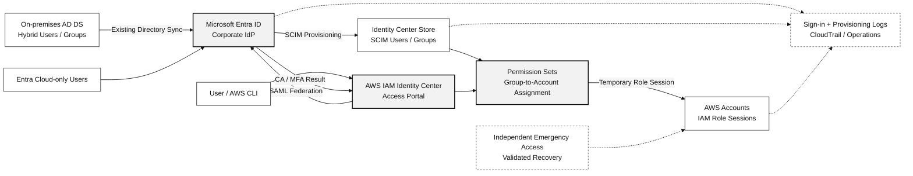

# AWS Workforce Identity Federation with Microsoft Entra ID

> **IP-21 | Customer Service Brochure**  
> **Enterprise SSO · SCIM Provisioning · Conditional Access · MFA · AWS Permission Sets**

**Reference Duration: 6 Person-Days** — Scoped Integration/Pilot, Security Controls และ Validation สำหรับ Environment ที่พร้อมใช้งาน โดยยืนยันจำนวน AWS Accounts, User/Group Scope, Existing Identity Source และ Change Requirements ใน Statement of Work

## 1. About This Service

บริการออกแบบ เชื่อมต่อ และปรับปรุงการเข้าถึง AWS ด้วย Workforce Identities จาก Microsoft Entra ID โดยใช้ **AWS IAM Identity Center** รองรับผู้ใช้ที่ Synchronize จาก On-premises Active Directory และ Cloud-only Users ใน Microsoft Entra ID

องค์กรสามารถใช้ Corporate Sign-in เดิมร่วมกับ **Microsoft Entra Conditional Access และ MFA** ผ่าน SAML 2.0 Single Sign-On ขณะที่ **SCIM 2.0** ใช้ Provision/Update/Deprovision Users และ Groups เพื่อจัดการ AWS Account Access ผ่าน **IAM Identity Center Permission Sets** อย่างเป็นระบบ

บริการช่วยลดการสร้าง IAM Users สำหรับพนักงานโดยไม่จำเป็น เพิ่มความชัดเจนของ Group-to-AWS-Account Assignments และจัดการ User Lifecycle จากระบบ Identity ที่องค์กรมีอยู่แล้ว พร้อมตรวจสอบ Privileged Access, Emergency Access, Authentication/Provisioning Logs และผลการทดสอบก่อนเปิดใช้งานจริง

**Security Responsibility:** Entra ID ทำหน้าที่ Authenticate และประเมิน Conditional Access สำหรับ Federated Sign-in ส่วน IAM Identity Center/IAM ทำหน้าที่ Authorize AWS Account/Role Access; การตรวจ MFA ที่ Entra ไม่ได้แทน IAM Policy, Root User Security หรือ Workload Role Controls ใน AWS

## 2. Who Is This For?

- องค์กรที่มี On-premises AD DS → Microsoft Entra ID Synchronization, Conditional Access และ MFA อยู่แล้ว และต้องการนำ Identity เดิมมาใช้กับ AWS
- องค์กรที่มีหลาย AWS Accounts และต้องการ SSO โดยไม่สร้าง IAM Users/Passwords แยกสำหรับพนักงาน
- องค์กรที่มี Cloud Platform, Developer, Operations, Audit และ External Workforce Groups ต้องจัดสิทธิ์แยกตาม AWS Account และ Job Function
- องค์กรที่ต้องการเชื่อม Joiner/Mover/Leaver Workflow จาก Entra ID ไปสู่ AWS IAM Identity Center
- องค์กรที่กำลังใช้ IAM Identity Center Directory หรือ Federation แบบเดิม และต้องการประเมิน Migration Impact ก่อนเปลี่ยน Identity Source

## 3. Scope & Approach

### A. Assessment & Federation Integration

| # | Capability | Assessment / Implementation Activities |
|---|---|---|
| **1** | **Existing Identity & AWS Readiness Assessment** | ตรวจ AD DS/Entra Sync Flow (โดยไม่เปลี่ยน Sync Architecture เป็นค่าเริ่มต้น), Identity Sources, UPN/Email Attributes, Entra Security Groups, Conditional Access/MFA ที่มีอยู่ และ AWS Organizations/IAM Identity Center Instance, Identity Source, Existing Users/Groups/Assignments พร้อมระบุ Migration Dependencies และ Change Risks |
| **2** | **SAML 2.0 Federation & Single Sign-On** | ออกแบบ/กำหนด Entra Enterprise Application และ AWS IAM Identity Center External IdP, แลกเปลี่ยน SAML Metadata, Identifier/NameID, Signing Certificates และ Trust Settings; ทดสอบ AWS Access Portal แบบ SP-initiated/IdP-initiated ตามความสามารถที่รองรับ รวมถึง AWS CLI SSO สำหรับ Pilot Users |
| **3** | **SCIM User & Group Provisioning** | กำหนด Provisioning Scope, User/Group Assignments, Attribute Mapping, User Matching, SCIM Endpoint/Token Handling, Create/Update/Disable และ Group Membership Synchronization; ตรวจ Provisioning Logs, Quarantine/Failures และ Accidental Deletion Protection; ไม่ออกแบบโดยอาศัย Nested Group Expansion ซึ่งไม่รองรับ |
| **4** | **Conditional Access & MFA Integration** | ตรวจ AWS IAM Identity Center Enterprise Application ใน CA Policy Scope, MFA/Authentication Strength, Named Locations, Device/Compliance Requirements (หากรองรับ) และ Exceptions; ทดสอบ Success/Block Scenarios โดยเริ่มจาก Report-only หรือ Pilot Enforcement ก่อนขยายผล |
| **5** | **AWS Account Assignment & Permission Set Integration** | ออกแบบ Entra Group → SCIM Group → IAM Identity Center Permission Set → AWS Account Mapping ตาม Job Function และ Least Privilege; กำหนด Read-only/Operator/Administrator Roles, Assignment Owners, Separation of Duties และ Pilot Allowed/Denied AWS Actions |
| **6** | **Privileged & Emergency Access Design** | ทบทวน AWS Administrative Groups/Permission Sets, Privileged Access Approval, Root Access Controls และ Recovery Paths; ออกแบบ Optional Entra PIM for Groups (เมื่อมี License) พร้อมทดสอบ Provisioning Delay; แยกกรณี IAM Identity Center Outage กับ Entra/IdP Outage เพื่อกำหนด Emergency Access Route ที่ใช้งานได้จริง |
| **7** | **Identity Lifecycle & Deprovisioning** | ทดสอบ Joiner/Mover/Leaver Flow ตั้งแต่ AD/Entra Group Membership → SCIM → AWS Assignment; ระบุ Owners, Access Review, Exception Handling, SCIM Sync Latency และ Session Revocation/Existing Role Session Risks โดยไม่ถือว่าการ Disable User ปิด AWS Role Sessions เดิมทันที |
| **8** | **Monitoring, Validation & Operational Handover** | ตรวจ Entra Sign-in/Conditional Access/Provisioning Logs และ AWS IAM Identity Center/CloudTrail Events ตาม Coverage; ทดสอบ Browser SSO, MFA, CLI SSO, Positive/Negative Access, Join/Leave, Provisioning Failure และ Recovery พร้อมจัดทำ Runbook, Certificate/Token Rotation Ownership และ Monitoring Recommendations |

### B. Representative Integration Flow

**On-prem AD DS → Microsoft Entra ID → AWS IAM Identity Center → AWS Accounts**

- **Directory Synchronization:** Entra Connect Sync/Cloud Sync ที่มีอยู่ส่ง Hybrid Users และ Groups เข้าสู่ Entra ID ตาม Configuration ของลูกค้า
- **Authentication (SAML):** Entra ID ยืนยันตัวตนและใช้ Conditional Access/MFA เมื่อ User Sign in ผ่าน AWS IAM Identity Center Federation
- **Provisioning (SCIM):** Entra ID ส่ง Users/Groups และ Membership ไปยัง IAM Identity Center ตาม Assignment/Provisioning Scope
- **Authorization (AWS):** IAM Identity Center Group + Permission Set + Account Assignment กำหนดสิทธิ์สำหรับ Console และ CLI; Workload IAM Roles และ AWS Root Users ยังใช้ AWS Security Controls แยกต่างหาก

### C. Example Access Assignment Model (Illustrative)

| Microsoft Entra Security Group | AWS Account | IAM Identity Center Permission Set | Intended Access |
|---|---|---|---|
| SG-AWS-Prod-Readers | Production | ReadOnlyAccess | Operational Visibility |
| SG-AWS-Prod-Operators | Production | Custom-Operations | Scoped Operational Actions |
| SG-AWS-Dev-Developers | Development | Custom-Developer | Development Workloads |
| SG-AWS-Security-Audit | Security / Production | SecurityAudit | Audit & Investigation |
| SG-AWS-Platform-Admins | Selected Accounts | Scoped-Administrator | Approved Administrative Tasks |

กลุ่มและ Permission Sets เป็น **ตัวอย่างการออกแบบเท่านั้น** ไม่ใช่ Configuration ที่มีอยู่ในระบบลูกค้าจริง ต้องตรวจ Policy Scope และ Resource-Level Access แยกใน IP-05 เมื่อจำเป็น

### D. Architecture — Authentication, Provisioning and AWS Authorization

**Architecture Mental Model:** SAML + Entra Conditional Access/MFA ใช้สำหรับ **Workforce Authentication**; SCIM ใช้ส่ง **User/Group Lifecycle**; IAM Identity Center Permission Sets + AWS IAM เป็นผู้กำหนด **AWS Authorization**. Emergency Access ต้องประเมินเส้นทางที่ไม่พึ่ง IdP เดิมในกรณี Entra Outage

### E. Production Readiness, Recovery & Operations Decisions

| Decision / Control | Required Assessment & Configuration | Acceptance / Operational Evidence |
|---|---|---|
| **Identity Source Change: Go/No-Go** | ตรวจ Source ปัจจุบัน, Users/Groups, Permission Sets/Assignments, Resource Policies ที่อ้าง Role ARN (รวม KMS/EKS), Sign-in Dependencies และผลกระทบตาม Source เดิม/ใหม่ | Written Impact Decision + Pre-change Export/Inventory, Recovery Plan และ Owner Approval **ก่อน Cutover** |
| **SCIM Token Lifecycle** | ระบุ Token Owner, Secret Storage, Expiration Date, Rotation Calendar และ Notification/Monitoring; **AWS SCIM Token มีอายุ 1 ปี** | Owner/Runbook + Rotation Procedure; ตรวจ AWS Health/Console Reminder และ Provisioning Error |
| **Provisioning Drift** | เทียบ Assigned Entra Users/Groups/Membership กับ IAM Identity Center Identity Store และ Account Assignments; ตรวจ Failures, Delay, Missing Users/Groups, Provisioning Quarantine | Reconciliation / Exception Log พร้อม Owner และ Correction Path |
| **SAML Certificate Lifecycle** | ระบุ Signing Certificate Expiry, Metadata Owner, Test Plan สำหรับการเปลี่ยน Certificate และ Rollback | Rotation Ownership + Maintenance/Recovery Guide |
| **Joiner / Mover / Leaver** | ทดสอบ Provisioning, Membership Change และ Account Access; ระบุ Sync Latency รวมถึง PIM Group Activation เมื่อใช้ | Successful/Denied Sign-in + SCIM Update/Deactivate Evidence + Account Assignment Review |
| **Existing AWS Sessions** | ทดสอบหรือระบุ Limit ของ AWS Access Portal / CLI / IAM Role Sessions; การ Remove User/Group **ไม่เท่ากับการหมดอายุ Session ที่ออกไปแล้วทันที** | Session Duration & Revocation / Incident Response Procedure |
| **Privileged & Emergency Access** | เลือก Scoped Admin Permission Sets, ตรวจ Entra CA/MFA Coverage, ตรวจ Recovery เมื่อ IAM Identity Center หรือ Entra ใช้งานไม่ได้ | Negative Access Tests + Independent Emergency Route Evidence / Explicit Open Risk |

**Migration nuance:** การเปลี่ยน Identity Source **ไม่ได้ลบ Assignments ทุกกรณี**; ผลขึ้นกับ Source เดิม/ใหม่และ Identity Matching. โดยเฉพาะการเปลี่ยน **ระหว่าง Active Directory กับ External IdP** อาจลบ Users/Groups/Assignments และ Permission-Set Role Dependencies; ถ้ายังไม่มี Inventory/Recovery Approval ให้ **Hold Production Cutover**. งาน Reference 6 Person-Days ครอบคลุม Pilot Integration และ Design/Validation ไม่รวม Full Rebuild/Migration ของ Production Source

**Example Customer Outcomes (Illustrative):**

| Business Request | Expected Technical Outcome |
|---|---|
| "พนักงาน Sign in AWS ด้วย Corporate Account เดิม" | SAML SSO ผ่าน Entra ID พร้อม Tested MFA/CA สำหรับ Pilot Users |
| "เพิ่มพนักงานเข้ากลุ่ม AWS Operator" | Entra Group → SCIM Membership → IAM Identity Center Account/Permission Set Assignment ที่ได้รับอนุมัติ |
| "ลบสิทธิ์ AWS เมื่อพนักงานออก" | SCIM Update/Deactivate Verified; บันทึกข้อจำกัดของ Active Sessions และ Incident Revocation |
| "ป้องกัน Group Sync หยุดทำงาน" | SCIM Token Rotation + Provisioning Failure/Drift Monitoring Runbook |
| "เกิด Entra Sign-in Outage" | Emergency Access Decision พร้อม Recovery Test หรือ Unresolved Risk ก่อน Rollout |

**Pilot Acceptance Gates:** (1) Identity Source Impact + Owner/Recovery Approval, (2) SSO/CA-MFA Positive & Negative Tests, (3) SCIM User/Group Lifecycle + Drift/Failure Detection, (4) AWS Permission-Set Allowed/Denied Actions, (5) Token/Certificate Owners และ Emergency Procedure. หาก Gate สำคัญไม่ผ่าน ให้ระบุ **Hold / Pending** ไม่ใช่ Production-ready

### F. Implementation Agenda

| Phase | Activities | Effort |
|---|---|---:|
| **1. Discovery & Integration Readiness** | ตรวจ Entra Sync, IAM Identity Center Identity Source, Existing Assignments, Prerequisites และ Migration Risks | 1 วัน |
| **2. SAML & SCIM Pilot Integration** | กำหนด/Test SAML Trust และ SCIM Provisioning สำหรับ Pilot Users/Groups ที่อนุมัติ | 2 วัน |
| **3. Security & Access Mapping** | ตรวจ CA/MFA, กำหนด Group/Permission Set/Account Mapping และ Privileged/Emergency Design | 1 วัน |
| **4. Lifecycle & Security Validation** | ทดสอบ Login, CLI, Group Membership, Provisioning, Deprovisioning, Allowed/Denied Actions และ Exceptions | 1 วัน |
| **5. Documentation & Handover** | สรุป Test Evidence, Operational Runbook, Risks, Recovery Plan และ Rollout Roadmap | 1 วัน |
| **Total** | | **6 Person-Days** |

**Duration Condition:** Reference 6 Person-Days เหมาะกับการเชื่อมต่อ/Pilot ที่มี IAM Identity Center และ Entra พร้อมใช้งาน, เลือก Pilot Users/Groups และ AWS Account(s) ใน SOW และไม่มี Production Identity Source Migration ที่ซับซ้อน หากเปลี่ยน Identity Source ของ IAM Identity Center ที่ให้บริการอยู่แล้ว หรือจำเป็นต้อง Recreate User/Group Assignments/Permission-Set Roles ต้องทำ Migration Assessment, Change/Recovery Plan และแยกระยะเวลา Implementation เพิ่มเติมก่อนดำเนินการ

## 4. Deliverables

| Deliverable | Description |
|---|---|
| **1. Current-State & Readiness Assessment** | Existing Hybrid Identity Flow, Entra Enterprise Applications, AWS Identity Source, Group/Assignment Inventory, Gaps และ Migration Prerequisites |
| **2. Federation & Provisioning Architecture** | Target SAML/SCIM Trust & Data Flow, Attribute/NameID Mapping, Provisioning Scope, Integration Settings และ Recovery Dependencies (ไม่บันทึก Secrets/Tokens) |
| **3. Conditional Access & AWS Access Matrix** | CA/MFA Policy Coverage, Exception Decisions, Entra Group ↔ AWS Account ↔ Permission Set Assignments และ Privileged/Emergency Access Design |
| **4. Implementation & Configuration Record** | Approved SAML/SCIM Configuration, Pilot Groups/Assignments, Provisioning Settings และ Change/Approval Evidence |
| **5. Pilot Validation & Test Report** | SSO/CLI/MFA, Provisioning, Allow/Deny, Deprovisioning และ Failure/Recovery Test Results พร้อม Actual Evidence และ Remaining Issues |
| **6. Operations & Rollout Roadmap** | Access Review/Offboarding Runbook, Monitoring Guide, Certificate/SCIM Token Rotation Responsibilities, Exceptions และ Rollout/Remediation Plan |

## 5. Tools & Technologies

| Tool / Platform | Role |
|---|---|
| **On-premises Active Directory + Entra Connect Sync / Cloud Sync** | Existing Source of Authority สำหรับ Hybrid Users/Groups (หากมีอยู่แล้ว) |
| **Microsoft Entra ID Enterprise Applications** | AWS IAM Identity Center SAML Federation, Application Assignment และ Sign-in Configuration |
| **Microsoft Entra Conditional Access + MFA** | Federated Sign-in Security, MFA และ Device/Location Controls ที่ได้รับอนุญาต |
| **Microsoft Entra Provisioning (SCIM)** | User/Group Provisioning, Attribute Mapping, Membership Update, Deprovisioning และ Provisioning Logs |
| **AWS IAM Identity Center** | External Identity Provider Trust, Users/Groups, Permission Sets, AWS Account Assignments และ AWS Access Portal |
| **AWS Organizations / IAM** | AWS Accounts, IAM Permission Policies, Role Sessions, Privileged/Emergency Access Controls |
| **AWS CloudTrail + Entra Sign-in/Audit/Provisioning Logs** | Authentication/Authorization Evidence, Change Monitoring และ Troubleshooting |
| **Microsoft Entra PIM for Groups (Optional)** | Time-limited Privileged Group Activation — ต้องตรวจ License, SCIM Propagation Delay และ AWS Role Session Duration |

**Licensing:** Conditional Access ต้องมี Entra ID P1 หรือ License ที่ครอบคลุม; PIM for Groups ต้องมี License ที่รองรับ การใช้งาน AWS/Entra Logging, Cloud Monitoring และ Third-party Components อาจมีค่าใช้จ่ายเพิ่มเติมตาม Configuration

## 6. Sample Report

> **Fictional data only** — ตัวอย่างรายงานและ Test Cases ไม่มีการใช้ Accounts/Configuration/ผลทดสอบจริงของลูกค้า

**[ดู Sample Integration & Validation Report ฉบับเต็ม](../examples/aws-entra-workforce-federation-outcome.md)**

### A. Example Readiness Checklist

| Control | Example Observation | Decision |
|---|---|---|
| Hybrid Identity Source | AD Users/Groups Sync ไป Entra แล้ว | Retain Existing Sync |
| IAM Identity Center | Enabled; Current Identity Source ต้องตรวจ | Verify Before SAML Change |
| Conditional Access | Entra MFA มีอยู่แล้ว | Confirm AWS App Coverage |
| SCIM Provisioning | ยังไม่กำหนด Pilot Group Scope | Configure Pilot |
| Emergency AWS Access | Recovery Procedure ยังไม่ผ่านการทดสอบ | Design & Validate |

### B. Example Group-to-Account Assignment

| Entra Group | AWS Account | Permission Set | Expected Action |
|---|---|---|---|
| SG-AWS-Prod-Readers | demo-prod | ReadOnlyAccess | View resources, deny write |
| SG-AWS-Dev-Developers | demo-dev | Custom-Developer | Use approved development APIs |
| SG-AWS-Platform-Admins | demo-shared | Scoped-Administrator | Approved administrative actions |

### C. Example Pilot Validation Matrix

| Test Case | Expected Result | Illustrative Status |
|---|---|---|
| SAML SSO — Assigned user | Access AWS Portal ผ่าน Entra ID | Example: Pass |
| Conditional Access — MFA | Enforce approved MFA policy at sign-in | Example: Pass |
| CA — Blocked sign-in condition | Deny federated sign-in | Example: Pass |
| SCIM — Group membership update | AWS Identity Center เห็น Group Membership หลัง Sync | Example: Pass |
| IAM Permission Set — Least Privilege | Allowed API succeeds; unauthorized API denied | Example: Pass |
| Offboarding — User removed | ป้องกันการออก New Session หลัง Deprovision; บันทึกผล Existing Sessions | Example: Review |
| Emergency Access — Identity Provider outage | Recovery path ที่ไม่พึ่งพา IdP เดิมใช้งานได้ | Example: Not Tested |

**Reporting rule:** Status ตัวอย่างเป็นเพียงรูปแบบรายงาน; การทดสอบจริงแยก **Planned, Executed, Passed, Failed, Exception** และไม่ถือว่า Emergency Access ผ่านจนกว่าจะมีหลักฐาน

### D. Example Architecture & Risk Findings

| Finding | Risk | Recommended Action |
|---|---|---|
| AWS Admin Group มี Permanent Membership | High | Review Privileged Group Design / Optional PIM |
| AWS Enterprise App ไม่ครอบคลุม CA ที่ต้องการ | High | Define AWS-specific CA/MFA Scope & Pilot |
| Nested Entra Security Groups ใช้สำหรับ SCIM Assignment | Medium | Replace with Direct Group Membership |
| Identity Source Change อาจทำ Assignments สูญหาย | High | Inventory & Migration/Recovery Plan ก่อน Cutover |
| SCIM Deprovisioning ไม่เท่ากับ Instant AWS Session Revocation | Medium | Review Session Duration และ Incident Access Revocation Procedure |

---

### Assumptions & Boundaries

- งานนี้เน้น **Workforce User Federation** ไม่ครอบคลุม AWS Workload Roles, IAM Policy Assessment ทั้งองค์กร หรือ Application-specific Federation ทั้งหมด ซึ่งเป็น Scope ของ IP-05/Workload Security ที่เกี่ยวข้อง
- **ไม่มีการเปลี่ยน Entra Connect/Cloud Sync, On-prem AD Forest หรือ Microsoft 365 Sign-in Method** โดยอัตโนมัติ; จะทบทวนเฉพาะ Dependencies ที่จำเป็นสำหรับ AWS Integration
- IAM Identity Center มี **หนึ่ง Identity Source ต่อ Organization**; การเปลี่ยน Identity Source ที่ใช้ Production อยู่แล้วอาจกระทบ User/Group Assignments และ Permission-Set Roles ต้องผ่าน Impact Assessment/Change Approval แยก
- ต้องตรวจ SCIM Token Expiry (1 ปี), Rotation Owner, Provisioning Errors/Drift, SAML Signing Certificate Expiry และ Group/Permission Set Reconciliation; ไม่รวม Managed 24×7 Operations
- **SCIM Group Provisioning ไม่รองรับ Nested Group Expansion** และ Sync/Deprovisioning มี Delay; การ Disable User ใน Entra ID ไม่ได้ทำให้ AWS Role Sessions ที่ออกไปแล้วหมดอายุทันที
- Emergency Access ต้องแยกระหว่าง **IAM Identity Center Outage** (IdP อาจยังใช้งานได้) และ **Entra/IdP Outage** (ต้องมี Independent Recovery Path)
- SAML/SCIM Integration ไม่ได้ทำให้ Conditional Access ควบคุม AWS Root, Direct IAM User Sign-in, Workload API Credentials หรือทุก AWS STS Session โดยตรง
- Full Production Migration, Organization-wide Rollout, Advanced PIM Deployment, 24×7 Monitoring และ Unrelated IAM Remediation ไม่รวมอัตโนมัติใน Reference Package

**[ดู Technical Service IP-21](../ip-21-aws-workforce-identity-federation.md)** · **[ติดต่อ In The Cloud](../../contact.md)**

### References

- [AWS — Configure SAML and SCIM with Microsoft Entra ID](https://docs.aws.amazon.com/singlesignon/latest/userguide/idp-microsoft-entra.html)
- [AWS — Change Your Identity Source](https://docs.aws.amazon.com/singlesignon/latest/userguide/manage-your-identity-source-change.html)
- [AWS — Identity Source Change Considerations](https://docs.aws.amazon.com/singlesignon/latest/userguide/manage-your-identity-source-considerations.html)
- [AWS — SCIM Provisioning and Token Expiry](https://docs.aws.amazon.com/singlesignon/latest/userguide/provision-automatically.html)
- [AWS — External Identity Providers](https://docs.aws.amazon.com/singlesignon/latest/userguide/manage-your-identity-source-idp.html)
- [AWS — Emergency Access Configuration](https://docs.aws.amazon.com/singlesignon/latest/userguide/emergency-access-implementation.html)
- [AWS — Understanding Authentication Sessions](https://docs.aws.amazon.com/singlesignon/latest/userguide/authconcept.html)
- [Microsoft — AWS IAM Identity Center Automatic Provisioning](https://learn.microsoft.com/en-us/entra/identity/saas-apps/aws-single-sign-on-provisioning-tutorial)
- [Microsoft — Application Provisioning Known Issues](https://learn.microsoft.com/en-us/entra/identity/app-provisioning/known-issues)
- [Microsoft — Entra Licensing](https://learn.microsoft.com/en-us/entra/fundamentals/licensing)
