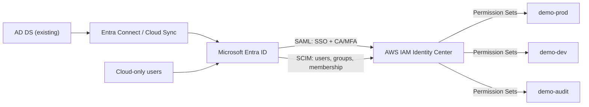

# Sample Outcome — AWS Workforce Identity Federation with Microsoft Entra ID

> **DEMO DATA ONLY · Fictional AWS Accounts, Entra Groups and Pilot Results**  
> รูปแบบรายงานสำหรับ [IP-21 — AWS Workforce Identity Federation with Microsoft Entra ID](../ip-21-aws-workforce-identity-federation.md) ไม่ใช่ผลจากระบบลูกค้าจริง

## Executive Summary

ตัวอย่างองค์กรมี Existing On-premises AD DS → Microsoft Entra ID Synchronization และใช้ Entra Conditional Access/MFA อยู่แล้ว ต้องการให้นักพัฒนา ผู้ดูแลระบบ และทีม Audit เข้า AWS ด้วย Corporate Identities ผ่าน AWS IAM Identity Center

**Illustrative Pilot Scope:** 3 AWS Accounts, 3 Entra Security Groups, 3 IAM Identity Center Permission Sets และ 7 Validation Scenarios

| Metric | Example |
|---|---:|
| AWS Accounts in Pilot | 3 |
| Entra Groups in Pilot | 3 |
| Permission Sets Mapped | 3 |
| Pilot Validation Scenarios | 7 |
| Passed | 5 |
| Requires Follow-up | 1 |
| Not Yet Tested | 1 |

**Decision: HOLD Production Rollout** จนกว่า Emergency Access Validation จะผ่านและ Offboarding Session Handling ได้รับการอนุมัติ แม้ SSO/SCIM Pilot ผ่านส่วนใหญ่แล้ว

## Proposed Identity & Access Architecture

*แสดง Conceptual Data Flow เท่านั้น SCIM Identity Store และ SAML Sign-in มีหน้าที่ต่างกัน*

## 1. Readiness & Dependency Register

| Component | Example Finding | Proposed Decision | Owner |
|---|---|---|---|
| On-prem AD → Entra | Sync มีอยู่และ Healthy | Keep existing sync; no changes in pilot | Hybrid Identity Team |
| Entra Conditional Access | Entra MFA มีอยู่ แต่ AWS App Scope ยังไม่ยืนยัน | Review assigned/excluded policies | Identity Security |
| AWS IAM Identity Center | Identity source ยังเป็น Directory ภายใน | Assess migration impact; do not change without approval | AWS Platform |
| Permission Set Assignments | Existing Admin assignments อาจได้รับผลกระทบเมื่อเปลี่ยน source | Export mapping and build recovery plan | AWS Platform |
| SCIM Provisioning | ไม่มี Pilot Group Scope ที่ยืนยันแล้ว | Assign dedicated, directly managed Entra groups | Identity Ops |
| Emergency Access | ยังไม่มี Test Evidence | HOLD rollout until tested | Security Owner |

## 2. Entra Groups to AWS Account Assignments

| Entra Group | AWS Account (Fictional) | Permission Set | Expected Access | Approval |
|---|---|---|---|---|
| SG-AWS-Prod-Readers | demo-prod | ReadOnlyAccess | Read-only Operations | Approved for Demo |
| SG-AWS-Dev-Developers | demo-dev | Custom-Developer | Scoped Development Actions | Approved for Demo |
| SG-AWS-Audit-Readers | demo-audit | SecurityAudit | Audit & Investigation | Approved for Demo |

**Assignment control:** การ Provision Entra Group ไป IAM Identity Center ไม่ใช่การให้สิทธิ์อัตโนมัติทุก AWS Account ต้องสร้าง/ยืนยัน Group-to-Permission-Set-to-Account Assignment ภายใต้การอนุมัติแยกต่างหาก

## 3. SAML, SCIM & Security Validation Register

| Test ID | Scenario | Expected Result | Fictional Result | Status |
|---|---|---|---|---|
| F-01 | Assigned Hybrid User signs in to AWS Portal | Federated SAML SSO succeeds | SSO accepted | Passed |
| F-02 | Require MFA via Entra CA for AWS App | MFA challenge or valid compliant sign-in | Policy satisfied | Passed |
| F-03 | Unapproved sign-in condition | Entra CA blocks the federated sign-in | Access denied | Passed |
| F-04 | New Pilot Group membership | SCIM updates AWS Identity Center after sync | Group visible | Passed |
| F-05 | User receives ReadOnly Permission Set | Read API passes; Write API denied | Positive/negative test passed | Passed |
| F-06 | Remove user from eligible group | No new AWS assignment after sync; assess prior role sessions | New access blocked; existing session handling requires review | Follow-up |
| F-07 | Emergency AWS access without Entra/Identity Center | Independent authorized recovery path works | No approved outage exercise | Not Tested |

### Validation Principles

- **Authentication:** Entra Sign-in Log, CA/MFA Result, SAML Matching/NameID Evidence
- **Provisioning:** Entra Provisioning Logs, AWS Identity Store User/Group/Membership, SCIM Errors and Latency
- **Authorization:** AWS Account Assignment + Permission Set; test Actual Allowed/Denied IAM Operations
- **Session Handling:** AWS Session Duration/Existing IAM Role Sessions; don't claim immediate revocation after Disable
- **Recovery:** Confirm specific failure mode (IAM Identity Center-only vs Entra IdP outage), approved access method, Owner and evidence

## 4. Priority Risk & Remediation Register

| Risk ID | Finding | Impact | Recommended Action | State |
|---|---|---|---|---|
| FDR-01 | Existing identity source change can disrupt SSO/assignments | Critical | Preserve current mappings, perform migration impact analysis and recovery design | Open |
| FDR-02 | AWS CA/MFA scope unknown for excluded groups | High | Evaluate policy assignments/exceptions and pilot negative tests | Assessed |
| FDR-03 | Nested Group design cannot be relied upon for SCIM | Medium | Use direct user/group assignment and validate membership | Recommended |
| FDR-04 | Entra PIM/SCIM changes are not instant | Medium | Define propagation expectations, session duration and incident response | Open |
| FDR-05 | Emergency access not independently validated | High | Conduct approved recovery exercise prior to production rollout | Blocking |

## 5. Implementation & Rollout Decision

| Gate | Evidence | Demo Decision |
|---|---|---|
| SAML Federation | Successful Hybrid User SSO + correct NameID | Pass |
| Conditional Access / MFA | Positive and Negative Test Evidence | Pass |
| SCIM Pilot | User/Group synchronization demonstrated | Pass |
| AWS Authorization | Read succeeds; prohibited write denied | Pass |
| Offboarding | Deprovision results and session expiry handling agreed | Review |
| Emergency Access | Approved independent recovery route tested | Fail (not yet tested) |
| **Production Go/No-Go** | **Critical gates complete** | **HOLD** |

**Sample outcome:** แม้ 5 จาก 7 Scenarios ผ่าน แต่ยังไม่ควรขยาย Pilot เป็น Production Deployment เพราะไม่มีหลักฐาน Recovery Test ที่เพียงพอ และต้องยืนยัน Offboarding Session Behavior ก่อน

## What the Customer Receives

Current-State Readiness, SAML/SCIM Integration Design, Group-to-Permission Set Matrix, CA/MFA Assessment, Implemented Pilot Configuration Register, Test & Validation Evidence, Exceptions/Recovery Register และ Operations/Rollout Guide

[Back to IP-21 Technical Service](../ip-21-aws-workforce-identity-federation.md) · [Customer Brochure](../brochures/ip-21-aws-workforce-identity-federation.md) · [Contact](../../contact.md)

---

*ทั้งหมดเป็นข้อมูลสมมติ ไม่มี Production Credentials, Tenant Data หรือ AWS Account Identifiers จริง*
