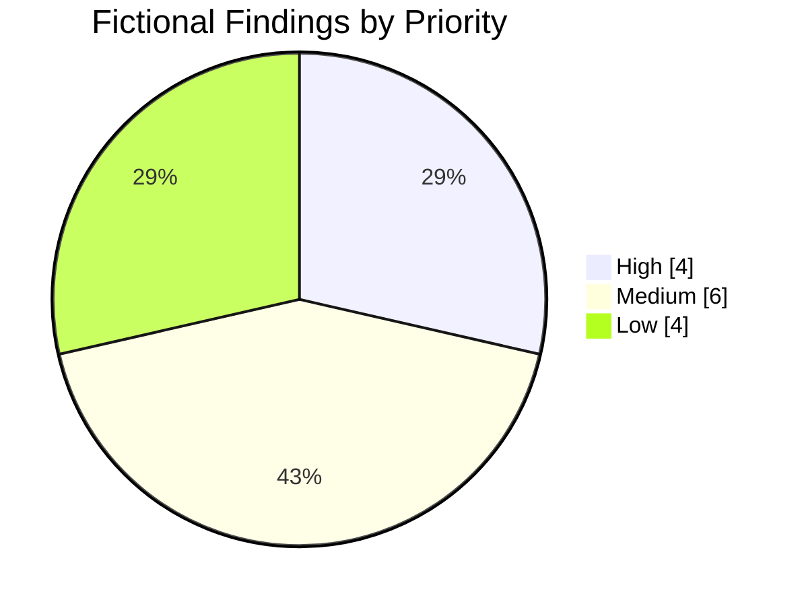
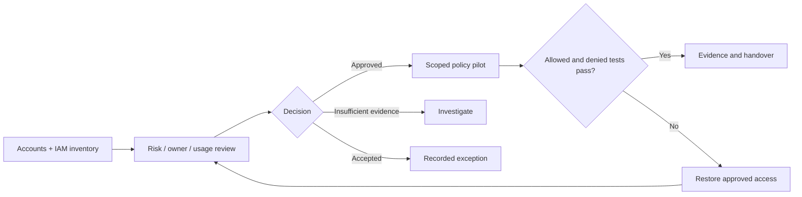

# Sample Outcome — AWS Identity & Access Baseline

> **DEMO DATA · Fictional AWS Organization · No customer identifiers**  
> ตัวอย่างรายงานของ [AWS Identity & Access Governance and Security Baseline](../ip-05-aws-identity-access-baseline.md) ใช้ข้อมูลสมมติทั้งหมดเพื่อแสดงลักษณะ Deliverables

## Executive Summary

ตัวอย่างองค์กรที่มี AWS 6 Accounts และ IAM Identity Center Permission Sets 8 ชุด หลัง Inventory และ Review พบ 14 Prioritized Findings โดยมี 3 Scoped Controls ที่ผ่าน Pilot Validation และรายการอื่นยังต้องผ่าน Owner Review / Change Approval

  
6AWS Accounts

  
8Permission Sets

  
14Findings

  
3Pilot Controls Validated

**Decision required:** ยืนยัน Owner และลำดับแก้ไขสิทธิ์; ทดสอบ Privileged/Emergency Access และ Workload Permissions ก่อนเปลี่ยน SCP, Permission Sets หรือ Role Policies ในวงกว้าง

## Risk Distribution

| Priority | Findings | Decision |
|---|---:|---|
| High | 4 | ทบทวน Admin Privilege และ External Resource Access |
| Medium | 6 | Least-Privilege / Trust Policy / Unused Access Review |
| Low | 4 | Ownership, Retention และ Review Cadence |
| **Total** | **14** | Findings อาจมีหลายรายการต่อหนึ่ง Role/Account |

## Example Findings & Treatment

| Finding | Account (Fictional) | Observation | Proposed Action | Demo Status |
|---|---|---|---|---|
| IAM-001 | demo-prod | Admin Role มี Privileges กว้าง | Review + Pilot Role Reduction | Validated |
| IAM-002 | demo-prod | API Role มี Wildcard Actions | Scope Policy to API Duties | Pending |
| IAM-003 | demo-shared | Resource Policy อาจอนุญาต External Access | Validate Trusted Principals | Owner Review |
| IAM-005 | demo-dev | Permission Set เกินหน้าที่ | Pilot Less-privileged Assignment | Validated |
| IAM-008 | demo-dev | Role ไม่พบ Usage ในช่วงข้อมูลที่มี | Confirm Consumers before Removal | Owner Review |
| IAM-010 | demo-logs | Excessive Audit Access | Validate Read-only Role | Validated |

**[Download 14-row Findings Register (Excel-ready CSV)](../../assets/examples/aws-iam-baseline-findings-demo.csv)**

## Change Decision & Validation

| Evidence | Example Acceptance Criterion |
|---|---|
| Identity Center | Authorized user and group assignments match approved duties |
| Effective Access | Required API calls pass; prohibited calls fail |
| SCP Guardrails | SCP restrictions tested without removing intended workload access |
| Emergency Access | Recovery Route available and tested before rollout |
| Findings Closure | Owner, Evidence, Approval, Exception/Follow-up linked to each finding |

**Engineering note:** SCP จำกัด Maximum Permissions ไม่ได้ให้สิทธิ์เพิ่ม ส่วน IAM Access Analyzer Findings ขึ้นอยู่กับ Analyzer Type, Region, Setup และ Observation Window; Unused Access Findings ไม่ใช่คำสั่งให้ลบทันที

## Example Deliverables

AWS Identity Inventory, Permission Set & Role Mapping, Risk Register, Approved Remediation Plan, Pilot Before/After Evidence และ Governance Handover

*Fictional data only. No IAM Policies, AWS Accounts or Resources were actually modified.*

[Back to AWS Identity & Access](../ip-05-aws-identity-access-baseline.md) · [Contact](../../contact.md)
