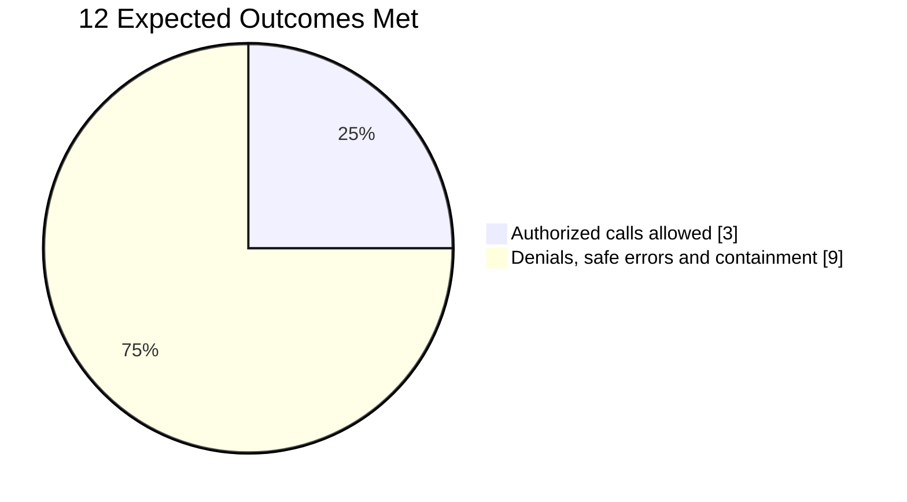
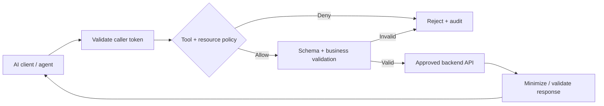

# Sample Outcome — Enterprise MCP Server

> **DEMO DATA · 3 fictional MCP tools · 2 fictional enterprise APIs**  
> ตัวอย่าง Deliverable ของ [Enterprise MCP Server Implementation & Integration](../ip-09-enterprise-mcp-server.md) ไม่ใช่ผลการทดสอบของลูกค้าจริง

## Executive Summary

ตัวอย่าง AI Client เรียก 3 Tools เพื่อค้นเอกสารนโยบาย ดูสถานะ Case และสร้าง Case ผ่าน MCP Server ทุกคำขอต้องผ่าน **Caller Authentication, Tool Authorization, Resource-Level Access และ Input Validation** ก่อนเรียก Backend

  
3MCP Tools

  
2Backend APIs

  
12Security & Functional Tests

  
12/12Expected Results Met

**Outcome:** 3 Authorized Test Calls ได้รับอนุญาต ส่วนอีก 9 กรณีเป็น Denial หรือ Controlled Error/Containment ที่ตรง Expected Behavior ผลทั้งหมดผ่านใน Demo นี้เท่านั้น ไม่ใช่การรับประกันว่าจะป้องกันการโจมตีทุกประเภท

## Tool & Authorization Matrix

| Tool | Operation | Scope & Data Boundary | Positive Test |
|---|---|---|---|
| `search_policy` | Read | Allowed Knowledge Domain, caller read scope | Scoped policy summary |
| `get_case_status` | Read | Case ownership / tenant scope, read scope | Authorized case status |
| `create_case` | Write | Create scope, schema, rate limits, approved business rule | Demo case creation |

**Authorization rule:** การแสดงชื่อ Tool ให้ AI Client เห็นไม่ใช่การให้สิทธิ์ ผู้เรียกและ Record/Resource ต้องผ่าน Server-side Checks ทุกครั้ง

## Functional & Security Test Results

| Test | Scenario | Expected Result | Demo |
|---|---|---|---|
| MCP-01 | Scoped policy query | Allow | PASS |
| MCP-03 | Approved case creation | Allow | PASS |
| MCP-04 | Missing scope | Deny before backend | PASS |
| MCP-05 | Cross-tenant resource | Deny | PASS |
| MCP-07 | Invalid Token Audience | Reject authentication | PASS |
| MCP-09 | Invalid tool arguments | Reject schema | PASS |
| MCP-10 | Instruction text inside Tool Output | Treat as untrusted data | PASS |
| MCP-11 | Sensitive backend exception | Sanitized error | PASS |

**[Download all 12 fictional test cases — Excel-ready CSV](../../assets/examples/enterprise-mcp-test-evidence-demo.csv)**

## Authorization & Resource Boundary

## Handover Evidence

| Artifact | Example Acceptance Evidence |
|---|---|
| Tool Catalog | Input/output schema, Read/Write classification and data owner |
| Authorization Matrix | Allowed principal-to-tool/resource combinations and negative tests |
| Test Report | Expected/Observed Result, PASS/FAIL, sanitized trace reference |
| Deployment Guide | Transport, TLS, Secrets, Environment, Monitoring and Recovery |
| Audit Model | Correlation ID, tool identifier, outcome and minimal necessary metadata |

**Security boundary:** สำหรับ MCP Remote HTTP ที่รองรับ Authorization ให้ทำตาม MCP Authorization Specification และตรวจ Token Audience ให้ตรงกับ MCP Server ห้ามส่งต่อ Access Token ของ MCP Caller ไปเป็น Backend Token โดยตรง ต้องออกแบบ Delegation/On-Behalf-Of หรือ App Identity ที่เหมาะสมและได้รับอนุมัติ การตรวจสิทธิ์ที่ MCP Server ไม่แทน Backend Authorization

**Not included automatically:** การพัฒนา Backend API ใหม่, HA, 24/7 Support, Enterprise-wide rollout หรือการรับประกัน Prompt Injection Resistance ทุกกรณี

*Data, tools, APIs and evidence references are fictional; no customer integration was performed.*

[Back to Enterprise MCP Server](../ip-09-enterprise-mcp-server.md) · [Contact](../../contact.md)
