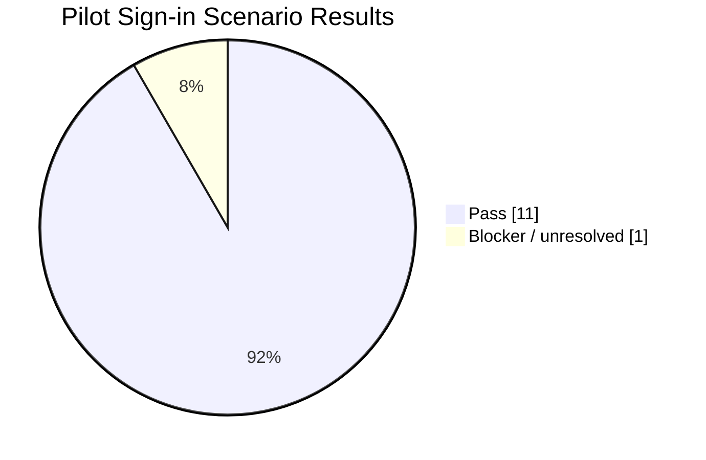
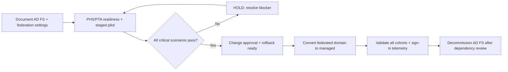

# Sample Outcome — Federation to Cloud Authentication

> **DEMO DATA · Fictional Microsoft Entra tenant · Pre-cutover pilot only**  
> ตัวอย่างรายงานของ [Federation to Cloud Authentication Migration](../ip-20-federation-cloud-authentication-migration.md) สำหรับนำเสนอ Sign-in Readiness และการตัดสินใจ Cutover

## Executive Summary

องค์กรสมมติมี 1 Federated Domain และ Users 600 บัญชี ต้องการย้าย Microsoft Entra Authentication จาก AD FS/Federation มาใช้ Password Hash Synchronization (PHS) โดยเริ่ม Staged Rollout กับ Pilot Users 50 บัญชี ก่อนพิจารณาเปลี่ยน Domain เป็น Managed

  
1Federated Domain

  
600Users in Domain (Demo)

  
50Pilot Users

  
11/12Sign-in Scenarios Passed

**Current decision: HOLD / NO-GO.** Sign-in Tests ผ่าน 11 จาก 12 Scenarios แต่พบ Nonpersistent VDI Dependency ที่ไม่รองรับตามเงื่อนไข Staged Rollout/Migration ที่ใช้ทดสอบ จึงยัง **ไม่ทำ Domain Cutover หรือ Decommission AD FS** จนกว่าเจ้าของระบบจะอนุมัติทางออกและ Validate ได้

## Pilot Validation Matrix

| Scenario | Expected Outcome | Demo Result |
|---|---|---|
| Microsoft 365 Browser + Office Client | Sign-in works with selected Cloud Auth | PASS |
| Entra / Hybrid-joined Windows | PRT and SSO behave as designed | PASS |
| Windows Hello for Business | Supported sign-in method verified | PASS |
| MFA + Conditional Access | Required Challenges enforced | PASS |
| Password Change + PHS | Synced Password can authenticate | PASS |
| Cloud-only Emergency Admin | Break-glass path remains available | PASS |
| Nonpersistent VDI sign-in dependency | Supported design after Cutover | **BLOCKER** |

**[Download all 12 fictional Sign-in Test Cases (Excel-ready CSV)](../../assets/examples/federation-cloud-auth-validation-demo.csv)**

## Domain Cutover Decision

**Migration Facts:** Staged Rollout เป็น Temporary Test Mechanism ซึ่งไม่เปลี่ยน Domain State เป็น Managed; ต้องทำ Final Domain Cutover แยกต่างหาก Microsoft ระบุว่า Conversion อาจใช้เวลาถึง 60 นาที จึงต้องรวมช่วงเวลานี้ใน Maintenance Window และเตรียม Rollback Federation Configuration ไว้ก่อน

## Example Cutover Readiness Register

| Gate | Evidence | Demo Status |
|---|---|---|
| Federation configuration and claim rules captured | Signed baseline / export | Prepared |
| PHS synchronization health validated | Pilot sign-in and password update | PASS |
| CA / MFA / emergency access ready | Per-scenario test record | PASS |
| All critical apps and device paths compatible | Owner-confirmed matrix | **BLOCKER** |
| Rollback authority and maintenance window | Reviewed migration runbook | Prepared |
| Domain cutover authorization | Change Board Go/No-Go | **NOT APPROVED** |

## Deliverables Shown

Current Federation Baseline, Authentication Method Decision Record, Application/Device Dependency Matrix, 12-scenario Pilot Test Register, Go/No-Go Readiness Report, Cutover & Rollback Plan และ AD FS Decommission Dependency Checklist

**Important:** ไม่ลบ AD FS ทันทีเพียงเพราะ Domain เปลี่ยนเป็น Managed เพราะ AD FS อาจยังมี Relying Parties อื่น และต้องตรวจ Dependency + Retention ของระบบก่อน

*Fictional evidence only; no production domain was converted.*

[Back to Federation Migration](../ip-20-federation-cloud-authentication-migration.md) · [Customer Brochure](../brochures/ip-20-federation-cloud-authentication-migration.md) · [Contact](../../contact.md)
