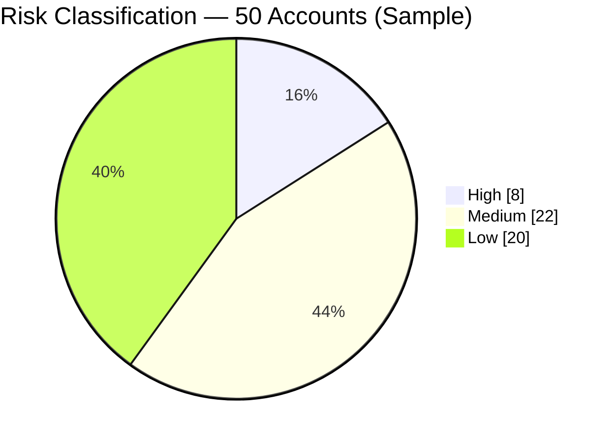
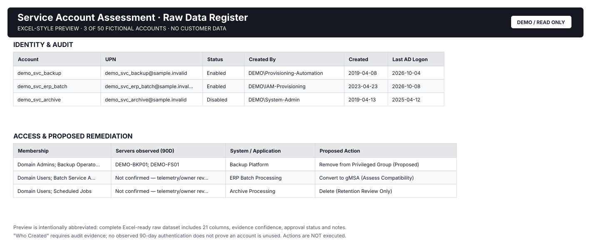
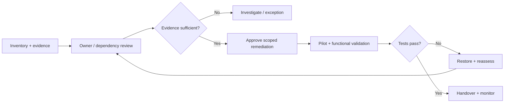

# Sample Assessment Report — Service Account Security

> **DEMO DATA · 50 fictional service accounts · illustrative findings only**  
> รายงานนี้เป็นตัวอย่างรูปแบบ Deliverables ของบริการ [Service Account Security Assessment & Remediation](../ip-03-service-account-security.md) ไม่ใช่ข้อมูลลูกค้า ผลการประเมินจริง หรือการรับประกันผลลัพธ์

## Executive Summary

ตัวอย่างนี้แสดงวิธีสรุปความเสี่ยง การยืนยัน Account Ownership และ Authentication Dependencies ของ Service Accounts จำนวน 50 บัญชี ก่อนเสนอ Remediation ที่ต้องผ่านการตรวจสอบและอนุมัติ

  
50Accounts Assessed

  
8High-risk Accounts

  
41/50Owners Verified

  
38/50Dependencies Mapped

### Evidence Coverage

  

    
<strong>Account ownership verified</strong>41 / 50 · 82%

    

    
9 accounts require owner confirmation

  

  

    
<strong>Dependencies mapped</strong>38 / 50 · 76%

    

    
12 accounts require further dependency evidence

  

**Decision required:** ให้ Account Owners ตรวจสอบ 9 บัญชีที่ยังไม่ยืนยันเจ้าของ และ 12 บัญชีที่ Dependency Evidence ยังไม่ครบ พร้อมอนุมัติลำดับ Remediation ตามความเสี่ยงจริง ตัวเลขเหล่านี้อาจเป็นคนละกลุ่มหรือซ้อนทับกันได้

## Risk Distribution

| Risk | Accounts | Interpretation |
|---|---:|---|
| High | 8 | ต้อง Review Privileges, Credential Exposure หรือพฤติกรรมการใช้งานเป็นลำดับแรก |
| Medium | 22 | ต้อง Remediate หรือยืนยัน Business Dependencies ในรอบที่ตกลง |
| Low | 20 | มี Controls ที่เหมาะสมตามข้อมูลที่ประเมิน แต่ยังต้องติดตาม |
| **Total** | **50** | แต่ละ Account ถูกจัดไว้ใน Risk Band เดียว |

Risk Bands ในรายงานตัวอย่างเป็นการจัดประเภทสมมติ ไม่ใช่ผลจาก Scoring Engine ที่กำหนดเป็นมาตรฐานสากล ทั้งนี้เกณฑ์จริงต้องยืนยันร่วมกับองค์กร

## Primary Remediation Groups

กำหนด **Primary Action ให้แต่ละ Account เพียงหนึ่งกลุ่ม** สำหรับการจัดสรรความรับผิดชอบ แม้ Account เดียวจะมี Findings ได้หลายประเด็น ทั้งตารางนี้และ Risk Distribution ต่างเป็นการจำแนก 50 บัญชีชุดเดียวกันจากคนละมุม จึงไม่ควรนำยอดมารวมซ้ำ

| Primary Action | Accounts | Recommended Next Step |
|---|---:|---|
| Privileged Access Review | 8 | ยืนยันว่า Administrative Groups, Delegation และ Logon Rights จำเป็นต่อบริการจริง |
| Least-Privilege Remediation | 12 | ตรวจ Resource Access, Group Membership และเสนอสิทธิ์ขั้นต่ำที่เหมาะสม |
| Credential Modernization | 11 | ประเมิน gMSA/dMSA ตาม Platform และ Application Compatibility; จัดทำ Pilot |
| Ownership / Dependency Investigation | 9 | ระบุ Owner และ Authentication Consumers ให้ชัดก่อนเปลี่ยนบัญชี |
| Potential Inactivity Investigation | 5 | ตรวจ Scheduled/Periodic Jobs, Sign-in Signals และ Historical Dependencies |
| Accept & Monitor | 5 | บันทึกเหตุผล, Risk Owner, Evidence และรอบ Review |
| **Total** | **50** | **Proposed classifications — no changes have been applied** |

  
Privileged Access Review

<strong class="assessment-portfolio__value">8</strong>

  
Least-Privilege Remediation

<strong class="assessment-portfolio__value">12</strong>

  
Credential Modernization

<strong class="assessment-portfolio__value">11</strong>

  
Ownership / Dependency Investigation

<strong class="assessment-portfolio__value">9</strong>

  
Potential Inactivity Investigation

<strong class="assessment-portfolio__value">5</strong>

  
Accept & Monitor

<strong class="assessment-portfolio__value">5</strong>

*แถบสีดำแสดงจำนวนบัญชีเทียบกับทั้งหมด 50 บัญชี โดยแต่ละบัญชีอยู่ใน Primary Remediation Group เดียว*

## Example Account-level Findings

ชื่อบัญชีและ Host ในตารางนี้เป็น **ชื่อสมมติทั้งหมด** เพื่ออธิบายว่า Executive Findings เชื่อมต่อกับ Engineer Remediation Register อย่างไร

| Account (Fictional) | Risk | Example Finding | Proposed Action | Status |
|---|---|---|---|---|
| `demo_svc_backup` | High | มี Privileged Group Membership ที่ต้องตรวจสอบ | ยืนยัน Required Rights และ Application Dependencies ก่อนลดสิทธิ์ | Owner Review |
| `demo_svc_erp_batch` | High | ใช้ Static Credential กับ Batch Service | ตรวจ gMSA/dMSA Compatibility และวาง Pilot | Proposed |
| `demo_svc_reports` | Medium | มี Resource Permissions เกินการใช้งานที่ยืนยันได้ | ทำ Least-Privilege Review กับ Application Owner | Proposed |
| `demo_svc_legacy` | Medium | ยังไม่พบ Account Owner ที่รับผิดชอบ | ยืนยัน Owner และ Authentication Source/Destination | Investigation |
| `demo_svc_archive` | Low | ไม่พบ Activity ใน Observation Window ที่มี | ตรวจ Periodic Jobs และ Retention ก่อนพิจารณาการเปลี่ยนใด ๆ | Investigate |

**หลักการ:** ไม่พบ Authentication Event ไม่ได้แปลว่าบัญชีไม่ได้ใช้งาน และยังไม่ใช่เหตุผลที่เพียงพอสำหรับ Disable/Delete

## Account Register — Spreadsheet Preview

รายงานระดับ Management เชื่อมกับ Account-level Register ได้โดยตรง ตัวอย่างภาพด้านล่างเป็น **Spreadsheet-style Preview** จากชุดข้อมูลสมมติเดียวกัน ไม่ใช่ภาพหน้าจอของระบบลูกค้า

**[View full-size preview](../../assets/examples/service-account-register-preview.svg)** · **[Download 50-row Excel-ready CSV](../../assets/examples/service-account-register-demo.csv)**

ไฟล์ CSV สามารถเปิดใน Excel เพื่อ Filter ตาม Risk, Owner Verified, Dependencies Mapped, Remediation Group และ Status ได้ โดยไม่ต้องติดตั้งเครื่องมือเพิ่มเติม

## Assessment Evidence & Coverage

ตัวอย่าง Assessment Register จริงควรมีข้อมูลด้านล่าง เพื่อให้ทุก Finding อธิบายที่มาและข้อจำกัดได้

| Evidence Field | Purpose |
|---|---|
| Account ID / Type / Owner | ยืนยันตัวตน ประเภทและเจ้าของบัญชี |
| Authentication Source / Destination | ระบุระบบต้นทางและปลายทางที่ตรวจพบ |
| Privileges & Resource Access | ประเมินสิทธิ์และการใช้งานที่จำเป็น |
| Activity Observation Window | ระบุช่วงเวลา Log และ Coverage ที่ใช้ประกอบข้อสรุป |
| Dependency Confidence | ระบุว่า Dependency ได้รับการยืนยันครบถ้วนเพียงใด |
| Risk / Finding / Decision Owner | เชื่อมความเสี่ยงกับผู้รับผิดชอบและการอนุมัติ |
| Action / Validation / Exception | ติดตามผลการปรับปรุงและข้อจำกัดที่เหลืออยู่ |

**Data Sources:** AD DS/Windows Services/Tasks และ Event Logs เป็นแหล่งพื้นฐาน โดยสามารถใช้ Microsoft Defender for Identity หรือ Silverfort เป็น Optional Evidence Sources ได้ตาม Coverage, Deployment, Licensing และ Permissions ที่มีจริง

## Proposed Remediation Plan

| Wave | Focus | Approval / Validation Gate |
|---|---|---|
| 0 — Confirm | Ownership, Dependencies, Priority และ Exceptions | เจ้าของระบบยืนยันข้อมูลและ Scope |
| 1 — Pilot | Selected Least-Privilege หรือ Credential Modernization Candidates | มี Change Approval, Recovery Plan และ Functional Test |
| 2 — Remediate | Accounts ที่ผ่าน Pilot และอนุมัติแล้ว | ยืนยัน Sign-in, Application Function และ Effective Access |
| 3 — Review | Remaining Exceptions, Monitoring และ Lifecycle Improvements | Risk Owners รับทราบและกำหนดวัน Review |

### Remediation Decision Flow

*การแสดงผลนี้เป็น Decision Model ไม่ใช่เครื่องมือ Remediation อัตโนมัติ*

!!! note "Example, not an execution report"
    รายงานนี้แสดง **Proposed Actions** เท่านั้น ไม่มีบัญชีใดถูกเปลี่ยนแปลงจริง การดำเนินงานจริงขึ้นกับ Account Owners, Business Impact, Change Approval, Telemetry Coverage และการทดสอบหลังเปลี่ยนแปลง

## What the Customer Receives

- **Executive Summary:** ความเสี่ยงตามลำดับความสำคัญ และประเด็นที่ต้องตัดสินใจ
- **Account Assessment Register:** Account-level Findings, Observed Dependencies, Evidence และ Ownership
- **Remediation & Exception Plan:** Priority Actions, Approvals, Testing, Recovery และรายการที่ต้องติดตาม

[Back to Service Account Security](../ip-03-service-account-security.md) · [Discuss Project Scope](../../contact.md)
