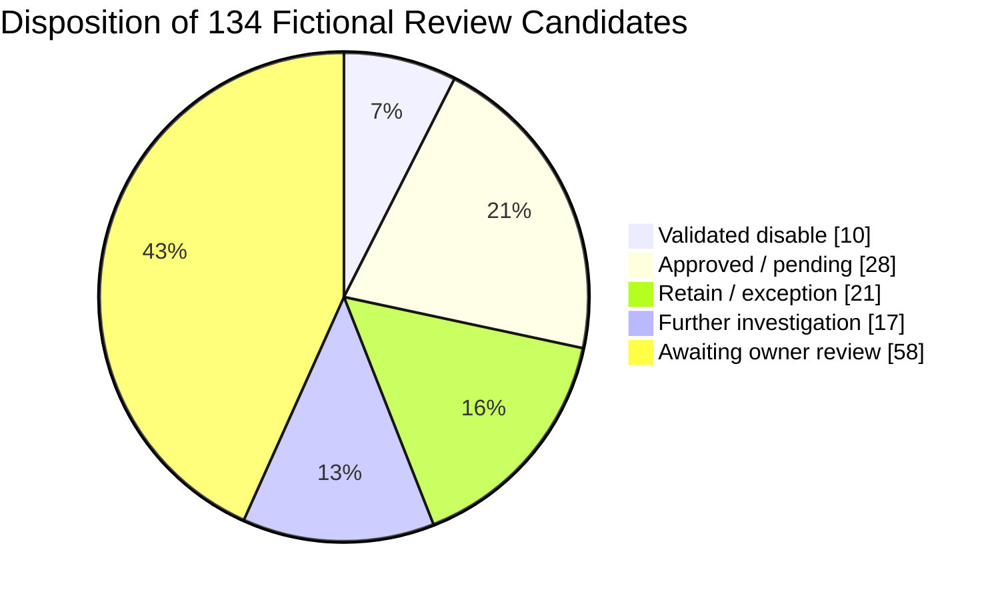
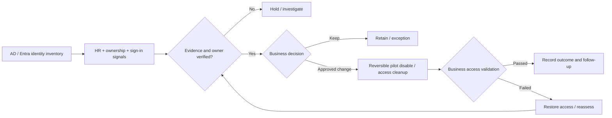

# Sample Outcome — User Account Hygiene

> **DEMO DATA · 1,000 fictitious human identities · 134 review candidates**  
> ตัวอย่างรายงานของ [User Account Hygiene Assessment & Remediation](../ip-19-user-account-hygiene.md) ไม่ใช่ข้อมูลพนักงานหรือผล Cleanup ของลูกค้าจริง

## Executive Summary

จาก Human User Accounts สมมติ 1,000 บัญชี พบ 134 บัญชีที่มี Inactivity, Ownership หรือ Access Signals ให้ Review ต่อ ทีมตรวจ Owner/HR/Dependencies แล้ว 76 บัญชี โดยมีเพียง 38 บัญชีได้รับอนุมัติการปิดใช้งานแบบกู้คืนได้ และผ่านการทดสอบ Pilot แล้ว 10 บัญชี ไม่มีการ Delete บัญชี

  
1,000Human Accounts in Sample Scope

  
134Review Candidates

  
76Owner Reviews Completed

  
10Validated Reversible Changes

**Decision required:** ติดตาม Owner Review ที่ยังไม่เสร็จ 58 บัญชี, รวบรวม Evidence เพิ่ม 17 บัญชี และวาง Change Windows สำหรับอีก 28 บัญชีที่อนุมัติแล้วแต่ยังไม่ได้ดำเนินการ

## Candidate Disposition

| Group | Accounts | Next Step |
|---|---:|---|
| Validated reversible disable | 10 | ตรวจ Post-change Access และเฝ้าระวัง |
| Approved; awaiting change window | 28 | Pilot/Batch Change ตามอนุมัติ |
| Retain / approved exception | 21 | บันทึกเหตุผลและ Review Date |
| Further investigation | 17 | หา HR/App/Sign-in Evidence เพิ่ม |
| Awaiting owner review | 58 | ขอ Business Owner Confirmation |
| **Total** | **134** | 134 = 10 + 28 + 21 + 17 + 58 |

**Reconciliation:** Owner Reviews Completed = 10 + 28 + 21 + 17 = **76**. Approved Disable = 10 + 28 = **38**. ส่วน 866 บัญชีที่เหลือไม่ได้ถูกจัดเป็น Review Candidates ในตัวอย่างนี้

## Example Account-level Decisions

| Fictional User | Identity Source | Reason for Review | Disposition |
|---|---|---|---|
| `demo_user_0001` | Entra Cloud-only | User Lifecycle / Sign-in Evidence | Disable Validated (Demo) |
| `demo_user_0017` | Hybrid | Confirmed Owner and Approval | Approved / Awaiting Window |
| `demo_user_0054` | AD DS | Retention Exception | Retain / Review Later |
| `demo_user_0074` | Hybrid | Data / HR Evidence Incomplete | Investigate |
| `demo_user_0110` | Hybrid | Owner Not Yet Confirmed | Awaiting Owner Review |

**[Download the 134-candidate Decision Register (Excel-ready CSV)](../../assets/examples/user-account-hygiene-candidates-demo.csv)**

## Remediation Decision Model

## Example Deliverables & Acceptance Evidence

| Deliverable | Customer-facing Evidence |
|---|---|
| Account Population Register | Account, Source of Authority, Status, Evidence Window |
| Inactivity & Ownership Register | Last Successful Sign-in (if available), HR/Owner Confirmation and Confidence |
| Proposed Action Register | Decision Owner, Reason, Required Approvals and Exceptions |
| Approved Change Record | Pre-state, Change ID, Post-state, Application Access Validation |
| Lifecycle Handover | Retention Review Date, HR Joiner/Mover/Leaver Improvements |

**Critical limitations:** `lastLogonTimestamp` ของ AD ไม่ใช่เวลาที่แม่นยำระดับ Real-time และ `signInActivity.lastSignInDateTime` ของ Entra อาจรวม Sign-in Attempts ที่ไม่สำเร็จได้ จึงต้องพิจารณา Last Successful Activity, Reporting Coverage, HR Information และ Application Owner Confirmation ประกอบกันเสมอ

**Exclusions:** Privileged/Emergency Accounts, Service/Automation, Guest Accounts และ Data/Legal Hold Cases ต้องใช้กระบวนการแยก ไม่มี Automatic Delete; Hybrid Accounts ต้องแก้ที่ Authoritative Identity Source

*ทุกบัญชี ชื่อ และ Outcome เป็นข้อมูลสมมติ ไม่มีบัญชีจริงถูกเปลี่ยนแปลง*

[Back to User Account Hygiene](../ip-19-user-account-hygiene.md) · [Customer Brochure](../brochures/ip-19-user-account-hygiene.md) · [Contact](../../contact.md)
