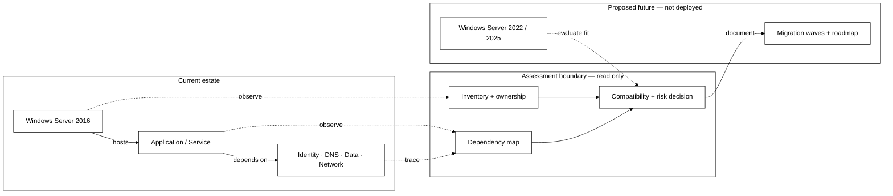
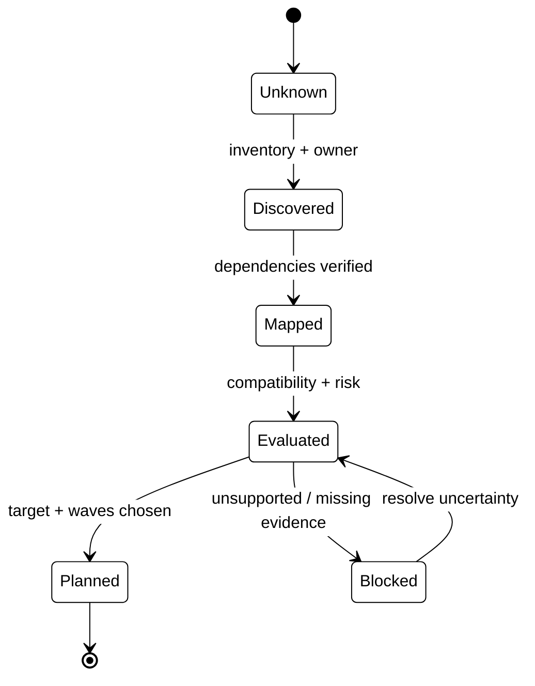

# Windows Server 2016 Migration Assessment & Roadmap

> **IP-01 | Repeatable Service Package**

**Expected Outcome:** ประเมินความพร้อมและจัดทำแผนย้าย Windows Server 2016 ไปยัง Windows Server 2022/2025

## When to Engage

- ยังไม่มีข้อมูล Server และ Application Dependencies ที่เชื่อถือได้ก่อนย้ายระบบ
- ต้องเลือกระหว่าง Upgrade, Side-by-side และ Rebuild โดยยังไม่เห็นความเสี่ยง
- ต้องวางแผน Migration Waves ให้มีเจ้าของและลำดับความสำคัญ

## Decisions & Outcomes

- Workloads ใดพร้อมย้าย และ Workloads ใดติดข้อจำกัด
- ควรใช้ Target Platform และ Migration Approach แบบใด
- ควรจัดลำดับ Migration Waves อย่างไร

## Scope

สำรวจ Server, Application และ Dependency ตามรายการที่ตกลง ประเมินความเสี่ยงและความซับซ้อน พร้อมกำหนด Target Baseline, Migration Approach และ Migration Waves; ไม่รวมการย้ายระบบจริง

## Architecture Mental Model

**System question:** What must be understood before deciding how a workload can move?

## Standard Delivery

1. Kickoff และรวบรวม Server Inventory
2. วิเคราะห์ Application, Dependency และ Compatibility
3. กำหนด Target Platform, Baseline และ Migration Approach
4. จัดทำ Risk Register, Migration Waves และ Roadmap

## Deliverables

Server/Workload Inventory, Dependency & Risk Assessment, Migration Strategy และ Roadmap

## Engineering Assurance

- ต้องทราบ Owner, Dependencies และความเสี่ยงก่อนให้สถานะว่าพร้อมย้าย
- Assessment นี้ไม่รวมการ Cutover ระบบจริง

**Failure & Recovery:** หากข้อมูล Compatibility หรือ Dependency ยังยืนยันไม่ได้ ให้ระบุ Blocker และเจ้าของข้อมูลก่อนกำหนด Wave

### State & Decision Model

## Assumptions & Boundaries

อาศัยข้อมูลจากทีม System/Application Owner; ไม่รวมการทดสอบย้ายระบบจริง

*Conceptual model only; detailed execution and estimates are maintained separately.*

## Getting Started

เตรียมรายการ Servers/Applications, Application Owners, Known Dependencies และ Target Platform ที่กำลังพิจารณา

## Discuss Your Project Scope

หากองค์กรกำลังเผชิญปัญหาข้างต้น สามารถส่งภาพรวมระบบ จำนวน Workloads หรือ Accounts ที่เกี่ยวข้อง และผลลัพธ์ที่ต้องการ เพื่อร่วมกันกำหนด Scope และเกณฑ์รับมอบก่อนเริ่มงาน

**[ติดต่อทีม In the Cloud](mailto:info@inthecloud.co.th?subject=Service%20IP-01)**

---

*Architecture และ State Models เป็นภาพเชิงแนวคิด ไม่ใช่ Production Topology ของลูกค้ารายใด*

