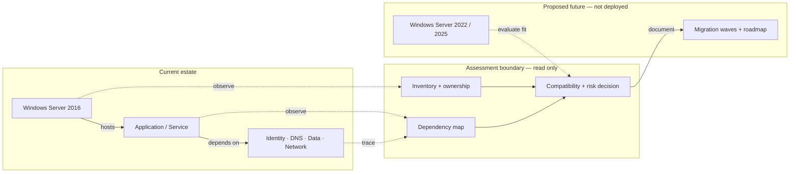

# Windows Server 2016 Migration Assessment & Roadmap

*Reusable technical service package*

## Overview

ประเมินความพร้อมและจัดทำแผนย้าย Windows Server 2016 ไปยัง Windows Server 2022/2025

## Scope

สำรวจ Server, Application และ Dependency ตามรายการที่ตกลง ประเมินความเสี่ยงและความซับซ้อน พร้อมกำหนด Target Baseline, Migration Approach และ Migration Waves; ไม่รวมการย้ายระบบจริง

## Architecture Mental Model

**System question:** What must be understood before deciding how a workload can move?

## Standard Delivery

1. Kickoff และรวบรวม Server Inventory
2. วิเคราะห์ Application, Dependency และ Compatibility
3. กำหนด Target Platform, Baseline และ Migration Approach
4. จัดทำ Risk Register, Migration Waves และ Roadmap

## Deliverables

Server/Workload Inventory, Dependency & Risk Assessment, Migration Strategy และ Roadmap

## Expected Outcome

ส่งมอบ Inventory และ Dependency/Risk Assessment พร้อม Migration Roadmap และรายการที่ต้องยืนยันก่อนลงมือย้าย

## Boundary

อาศัยข้อมูลจากทีม System/Application Owner; ไม่รวมการทดสอบย้ายระบบจริง

*Conceptual model only; detailed execution and estimates are maintained separately.*
