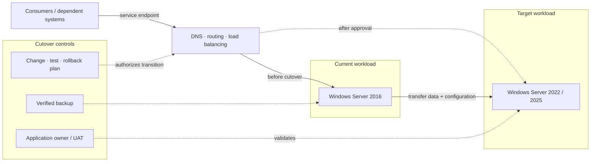
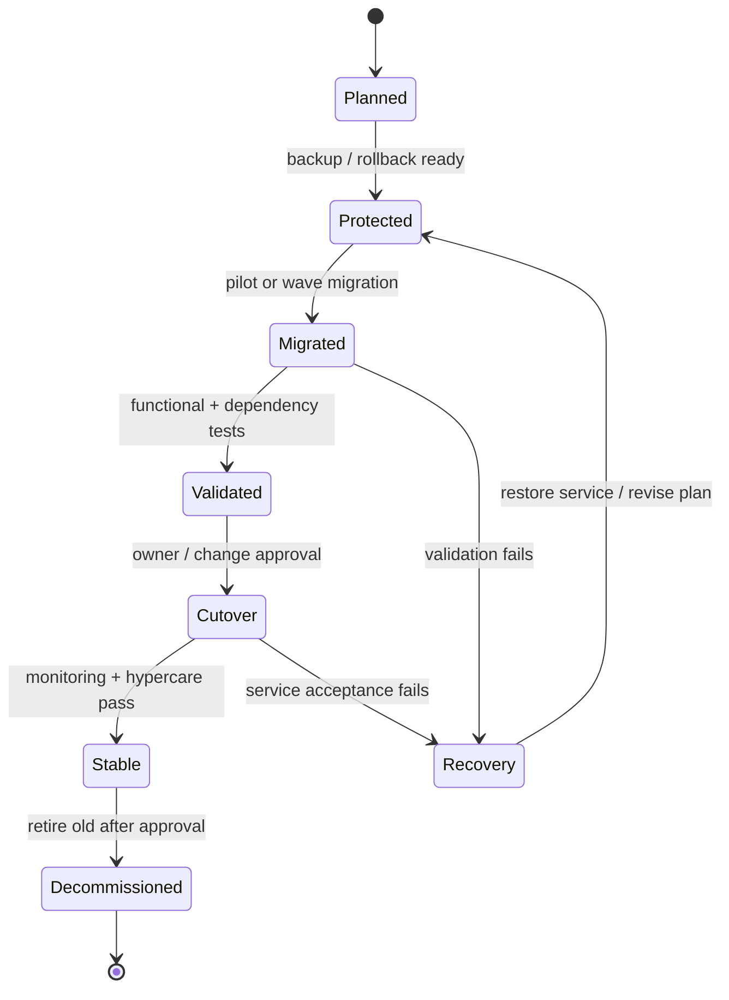

# Windows Server 2016 Migration Implementation

> **IP-02 | Repeatable Service Package**

**ผลลัพธ์ที่มุ่งหวัง:** ดำเนินการย้าย Windows Server 2016 ตาม Migration Waves และแผน Cutover ที่ได้รับอนุมัติ

## เมื่อใดควรใช้บริการนี้

- มี Roadmap แล้วแต่ยังต้องการแผน Cutover ที่ควบคุมความเสี่ยง
- กังวล Downtime, Rollback และบริการที่เชื่อมต่อระบบเดิม
- ต้องการหลักฐาน UAT ก่อนปลดระวาง Server

## Decisions & Outcomes

- รับรองแต่ละ Migration Wave บนเกณฑ์ทดสอบที่ตกลง
- เห็น Cutover, Rollback และสถานะงานคงค้างอย่างชัดเจน
- ตัดสินใจ Decommission จากผลทดสอบที่ตรวจสอบได้

## Scope

Pilot Migration, การย้ายระบบตาม Wave, Configuration/Functional Validation, Cutover, Remediation และการเลิกใช้ Server เดิมที่ตกลงร่วมกัน

## Architecture Mental Model

**System question:** What changes during cutover, and which state is recoverable?

## Standard Delivery

1. จัดทำแผน Runbook, Rollback และ Pilot Migration
2. ดำเนินการ Migration ตาม Wave ที่ตกลง
3. ทดสอบ Service, Application และ Dependency ร่วมกับ Owner
4. Cutover, Hypercare และแก้ไขปัญหาหลังย้าย
5. Decommission ระบบเดิมที่ผ่านเกณฑ์อนุมัติ

## Deliverables

Migration Runbook, ผลทดสอบ/ผล Cutover และรายการ Server ที่ย้ายเสร็จ

## Engineering Assurance

- ต้องมี Recovery Plan ที่ทดสอบหรือทบทวนก่อนเปลี่ยน Production Traffic
- ห้ามเลิกใช้ Source ก่อน Target ผ่าน Acceptance Tests

**Failure & Recovery:** หาก Service Validation ไม่ผ่าน ให้หยุดการเปลี่ยนผ่านและใช้แนวทาง Recovery ที่ตกลง ก่อนแก้ปัญหาและทดสอบซ้ำ

### State & Decision Model

## Assumptions & Boundaries

Effort เป็น TBD ต้องประเมินจำนวน Server, Application, Dependency, Downtime และ Cutover Window ก่อน

*Conceptual model only; detailed execution and estimates are maintained separately.*

## Preparing for an Assessment

กำหนดระบบและผู้รับผิดชอบที่เกี่ยวข้อง พร้อมข้อกำหนดการเข้าถึงและ Change Window เพื่อยืนยัน Scope, Validation และ Acceptance Criteria ก่อนเริ่มงาน

## พูดคุยขอบเขตงาน

หากองค์กรกำลังเผชิญปัญหาข้างต้น สามารถส่งภาพรวมระบบ จำนวน Workloads หรือ Accounts ที่เกี่ยวข้อง และผลลัพธ์ที่ต้องการ เพื่อร่วมกันกำหนด Scope และเกณฑ์รับมอบก่อนเริ่มงาน

**[ติดต่อทีม In the Cloud](mailto:info@inthecloud.co.th?subject=Service%20IP-02)**

---

*Architecture และ State Models เป็นภาพเชิงแนวคิด ไม่ใช่ Production Topology ของลูกค้ารายใด*

