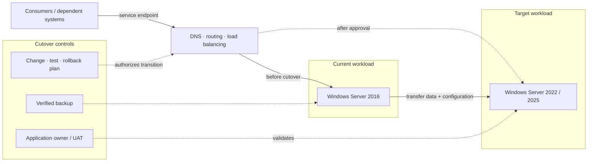

# Windows Server 2016 Migration Implementation

*Reusable technical service package*

## Overview

ดำเนินการย้าย Windows Server 2016 ตาม Migration Waves และแผน Cutover ที่ได้รับอนุมัติ

## Scope

Pilot Migration, การย้ายระบบตาม Wave, Configuration/Functional Validation, Cutover, Remediation และการเลิกใช้ Server เดิมที่ตกลงร่วมกัน

## Architecture Mental Model

**System question:** What changes during cutover, and which state is recoverable?

## Standard Delivery

1. จัดทำแผน Runbook, Rollback และ Pilot Migration
2. ดำเนินการ Migration ตาม Wave ที่ตกลง
3. ทดสอบ Service, Application และ Dependency ร่วมกับ Owner
4. Cutover, Hypercare และแก้ไขปัญหาหลังย้าย
5. Decommission ระบบเดิมที่ผ่านเกณฑ์อนุมัติ

## Deliverables

Migration Runbook, ผลทดสอบ/ผล Cutover และรายการ Server ที่ย้ายเสร็จ

## Expected Outcome

Workloads ใน Wave ผ่านเกณฑ์ทดสอบที่ตกลง, มีหลักฐาน Cutover และเอกสาร Rollback/Decommission ตามสถานะจริง

## Boundary

Effort เป็น TBD ต้องประเมินจำนวน Server, Application, Dependency, Downtime และ Cutover Window ก่อน

*Conceptual model only; detailed execution and estimates are maintained separately.*
