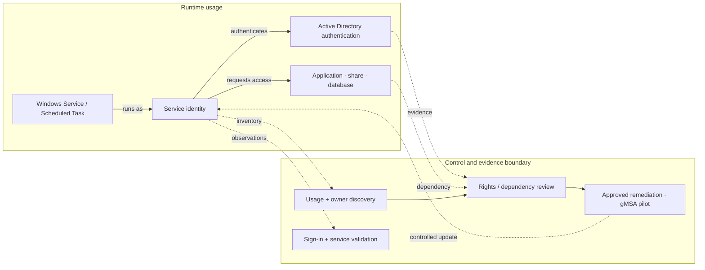
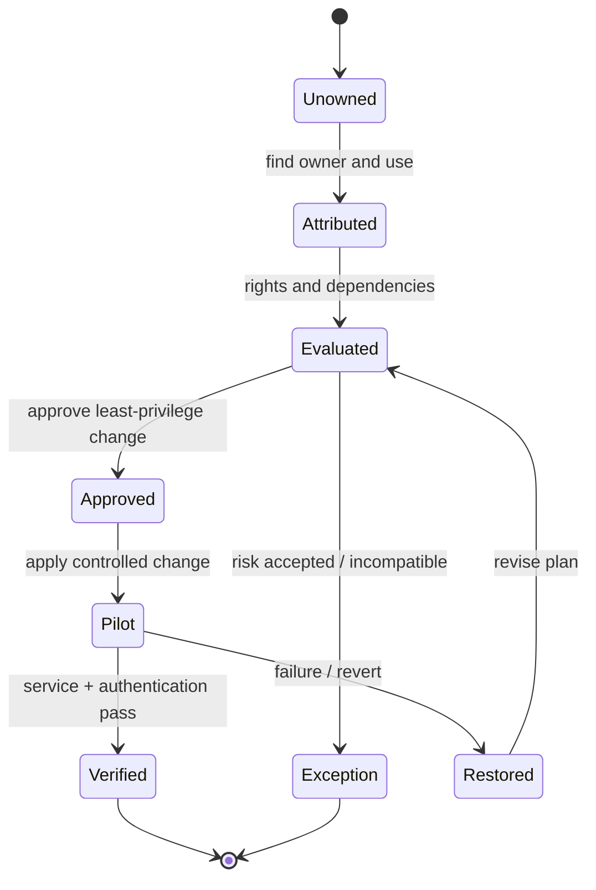

# Service Account Security Assessment & Remediation

> **IP-03 | Repeatable Service Package**

**Expected Outcome:** ตรวจสอบ Service Account และลดความเสี่ยงจากสิทธิ์เกินจำเป็นหรือการตั้งค่าที่ไม่ปลอดภัย

**Customer Brochure:** [Service Account Security Assessment & Remediation — 10 Capabilities, Scope, Tools & Sample Reports](brochures/ip-03-service-account-security.md)

## When to Engage

- ไม่ทราบ Service Account Owner หรือระบบที่พึ่งพาบัญชี
- Accounts มี Privileges สูงหรือสิทธิ์มากกว่าที่จำเป็น
- การเปลี่ยน Credential อาจทำให้ Business Services หยุดทำงาน

## Decisions & Outcomes

- ได้ Inventory, Owner, Usage และ Dependencies ของ Accounts ใน Scope
- เลือก Remediation หรือ gMSA Pilot ตามระดับความเสี่ยง
- ตรวจสอบว่า Services ยังทำงานหลังปรับสิทธิ์

## Scope

ครอบคลุม AD DS/Windows Service Accounts และข้อมูลจากเครื่องมือ Identity Security (หากมี) ตามระบบที่ตกลง พร้อม Remediation เฉพาะรายการที่ได้รับอนุมัติ

**Reference Pilot Boundary (6 Person-Days):** Inventory ของบัญชีใน Approved AD/Server Scope; สำหรับการประมาณการ เสนอ **Deep Dependency/Privilege Review สูงสุด 10 Priority Accounts และ Selected Remediation Pilot สูงสุด 2 Accounts** เมื่อมี Owner, Access, Change Approval และ Recovery Plan พร้อม (จำนวนสุดท้ายต้องตกลงใน SOW; ไม่รวม Full Enterprise Remediation)

## Architecture Mental Model

**System question:** Who is using this identity, and what capabilities can it exercise?

## Optional Security Platform Integration

บริการหลักสามารถดำเนินการด้วยข้อมูลจาก AD DS, Windows Services, Event Logs และหลักฐานจาก Application Owners ได้ โดย **ไม่จำเป็นต้องมีผลิตภัณฑ์เสริม** หากองค์กรใช้งาน Platform ที่รองรับอยู่แล้ว สามารถเพิ่มการวิเคราะห์ดังนี้

| Optional Platform | Additional Assessment Capabilities |
|---|---|
| **Microsoft Defender for Identity (MDI)** | Service Account Discovery, Source–Destination Authentication Connections, Kerberos/NTLM Activity, Identity Security Posture Findings, Privileged/Stale Service Account Review และ Threat Investigation |
| **Silverfort** | Authentication Visibility, Behavioral Baseline, Anomaly Review และการประเมิน Readiness สำหรับ Smart Policy / Virtual Fencing ตาม Deployment และ License ที่รองรับ |

ข้อมูลจาก Platform จะถูกใช้เป็น **Evidence เพิ่มเติม** เพื่อทำ Dependency Mapping, Risk Prioritization และ Remediation Planning ไม่ใช่เกณฑ์สรุปว่า Account ใช้งานไม่ได้หรือลบได้โดยอัตโนมัติ

**Scope Boundary:** MDI เหมาะกับ Visibility, Detection และ Posture Assessment โดยอาจรองรับ Response Actions บางประเภท แต่ไม่ถือว่าให้ Authentication Virtual Fencing เหมือน Silverfort ทั้งสองทางเลือกต้องตรวจ Coverage, Permissions, Licensing, Data Retention และ Identity Owners ก่อนเริ่มงาน

## Technical Readiness & Acceptance Controls

| Control | Requirement / Evidence |
|---|---|
| Coverage & Confidence | เก็บ AD/Host/MDI/Windows Log Coverage และ Observation Window; แยก Observed/Inferred/Owner-confirmed; No Activity ไม่ใช่ Unused |
| gMSA Feasibility | ประเมิน KDS Root Key, AD/Host/App Support, Password Retrieval Principals, SPN/Delegation และ Service Recovery |
| dMSA Feasibility | ตรวจ Windows Server 2025 DC ที่ Client ค้นพบได้, KDS, Host/Application Compatibility และ Migration Dependencies ก่อนออกแบบ Pilot |
| Change Validation | Approved Account/Resource/Owner + Before/After Authentication & Application Service Test + Rollback |
| Handover | Findings แยก Proposed, Approved, Applied, Validated, Exception และ Next-wave Risk Owner |

**Customer-facing Architecture and Outcomes:** [ดู Brochure พร้อม Mermaid ขาว–ดำ](brochures/ip-03-service-account-security.md)

## Standard Delivery

1. สำรวจ Account, Owner, Usage และ Dependency
2. วิเคราะห์ Privilege, Logon Rights และ Security Risks
3. จัดระดับความเสี่ยงและจัดทำ Remediation Plan
4. ปรับสิทธิ์/Configuration หรือ Pilot gMSA ตามความเหมาะสม
5. Validate และสรุปผล/รายการคงค้าง

## Deliverables

Service Account Raw Data Register (Excel-compatible), Risk Register, Remediation Checklist และ Validation Results

**Example Deliverable:** [View Sample Assessment Report — 50 Service Accounts](examples/service-account-security-assessment.md)

**Raw Data Example:** [View 50 fictional service accounts — Excel-ready CSV](../assets/examples/service-account-register-demo.csv)

ตัวอย่างรายงานแสดง Executive Dashboard, Risk Distribution, Remediation Groups และ Account-level Findings จาก **ข้อมูลสมมติทั้งหมด** เพื่อให้เห็นลักษณะสิ่งที่จะได้รับก่อนกำหนด Scope จริง

## Engineering Assurance

- ระบุ Account Owner และ Consumers ก่อนแก้ Credentials หรือ Permissions
- ปรับสิทธิ์ภายใต้ Change Approval และ Functional Validation

**Failure & Recovery:** หาก Service Authentication ไม่ผ่านหลังเปลี่ยนแปลง ให้ย้อนกลับตามแผนและสืบค้น Consumer ที่ยังไม่ถูกค้นพบ

### State & Decision Model

## Assumptions & Boundaries

ไม่รวมการแก้ไข Service Account ทุกระบบทั้งองค์กร; การเปลี่ยน Credential ต้องผ่าน Change Approval

*Conceptual model only; detailed execution and estimates are maintained separately.*

## Getting Started

เตรียม Service Account Inventory (ถ้ามี), เจ้าของระบบ, สิทธิ์อ่าน Configuration และข้อจำกัดการเปลี่ยน Credentials

## Discuss Your Project Scope

หากองค์กรกำลังเผชิญปัญหาข้างต้น สามารถส่งภาพรวมระบบ จำนวน Workloads หรือ Accounts ที่เกี่ยวข้อง และผลลัพธ์ที่ต้องการ เพื่อร่วมกันกำหนด Scope และเกณฑ์รับมอบก่อนเริ่มงาน

**[ติดต่อทีม In the Cloud](mailto:info@inthecloud.co.th?subject=Service%20IP-03)**

---

*Architecture และ State Models เป็นภาพเชิงแนวคิด ไม่ใช่ Production Topology ของลูกค้ารายใด*

