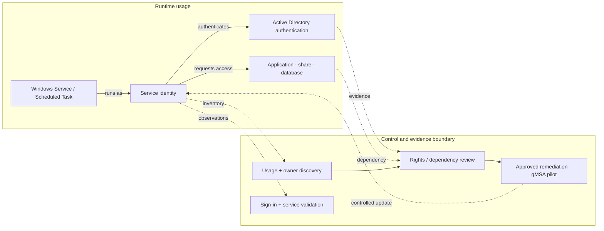

# Service Account Security Assessment & Remediation

*Reusable technical service package*

## Overview

ตรวจสอบ Service Account และลดความเสี่ยงจากสิทธิ์เกินจำเป็นหรือการตั้งค่าที่ไม่ปลอดภัย

## Scope

ครอบคลุม AD DS/Windows Service Accounts และข้อมูลจากเครื่องมือ Identity Security (หากมี) ตามระบบที่ตกลง พร้อม Remediation เฉพาะรายการที่ได้รับอนุมัติ

## Architecture Mental Model

**System question:** Who is using this identity, and what capabilities can it exercise?

## Standard Delivery

1. สำรวจ Account, Owner, Usage และ Dependency
2. วิเคราะห์ Privilege, Logon Rights และ Security Risks
3. จัดระดับความเสี่ยงและจัดทำ Remediation Plan
4. ปรับสิทธิ์/Configuration หรือ Pilot gMSA ตามความเหมาะสม
5. Validate และสรุปผล/รายการคงค้าง

## Deliverables

Service Account Inventory, Risk Register, Remediation Checklist และ Validation Results

## Expected Outcome

ระบุ Owner และ Risks ตาม Scope พร้อมบันทึก Remediation ที่อนุมัติและผลการตรวจหลังเปลี่ยนแปลง

## Boundary

ไม่รวมการแก้ไข Service Account ทุกระบบทั้งองค์กร; การเปลี่ยน Credential ต้องผ่าน Change Approval

*Conceptual model only; detailed execution and estimates are maintained separately.*
