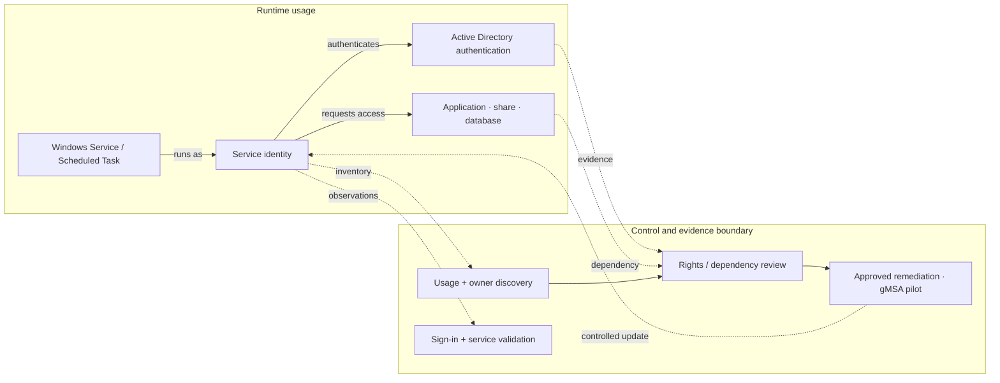
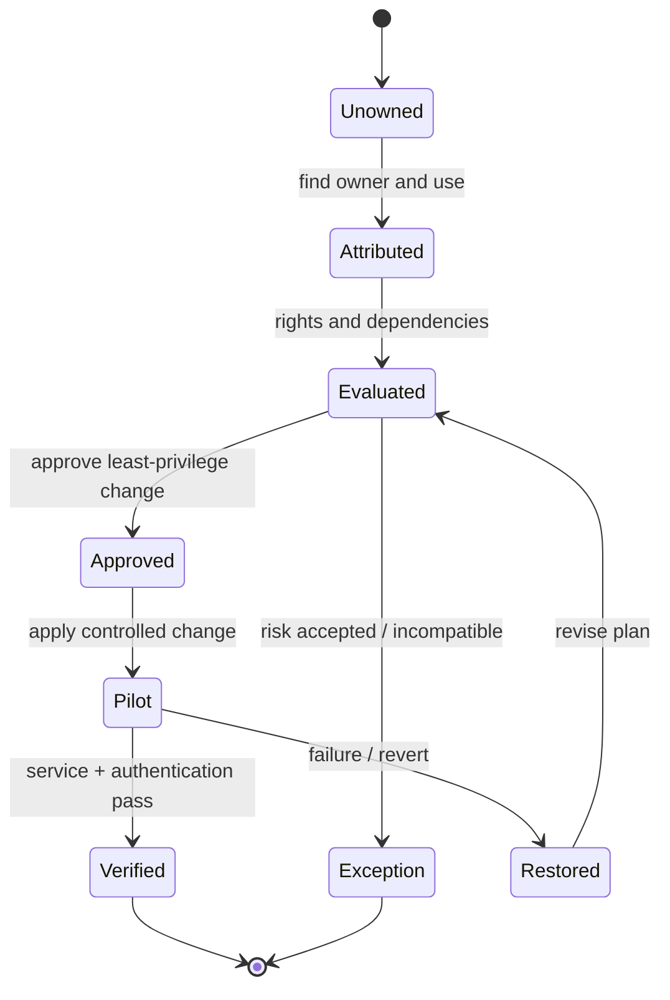

# Service Account Security Assessment & Remediation

> **IP-03 | Repeatable Service Package**

**ผลลัพธ์ที่มุ่งหวัง:** ตรวจสอบ Service Account และลดความเสี่ยงจากสิทธิ์เกินจำเป็นหรือการตั้งค่าที่ไม่ปลอดภัย

## เมื่อใดควรใช้บริการนี้

- ไม่ทราบ Service Account Owner หรือระบบที่พึ่งพาบัญชี
- Accounts มี Privileges สูงหรือสิทธิ์มากกว่าที่จำเป็น
- การเปลี่ยน Credential อาจทำให้ Business Services หยุดทำงาน

## Decisions & Outcomes

- ได้ Inventory, Owner, Usage และ Dependencies ของ Accounts ใน Scope
- เลือก Remediation หรือ gMSA Pilot ตามระดับความเสี่ยง
- ตรวจสอบว่า Services ยังทำงานหลังปรับสิทธิ์

## Scope

ครอบคลุม AD DS/Windows Service Accounts และข้อมูลจากเครื่องมือ Identity Security (หากมี) ตามระบบที่ตกลง พร้อม Remediation เฉพาะรายการที่ได้รับอนุมัติ

## Architecture Mental Model

**System question:** Who is using this identity, and what capabilities can it exercise?

## Standard Delivery

1. สำรวจ Account, Owner, Usage และ Dependency
2. วิเคราะห์ Privilege, Logon Rights และ Security Risks
3. จัดระดับความเสี่ยงและจัดทำ Remediation Plan
4. ปรับสิทธิ์/Configuration หรือ Pilot gMSA ตามความเหมาะสม
5. Validate และสรุปผล/รายการคงค้าง

## Deliverables

Service Account Inventory, Risk Register, Remediation Checklist และ Validation Results

## Engineering Assurance

- ระบุ Account Owner และ Consumers ก่อนแก้ Credentials หรือ Permissions
- ปรับสิทธิ์ภายใต้ Change Approval และ Functional Validation

**Failure & Recovery:** หาก Service Authentication ไม่ผ่านหลังเปลี่ยนแปลง ให้ย้อนกลับตามแผนและสืบค้น Consumer ที่ยังไม่ถูกค้นพบ

### State & Decision Model

## Assumptions & Boundaries

ไม่รวมการแก้ไข Service Account ทุกระบบทั้งองค์กร; การเปลี่ยน Credential ต้องผ่าน Change Approval

*Conceptual model only; detailed execution and estimates are maintained separately.*

## Preparing for an Assessment

กำหนดระบบและผู้รับผิดชอบที่เกี่ยวข้อง พร้อมข้อกำหนดการเข้าถึงและ Change Window เพื่อยืนยัน Scope, Validation และ Acceptance Criteria ก่อนเริ่มงาน

## พูดคุยขอบเขตงาน

หากองค์กรกำลังเผชิญปัญหาข้างต้น สามารถส่งภาพรวมระบบ จำนวน Workloads หรือ Accounts ที่เกี่ยวข้อง และผลลัพธ์ที่ต้องการ เพื่อร่วมกันกำหนด Scope และเกณฑ์รับมอบก่อนเริ่มงาน

**[ติดต่อทีม In the Cloud](mailto:info@inthecloud.co.th?subject=Service%20IP-03)**

---

*Architecture และ State Models เป็นภาพเชิงแนวคิด ไม่ใช่ Production Topology ของลูกค้ารายใด*

