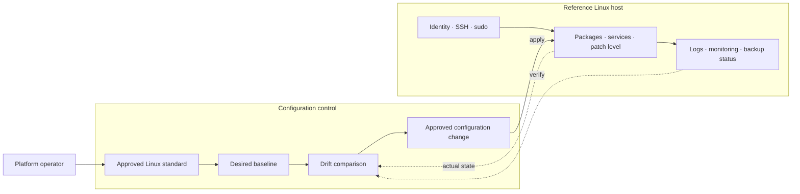
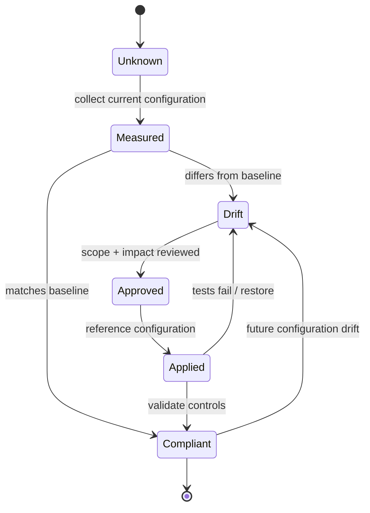

# Linux Platform Management, Standardization & Security

> **IP-04 | Repeatable Service Package**

**ผลลัพธ์ที่มุ่งหวัง:** กำหนดแนวทางบริหารจัดการ Linux ให้เป็นมาตรฐาน พร้อมสร้าง Reference Configuration ที่สามารถนำไปใช้ซ้ำได้

## When to Engage

- มี Linux หลาย Distribution หรือหลายทีมดูแลจน Configuration แตกต่างกัน
- ยังไม่มีมาตรฐาน Access, Patching, Monitoring และ Backup ที่ใช้ร่วมกัน
- ต้องการ Reference Build ก่อนขยายไปยัง Fleet

## Decisions & Outcomes

- ได้ Standard Baseline และ Reference Configuration ที่ตรวจสอบได้
- เห็น Control Gaps และข้อยกเว้นตาม Role ของ Server
- ใช้ Reference Build วางแผนการขยายผลได้

## Scope

ทบทวนสภาพแวดล้อม Linux และจัดทำมาตรฐานการตั้งค่า การดูแลระบบ การติดตามสถานะ และการสำรองข้อมูลสำหรับกลุ่มระบบที่ตกลง

## Architecture Mental Model

**System question:** How do many Linux hosts converge on one declared operating baseline?

## Standard Delivery

1. สำรวจสภาพแวดล้อม Linux และ Current Configuration
2. จัดทำ Standard Build และ Configuration Baseline
3. จัดทำ Reference Configuration และเชื่อมต่อระบบบริหารจัดการที่มีอยู่
4. ตรวจสอบผล จัดทำ Operations Guideline และ Knowledge Transfer

## Deliverables

Linux Standard Baseline, Reference Configuration, Validation Checklist และ Operations Guideline

## Engineering Assurance

- ทดสอบการเข้าถึงและบริการหลังปรับ Baseline
- Reference Configuration ไม่เท่ากับการ Rollout ทั้ง Fleet

**Failure & Recovery:** ถ้าการปรับ Baseline กระทบ Application หรือการบริหารเครื่อง ให้ย้อนกลับการตั้งค่าที่เกี่ยวข้อง แล้วทบทวน Exceptions

### State & Decision Model

## Assumptions & Boundaries

ขอบเขตเป็นการสร้างมาตรฐานและ Reference Implementation; ไม่รวมการ Rollout ไปยัง Linux ทุกเครื่องในองค์กร

*Conceptual model only; detailed execution and estimates are maintained separately.*

## Getting Started

เตรียม Linux Distributions/Versions, Existing Security Standards, Operations Tools และ Reference Hosts ที่ต้องการใช้เป็นต้นแบบ

## Discuss Your Project Scope

หากองค์กรกำลังเผชิญปัญหาข้างต้น สามารถส่งภาพรวมระบบ จำนวน Workloads หรือ Accounts ที่เกี่ยวข้อง และผลลัพธ์ที่ต้องการ เพื่อร่วมกันกำหนด Scope และเกณฑ์รับมอบก่อนเริ่มงาน

**[ติดต่อทีม In the Cloud](mailto:info@inthecloud.co.th?subject=Service%20IP-04)**

---

*Architecture และ State Models เป็นภาพเชิงแนวคิด ไม่ใช่ Production Topology ของลูกค้ารายใด*

