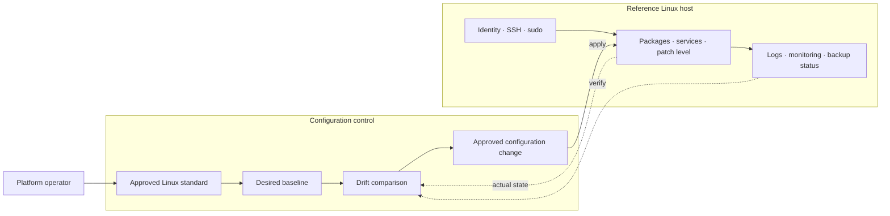

# Linux Platform Management, Standardization & Security

*Reusable technical service package*

## Overview

กำหนดแนวทางบริหารจัดการ Linux ให้เป็นมาตรฐาน พร้อมสร้าง Reference Configuration ที่สามารถนำไปใช้ซ้ำได้

## Scope

ทบทวนสภาพแวดล้อม Linux และจัดทำมาตรฐานการตั้งค่า การดูแลระบบ การติดตามสถานะ และการสำรองข้อมูลสำหรับกลุ่มระบบที่ตกลง

## Architecture Mental Model

**System question:** How do many Linux hosts converge on one declared operating baseline?

## Standard Delivery

1. สำรวจสภาพแวดล้อม Linux และ Current Configuration
2. จัดทำ Standard Build และ Configuration Baseline
3. จัดทำ Reference Configuration และเชื่อมต่อระบบบริหารจัดการที่มีอยู่
4. ตรวจสอบผล จัดทำ Operations Guideline และ Knowledge Transfer

## Deliverables

Linux Standard Baseline, Reference Configuration, Validation Checklist และ Operations Guideline

## Expected Outcome

Reference Configuration ผ่านการทดสอบตาม Checklist ที่ตกลง และส่งมอบเอกสารสำหรับการนำไปใช้งานซ้ำ

## Boundary

ขอบเขตเป็นการสร้างมาตรฐานและ Reference Implementation; ไม่รวมการ Rollout ไปยัง Linux ทุกเครื่องในองค์กร

*Conceptual model only; detailed execution and estimates are maintained separately.*
