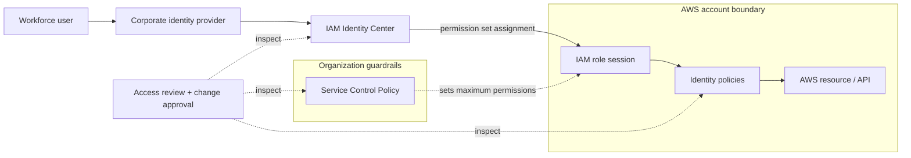
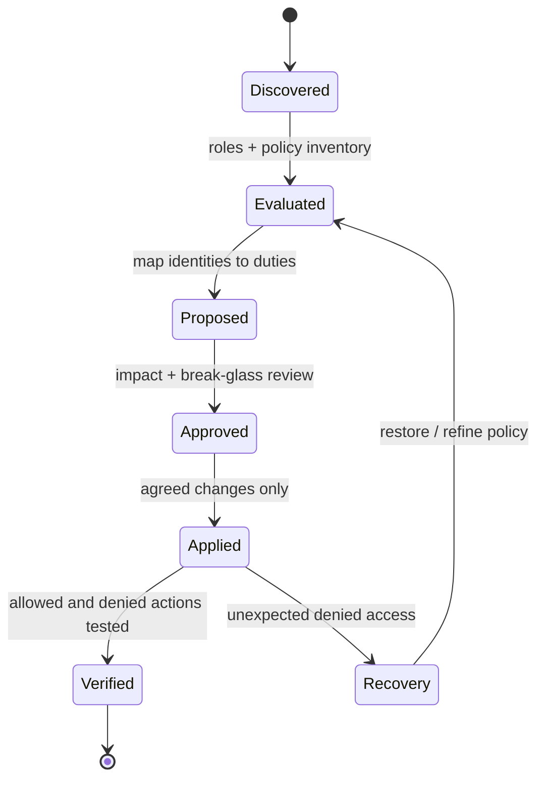

# AWS Identity & Access Governance and Security Baseline

> **IP-05 | Repeatable Service Package**

**Expected Outcome:** ประเมินและยกระดับมาตรฐาน AWS Identity & Access Governance สำหรับบัญชีที่ตกลง

## When to Engage

- สิทธิ์ IAM กระจัดกระจายและขาดภาพรวมของ Users, Roles และ Accounts
- ต้องการมาตรฐาน Federation, Permission Sets, SCP และ Break-glass
- กังวล Guardrails ใหม่กระทบการทำงานของ Workloads

## Decisions & Outcomes

- มี IAM / Federation Architecture ที่สอดคล้องกับการบริหาร AWS Accounts
- ทราบสิทธิ์และ Guardrails ที่ควรปรับตามความเสี่ยง
- ยืนยันผล Priority Controls จากการทดสอบจริง

## Scope

ทบทวน Federation/Identity Center, IAM Role & Permission Set, MFA, SCP, Break-glass และ Access Review พร้อมปรับใช้ Priority Controls ที่อนุมัติ

## Assessment Dimensions

| Workstream | Review & Decisions | Customer Outcome |
|---|---|---|
| AWS Organization & Account Boundaries | OU, Account Ownership, Management/Member Accounts, delegated administration | Account / OU Governance Matrix |
| Workforce Access | Federation, IAM Identity Center, Permission Sets, MFA, access assignments | Workforce Access Model และ Access Review |
| IAM Roles & Workload Identity | Trust Policies, Role Assumption, IAM Users/Access Keys, cross-account paths | Least-Privilege & Credential Modernization Candidates |
| Organization Guardrails | SCP Inheritance, explicit/implicit denies, workload impact, recovery | Tested Guardrail Proposal |
| Visibility & Evidence | CloudTrail, IAM Role/Policy inventory, Access Analyzer (ถ้ามี) | Prioritized Findings + Evidence Completeness |
| Operational Governance | Owner, Approval, Exceptions, Emergency Access, periodic reviews | Lifecycle / Governance Handover |

**Access Evaluation:** วิเคราะห์อย่างน้อย Identity/Resource Policies, Session/Permission Boundaries, SCP และ Trust Relationships ที่เกี่ยวข้อง เพื่อแยกว่า Permission ได้รับจริง ถูกจำกัด หรือถูก Deny จากชั้นใด ไม่สรุปจาก Policy Statement เดียว

### Remediation Decision Examples

| Example Finding | Recommended Decision | Validation |
|---|---|---|
| Broad Admin Access | แยก Role/Permission Set ตามหน้าที่ | Allowed & Denied API Actions |
| Excessive Cross-account Trust | จำกัด Trusted Principals / Conditions | ทดสอบ Required AssumeRole Flows |
| Unused IAM User / Access Key | ตรวจ Owner/Consumers ก่อน Disable/Rotate | Workload & API Continuity |
| SCP Restricts Critical Service | ทดลองกับ Scoped OU/Account ก่อนขยายผล | Existing Admin + Workload Access |
| Unowned Permission Set | กำหนด Access Owner และ Review Cadence | Owner Attestation & Assignment Record |

## Architecture Mental Model

**System question:** Which layers authorize AWS access, and which only restrict it?

## Standard Delivery

1. **Discover & Scope** — สำรวจ Organization, OU/Accounts, Federation, Identity Center, IAM Roles, Trusts, Permission Sets และ Evidence Coverage
2. **Assess & Classify** — วิเคราะห์ Effective Access, Privileged / External / Unused Findings, Ownership และ Workload Dependencies ตามความเสี่ยง
3. **Decide & Design** — สรุป Target IAM Standard, Scoped Permission Changes, Guardrails, Exceptions และ Recovery Route ที่เจ้าของระบบอนุมัติ
4. **Pilot & Validate** — ทดสอบ Priority Controls กับ Accounts/Principals ที่ตกลง พร้อม Positive/Negative Access Tests และ Rollback
5. **Handover** — ส่งมอบ Inventory, Findings Register, Before/After Evidence, Governance Playbook และ Open Items

## Deliverables

AWS Account/OU Inventory, Identity Center Permission Set & IAM Role Mapping, **Prioritized Findings Register (Excel-compatible)**, Proposed Remediation Decisions, Applied Control/Validation Evidence และ Governance Guide

**Example Deliverable:** [View Sample AWS Identity & Access Baseline Outcome — 6 Accounts, 14 Findings](examples/aws-identity-access-baseline-outcome.md)

**Raw Findings Example:** [Download fictional 14-row Findings Register (CSV)](../assets/examples/aws-iam-baseline-findings-demo.csv)

ตัวอย่างนี้แสดง Findings, Risk Distribution, Decision Owners, Scoped Pilot Results และ Acceptance Evidence ที่ลูกค้าจะได้รับ ไม่ใช่การประเมิน AWS ของลูกค้าจริง

## Engineering Assurance

- SCP เป็นขอบเขตจำกัดสิทธิ์ ไม่ใช่กลไกให้สิทธิ์
- ต้องรักษาและทดสอบเส้นทาง Administrative/Emergency Access ก่อนเปลี่ยน Guardrails

- ทดสอบ Critical Operations และ Emergency Access ก่อนเปลี่ยน SCP หรือ Administrative Roles; SCP ไม่ครอบคลุม Management Account ในลักษณะเดียวกับ Member Accounts
- Unused/External Access Signals เป็นสิ่งที่ต้อง Review ไม่ใช่คำสั่งให้ Disable/Remove โดยอัตโนมัติ และ Access Analyzer Coverage ต้องตรวจว่าเปิดใช้ Analyzer Type/Region ใด
- เก็บ Pre-change Policy, Trust Relationship, Approved Decisions และ Test Evidence เพื่อให้ Revert ได้ตาม Change Window

**Failure & Recovery:** ถ้าการแก้ Role, Permission Set หรือ SCP ทำให้เกิด Unexpected Deny ให้ใช้เส้นทาง Recovery ที่อนุมัติและคืนค่านโยบายที่ผ่านการทดสอบ

### State & Decision Model

## Assumptions & Boundaries

Scope และ Effort ขึ้นกับจำนวน AWS Accounts, Organizations, Permission Sets, IAM Roles, Workloads, External Trusts และ Approval Windows ไม่รวม Organization-wide Permission Cleanup, Root Account Recovery, การเปลี่ยนทุก SCP หรือ Security Operations ต่อเนื่องโดยอัตโนมัติ

Access Analyzer/CloudTrail Findings และ Last-Accessed Evidence มีข้อจำกัดด้าน Coverage, Supported Resource Types และ Observation Period ต้องตรวจสิทธิ์ใช้งานและอาจมีค่าใช้จ่ายส่วนเพิ่มจาก AWS Feature ที่เลือก

*Conceptual model only; detailed execution and estimates are maintained separately.*

## Acceptance & Handover Evidence

- มี Account/OU/Identity Inventory ตาม Scope พร้อม Ownership และแหล่งข้อมูล
- Findings สำคัญมี Risk, Evidence, Proposed Action, Decision Owner และ Approval/Exception ที่ตรวจสอบได้
- ทุก Pilot Change ที่อนุมัติแล้วมี Test Cases สำหรับ **Allow/Deny**, ผลจริง, Workload Impact และ Recovery Procedure
- ไม่พบการเปลี่ยนสิทธิ์ Production นอก Change Scope และส่งต่อ Remaining Risks พร้อมผู้รับผิดชอบ

## References

- [AWS Organizations — Service Control Policies](https://docs.aws.amazon.com/organizations/latest/userguide/orgs_manage_policies_scps.html)
- [AWS IAM — Access Analyzer Findings](https://docs.aws.amazon.com/IAM/latest/UserGuide/access-analyzer-findings.html)
- [AWS IAM — Access Analyzer Capabilities](https://docs.aws.amazon.com/IAM/latest/UserGuide/what-is-access-analyzer.html)

## Getting Started

เตรียม AWS Organization/Account Scope, IAM Identity/Federation Design, Access Owners และ Approved Change Process

## Discuss Your Project Scope

หากองค์กรกำลังเผชิญปัญหาข้างต้น สามารถส่งภาพรวมระบบ จำนวน Workloads หรือ Accounts ที่เกี่ยวข้อง และผลลัพธ์ที่ต้องการ เพื่อร่วมกันกำหนด Scope และเกณฑ์รับมอบก่อนเริ่มงาน

**[ติดต่อทีม In the Cloud](mailto:info@inthecloud.co.th?subject=Service%20IP-05)**

---

*Architecture และ State Models เป็นภาพเชิงแนวคิด ไม่ใช่ Production Topology ของลูกค้ารายใด*

