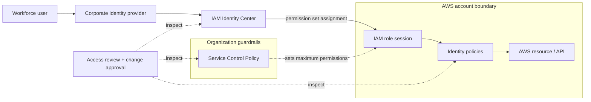
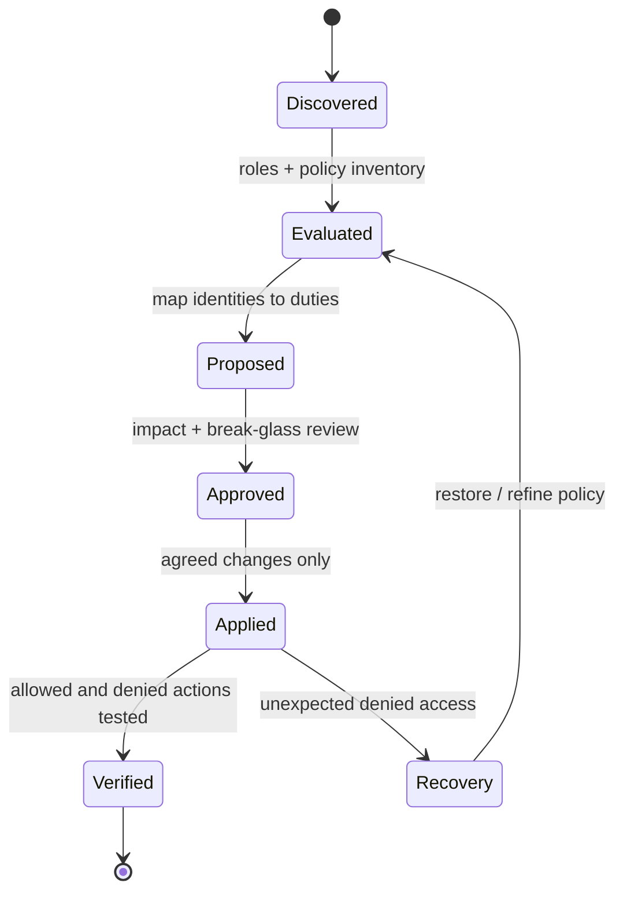

# AWS Identity & Access Governance and Security Baseline

> **IP-05 | Repeatable Service Package**

**ผลลัพธ์ที่มุ่งหวัง:** ประเมินและยกระดับมาตรฐาน AWS Identity & Access Governance สำหรับบัญชีที่ตกลง

## เมื่อใดควรใช้บริการนี้

- สิทธิ์ IAM กระจัดกระจายและขาดภาพรวมของ Users, Roles และ Accounts
- ต้องการมาตรฐาน Federation, Permission Sets, SCP และ Break-glass
- กังวล Guardrails ใหม่กระทบการทำงานของ Workloads

## Scope

ทบทวน Federation/Identity Center, IAM Role & Permission Set, MFA, SCP, Break-glass และ Access Review พร้อมปรับใช้ Priority Controls ที่อนุมัติ

## Architecture Mental Model

**System question:** Which layers authorize AWS access, and which only restrict it?

## Standard Delivery

1. Review AWS Organization/Account และ Existing IAM
2. ออกแบบ IAM Standard, Federation, Roles และ Guardrails
3. Implement Priority Controls บน Accounts ที่ตกลง
4. Validate Access และส่งมอบ Governance Runbook

## Deliverables

AWS IAM Baseline, Priority Finding List, Applied Control Evidence และ Governance Guide

## Decisions & Outcomes

- มี IAM / Federation Architecture ที่สอดคล้องกับการบริหาร AWS Accounts
- ทราบสิทธิ์และ Guardrails ที่ควรปรับตามความเสี่ยง
- ยืนยันผล Priority Controls จากการทดสอบจริง

## Engineering Assurance

- SCP เป็นขอบเขตจำกัดสิทธิ์ ไม่ใช่กลไกให้สิทธิ์
- ต้องรักษาและทดสอบเส้นทาง Administrative/Emergency Access ก่อนเปลี่ยน Guardrails

**Failure & Recovery:** ถ้าการแก้ Role, Permission Set หรือ SCP ทำให้เกิด Unexpected Deny ให้ใช้เส้นทาง Recovery ที่อนุมัติและคืนค่านโยบายที่ผ่านการทดสอบ

### State & Decision Model

## Assumptions & Boundaries

การเปลี่ยน SCP/Role ต้องทดสอบผลกระทบและรับอนุมัติ; ไม่รวมการปรับสิทธิ์ทุก Account

*Conceptual model only; detailed execution and estimates are maintained separately.*

## Preparing for an Assessment

กำหนดระบบและผู้รับผิดชอบที่เกี่ยวข้อง พร้อมข้อกำหนดการเข้าถึงและ Change Window เพื่อยืนยัน Scope, Validation และ Acceptance Criteria ก่อนเริ่มงาน

---
*Architecture และ State Models เป็นแบบจำลองเชิงแนวคิด ไม่ใช่ Production Topology ขององค์กรใดองค์กรหนึ่ง*
