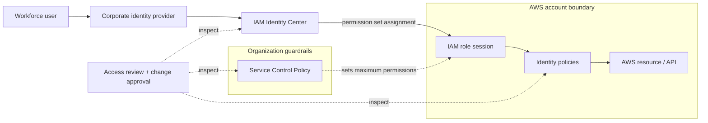

# AWS Identity & Access Governance and Security Baseline

*Reusable technical service package*

## Overview

ประเมินและยกระดับมาตรฐาน AWS Identity & Access Governance สำหรับบัญชีที่ตกลง

## Scope

ทบทวน Federation/Identity Center, IAM Role & Permission Set, MFA, SCP, Break-glass และ Access Review พร้อมปรับใช้ Priority Controls ที่อนุมัติ

## Architecture Mental Model

**System question:** Which layers authorize AWS access, and which only restrict it?

## Standard Delivery

1. Review AWS Organization/Account และ Existing IAM
2. ออกแบบ IAM Standard, Federation, Roles และ Guardrails
3. Implement Priority Controls บน Accounts ที่ตกลง
4. Validate Access และส่งมอบ Governance Runbook

## Deliverables

AWS IAM Baseline, Priority Finding List, Applied Control Evidence และ Governance Guide

## Expected Outcome

มี IAM Gap Matrix และหลักฐานการปรับ Priority Controls พร้อมบันทึกการตรวจสอบผล

## Boundary

การเปลี่ยน SCP/Role ต้องทดสอบผลกระทบและรับอนุมัติ; ไม่รวมการปรับสิทธิ์ทุก Account

*Conceptual model only; detailed execution and estimates are maintained separately.*
