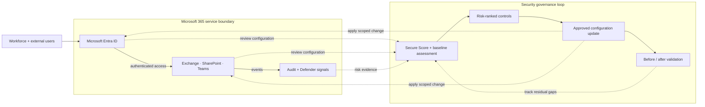
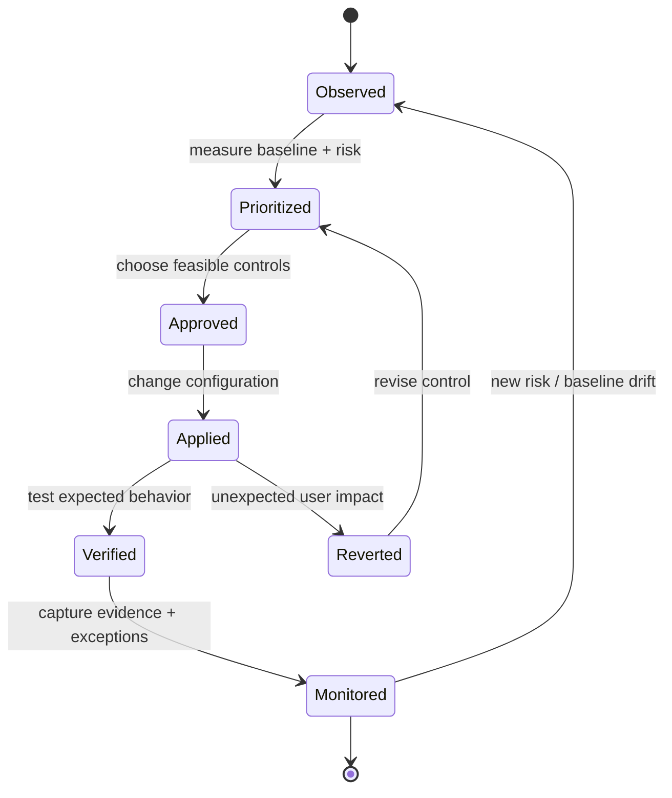

# Microsoft 365 Security Baseline & Secure Score Improvement

> **IP-06 | Repeatable Service Package**

**ผลลัพธ์ที่มุ่งหวัง:** ประเมิน Security Baseline ของ Microsoft 365 และปรับปรุง Controls ที่มีผลต่อความเสี่ยงและ Secure Score

## เมื่อใดควรใช้บริการนี้

- Microsoft 365 มีการตั้งค่าความปลอดภัยหลาย Workloads และยังไม่มี Prioritized Baseline
- Secure Score มีข้อเสนอมาก แต่ยังไม่ทราบว่าอะไรลดความเสี่ยงจริง
- ต้องการทำ Remediation โดยไม่สร้างผลกระทบต่อผู้ใช้

## Decisions & Outcomes

- เห็น Tenant Security Gaps ที่มีลำดับความสำคัญและ Owner
- ได้ผลการแก้ Priority Controls พร้อม Evidence
- เห็น Roadmap และ Exceptions ที่ต้องดำเนินการต่อ

## Scope

ครอบคลุมการตั้งค่า Entra, Exchange Online, SharePoint/Teams และ Defender ตามสิทธิ์ใช้งานที่มี พร้อม Remediation ที่อนุมัติและ Exception Register

## Architecture Mental Model

**System question:** Where are user access decisions made, and how is configuration drift detected?

## Standard Delivery

1. Assess Tenant Configuration, Licensing และ Secure Score
2. จัดลำดับ Security Gaps และเลือก Priority Controls
3. Implement Remediation ที่ตกลง
4. Validate Configuration และจัดทำ Remaining Roadmap

## Deliverables

Security Gap Assessment, Remediation Record, Secure Score Snapshot และ Exception Register

## Engineering Assurance

- Secure Score เป็นตัวชี้วัดหนึ่ง ไม่ใช่หลักฐานว่าปลอดภัยครบถ้วน
- ต้องทดสอบผลกระทบต่อการเข้าถึงและการทำงานของผู้ใช้ก่อน Rollout

**Failure & Recovery:** หากนโยบายที่ปรับใหม่กระทบการเข้าถึงหรือ Mail/Collaboration ให้ย้อนกลับการเปลี่ยนที่อนุมัติและปรับขอบเขตทดสอบ

### State & Decision Model

## Assumptions & Boundaries

เป้าหมายการปรับปรุง Secure Score ขึ้นอยู่กับคะแนนเริ่มต้น สิทธิ์ใช้งาน และการอนุมัติเปลี่ยนแปลง ไม่รับประกันผลภายในระยะเวลาตัวอย่าง

*Conceptual model only; detailed execution and estimates are maintained separately.*

## ก่อนเริ่มงาน

เตรียม Tenant/License Scope, Security Score Snapshot, Existing Policies และเจ้าของ Workloads ที่ได้รับผลกระทบ

## พูดคุยขอบเขตงาน

หากองค์กรกำลังเผชิญปัญหาข้างต้น สามารถส่งภาพรวมระบบ จำนวน Workloads หรือ Accounts ที่เกี่ยวข้อง และผลลัพธ์ที่ต้องการ เพื่อร่วมกันกำหนด Scope และเกณฑ์รับมอบก่อนเริ่มงาน

**[ติดต่อทีม In the Cloud](mailto:info@inthecloud.co.th?subject=Service%20IP-06)**

---

*Architecture และ State Models เป็นภาพเชิงแนวคิด ไม่ใช่ Production Topology ของลูกค้ารายใด*

