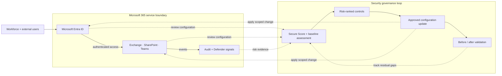

# Microsoft 365 Security Baseline & Secure Score Improvement

*Reusable technical service package*

## Overview

ประเมิน Security Baseline ของ Microsoft 365 และปรับปรุง Controls ที่มีผลต่อความเสี่ยงและ Secure Score

## Scope

ครอบคลุมการตั้งค่า Entra, Exchange Online, SharePoint/Teams และ Defender ตามสิทธิ์ใช้งานที่มี พร้อม Remediation ที่อนุมัติและ Exception Register

## Architecture Mental Model

**System question:** Where are user access decisions made, and how is configuration drift detected?

## Standard Delivery

1. Assess Tenant Configuration, Licensing และ Secure Score
2. จัดลำดับ Security Gaps และเลือก Priority Controls
3. Implement Remediation ที่ตกลง
4. Validate Configuration และจัดทำ Remaining Roadmap

## Deliverables

Security Gap Assessment, Remediation Record, Secure Score Snapshot และ Exception Register

## Expected Outcome

มีรายการ Security Gaps, Evidence ของการปรับค่าและผลตรวจสอบ, Exception Register และ Next-step Roadmap

## Boundary

เป้าหมายการปรับปรุง Secure Score ขึ้นอยู่กับคะแนนเริ่มต้น สิทธิ์ใช้งาน และการอนุมัติเปลี่ยนแปลง ไม่รับประกันผลภายในระยะเวลาตัวอย่าง

*Conceptual model only; detailed execution and estimates are maintained separately.*
