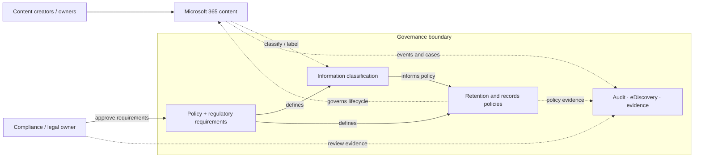
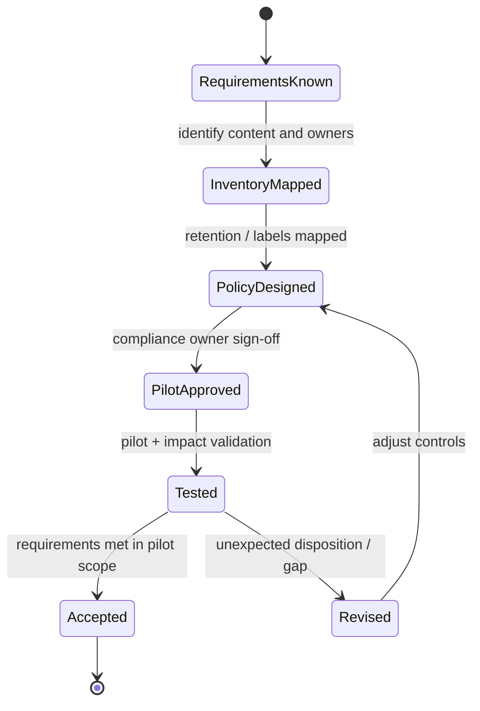

# Microsoft 365 Zero Trust – Regulatory & Compliance Readiness

> **IP-07 | Repeatable Service Package**

**ผลลัพธ์ที่มุ่งหวัง:** ประเมินความพร้อมด้าน Data Governance และ Compliance บน Microsoft 365/Purview

## เมื่อใดควรใช้บริการนี้

- ต้องแปลงข้อกำหนดด้านข้อมูลและการเก็บรักษาเป็น Microsoft 365 Controls
- ไม่มั่นใจว่านโยบาย Information Protection, Retention และ Audit ครอบคลุมหรือไม่
- ต้องการหลักฐาน Gap Analysis ก่อนปรับ Policy จริง

## Decisions & Outcomes

- เห็นความเชื่อมโยง Requirement → Control → Evidence
- เลือก Priority Policies และ Pilot ตามข้อมูลกับ License ที่มี
- ได้ Roadmap ของ Compliance Gaps ที่ยังไม่ปิด

## Scope

Review Information Protection, Retention, Audit, Records และ eDiscovery เทียบกับข้อกำหนดที่ลูกค้าระบุ พร้อมแก้ไข Controls ลำดับสำคัญเฉพาะขอบเขตที่อนุมัติ

## Architecture Mental Model

**System question:** How do information assets, governance requirements, and enforcement controls relate?

## Standard Delivery

1. กำหนด Requirement และ Control Scope ร่วมกับทีม Compliance
2. Review Purview Capabilities และ Current Settings
3. จัดทำ Gap Analysis และ Prioritized Controls
4. Implement/Pilot Priority Controls ที่ตกลง
5. Validate และส่งมอบ Compliance Remediation Roadmap

## Deliverables

Compliance Gap Matrix, Control Evidence, Pilot Configuration และ Remediation Roadmap

## Engineering Assurance

- ทุก Policy ต้องมีเจ้าของข้อกำหนดและเหตุผลอ้างอิง
- การตั้งค่า Purview ไม่ใช่การรับรองผ่านข้อกฎหมายโดยอัตโนมัติ

**Failure & Recovery:** หากนโยบาย Retention หรือ Disposition ทำให้เกิดผลที่ไม่คาดหมาย ให้ระงับการขยายผลและให้ Data/Compliance Owner ทบทวนก่อนปรับใช้ต่อ

### State & Decision Model

## Assumptions & Boundaries

ไม่รวม Legal Opinion/การรับรองผ่านข้อกำหนดทางกฎหมาย; การใช้ Feature ขึ้นกับ License

*Conceptual model only; detailed execution and estimates are maintained separately.*

## Preparing for an Assessment

กำหนดระบบและผู้รับผิดชอบที่เกี่ยวข้อง พร้อมข้อกำหนดการเข้าถึงและ Change Window เพื่อยืนยัน Scope, Validation และ Acceptance Criteria ก่อนเริ่มงาน

## พูดคุยขอบเขตงาน

หากองค์กรกำลังเผชิญปัญหาข้างต้น สามารถส่งภาพรวมระบบ จำนวน Workloads หรือ Accounts ที่เกี่ยวข้อง และผลลัพธ์ที่ต้องการ เพื่อร่วมกันกำหนด Scope และเกณฑ์รับมอบก่อนเริ่มงาน

**[ติดต่อทีม In the Cloud](mailto:info@inthecloud.co.th?subject=Service%20IP-07)**

---

*Architecture และ State Models เป็นภาพเชิงแนวคิด ไม่ใช่ Production Topology ของลูกค้ารายใด*

