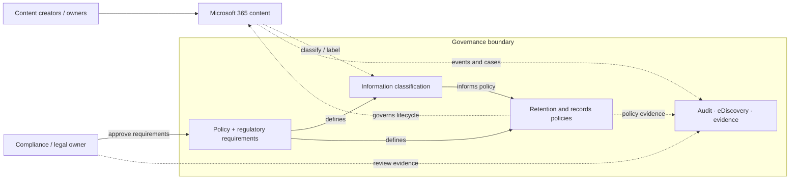

# Microsoft 365 Zero Trust – Regulatory & Compliance Readiness

*Reusable technical service package*

## Overview

ประเมินความพร้อมด้าน Data Governance และ Compliance บน Microsoft 365/Purview

## Scope

Review Information Protection, Retention, Audit, Records และ eDiscovery เทียบกับข้อกำหนดที่ลูกค้าระบุ พร้อมแก้ไข Controls ลำดับสำคัญเฉพาะขอบเขตที่อนุมัติ

## Architecture Mental Model

**System question:** How do information assets, governance requirements, and enforcement controls relate?

## Standard Delivery

1. กำหนด Requirement และ Control Scope ร่วมกับทีม Compliance
2. Review Purview Capabilities และ Current Settings
3. จัดทำ Gap Analysis และ Prioritized Controls
4. Implement/Pilot Priority Controls ที่ตกลง
5. Validate และส่งมอบ Compliance Remediation Roadmap

## Deliverables

Compliance Gap Matrix, Control Evidence, Pilot Configuration และ Remediation Roadmap

## Expected Outcome

ส่งมอบ Gap Matrix, ผลการทดสอบ Policy Pilot และ Roadmap สำหรับปรับปรุง Controls

## Boundary

ไม่รวม Legal Opinion/การรับรองผ่านข้อกำหนดทางกฎหมาย; การใช้ Feature ขึ้นกับ License

*Conceptual model only; detailed execution and estimates are maintained separately.*
