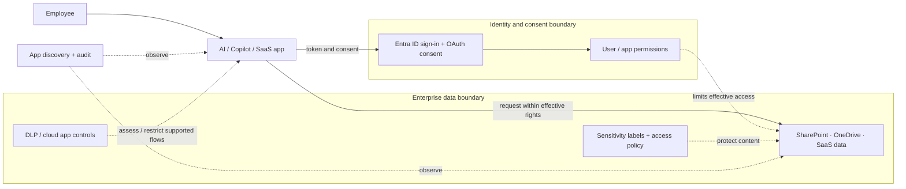
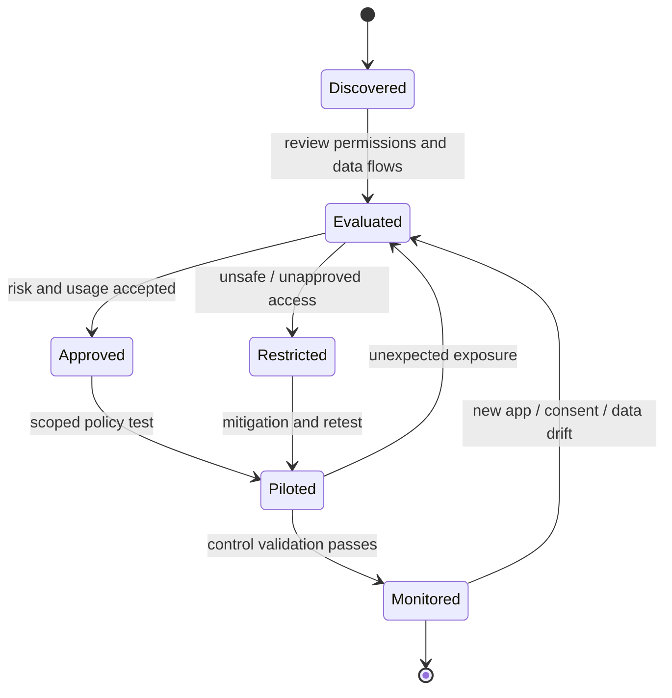

# Microsoft 365 Zero Trust – Secure AI Apps & Data

> **IP-08 | Repeatable Service Package**

**ผลลัพธ์ที่มุ่งหวัง:** ประเมินและจำกัดความเสี่ยงจาก AI Apps/Copilot และการเข้าถึงข้อมูลบน Microsoft 365

## เมื่อใดควรใช้บริการนี้

- มีการใช้ AI/Copilot และ OAuth Apps แต่ยังไม่เห็นเส้นทางเข้าถึงข้อมูลองค์กร
- กังวล Oversharing, Consent และการนำข้อมูลอ่อนไหวออกนอกขอบเขต
- ต้องการ Policy Pilot ที่ไม่กระทบการใช้งานเกินจำเป็น

## Decisions & Outcomes

- ระบุ AI Apps, Permissions และ Data Exposure ที่ต้องจัดการก่อน
- เชื่อม Risk กับ DLP, Labels และ App Controls ที่ใช้ได้ตาม License
- เห็นผล Pilot และรายการงานที่ต้องดำเนินการเพิ่มเติม

## Scope

ทบทวน AI/Copilot Usage, Enterprise/OAuth Apps, Data Exposure, DLP, Sensitivity Labels และ Cloud App Controls โดย Pilot การบังคับใช้นโยบายที่เลือก

## Architecture Mental Model

**System question:** What can an AI app see, and which controls constrain that access?

## Standard Delivery

1. Discover AI Apps, Copilot Use Cases และ Data Flows
2. Assess App Permissions และ Data Exposure Risks
3. ออกแบบ DLP/Label/App Control Priority Policies
4. Implement/Pilot Agreed Controls
5. Validate และจัดทำ Usage/Security Guidance

## Deliverables

AI App/Data Risk Assessment, Policy Matrix, Pilot Control Evidence และ Action Plan

## Engineering Assurance

- AI App ไม่ควรได้ Effective Access เกินสิทธิ์ที่องค์กรอนุมัติ
- การป้องกันต้องเริ่มจาก Data Ownership และ Permissions ต้นทาง ไม่ใช่ AI Layer อย่างเดียว

**Failure & Recovery:** หากพบ Consent หรือ Data Flow เสี่ยง ให้จำกัดการเข้าถึงตามขั้นตอนและตรวจสอบข้อมูลที่ได้รับผลกระทบก่อนเปิดใช้ต่อ

### State & Decision Model

## Assumptions & Boundaries

เน้น Assessment และ Selected Controls ไม่รวม Full Tenant Rollout; ฟีเจอร์ขึ้นกับ License

*Conceptual model only; detailed execution and estimates are maintained separately.*

## ก่อนเริ่มงาน

เตรียม AI Apps/OAuth App Inventory, Data Classification, Existing DLP Policies และ Risk Owners

## พูดคุยขอบเขตงาน

หากองค์กรกำลังเผชิญปัญหาข้างต้น สามารถส่งภาพรวมระบบ จำนวน Workloads หรือ Accounts ที่เกี่ยวข้อง และผลลัพธ์ที่ต้องการ เพื่อร่วมกันกำหนด Scope และเกณฑ์รับมอบก่อนเริ่มงาน

**[ติดต่อทีม In the Cloud](mailto:info@inthecloud.co.th?subject=Service%20IP-08)**

---

*Architecture และ State Models เป็นภาพเชิงแนวคิด ไม่ใช่ Production Topology ของลูกค้ารายใด*

