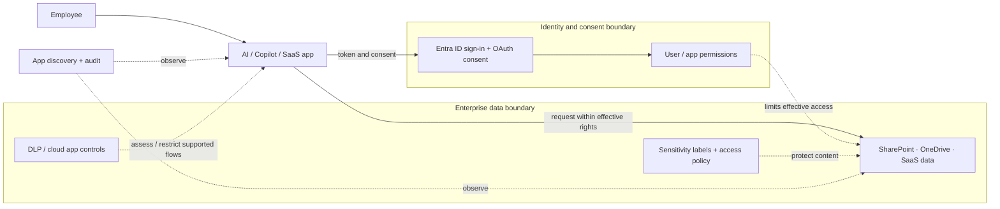

# Microsoft 365 Zero Trust – Secure AI Apps & Data

*Reusable technical service package*

## Overview

ประเมินและจำกัดความเสี่ยงจาก AI Apps/Copilot และการเข้าถึงข้อมูลบน Microsoft 365

## Scope

ทบทวน AI/Copilot Usage, Enterprise/OAuth Apps, Data Exposure, DLP, Sensitivity Labels และ Cloud App Controls โดย Pilot การบังคับใช้นโยบายที่เลือก

## Architecture Mental Model

**System question:** What can an AI app see, and which controls constrain that access?

## Standard Delivery

1. Discover AI Apps, Copilot Use Cases และ Data Flows
2. Assess App Permissions และ Data Exposure Risks
3. ออกแบบ DLP/Label/App Control Priority Policies
4. Implement/Pilot Agreed Controls
5. Validate และจัดทำ Usage/Security Guidance

## Deliverables

AI App/Data Risk Assessment, Policy Matrix, Pilot Control Evidence และ Action Plan

## Expected Outcome

ส่งมอบ Risks, Policy Matrix และหลักฐานทดสอบ Pilot พร้อมรายการข้อจำกัดและ Next Actions

## Boundary

เน้น Assessment และ Selected Controls ไม่รวม Full Tenant Rollout; ฟีเจอร์ขึ้นกับ License

*Conceptual model only; detailed execution and estimates are maintained separately.*
