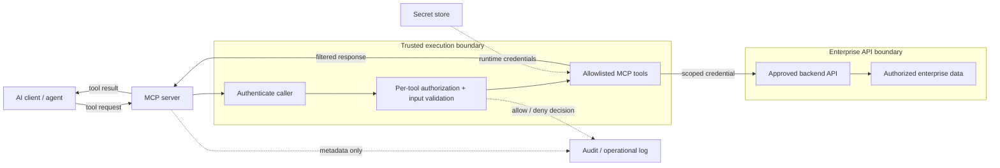

# Enterprise MCP Server Implementation & Integration

*Reusable technical service package*

## Overview

ออกแบบและพัฒนา MCP Server เพื่อให้ AI Clients เรียกใช้งาน Enterprise APIs/ข้อมูลที่ได้รับอนุญาต

## Scope

สร้าง MCP Server, Tools, Authentication/Authorization, Secrets/Logging และ Deployment สำหรับ Use Case ที่ตกลง โดยใช้ Enterprise API หรือ Data Source ที่มีอยู่

## Architecture Mental Model

**System question:** How is a natural-language tool request bounded before it reaches enterprise data?

## Standard Delivery

1. กำหนด Use Case, Tool Contract และ API/Data Source
2. ออกแบบ MCP Architecture และ Access Control
3. พัฒนา MCP Server และ Tools ตาม Scope
4. Deploy, ตั้งค่า Logging/Secrets และ Functional/Security Test
5. จัดทำ Runbook และ Knowledge Transfer

## Deliverables

MCP Server & Selected Tools, Test Evidence, Configuration/Deployment Guide

## Expected Outcome

มี MCP Tools ที่ผ่านการทดสอบการทำงานและสิทธิ์ใช้งานตาม Test Cases พร้อม Deployment Guide

## Boundary

ประมาณการ 6 วันสำหรับ 1 Data Source/API ที่พร้อมใช้ และไม่เกิน 3 Tools; ไม่รวมสร้าง Backend API ใหม่หรือ HA

*Conceptual model only; detailed execution and estimates are maintained separately.*
