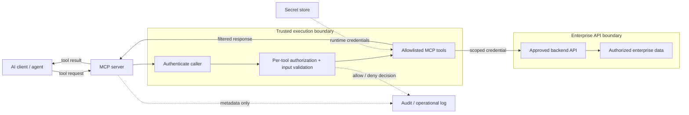
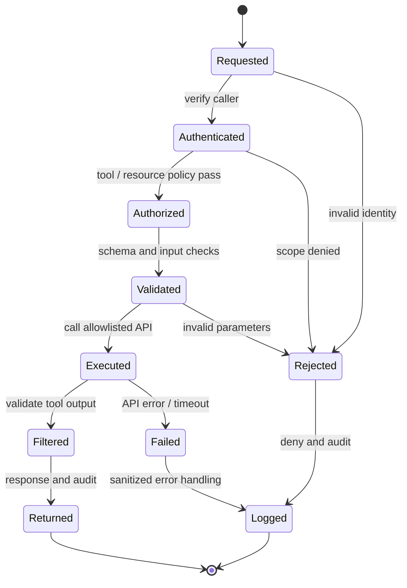

# Enterprise MCP Server Implementation & Integration

> **IP-09 | Repeatable Service Package**

**ผลลัพธ์ที่มุ่งหวัง:** ออกแบบและพัฒนา MCP Server เพื่อให้ AI Clients เรียกใช้งาน Enterprise APIs/ข้อมูลที่ได้รับอนุญาต

## เมื่อใดควรใช้บริการนี้

- ต้องการให้ AI Clients เรียกใช้งาน Enterprise Systems ผ่านเครื่องมือที่กำหนด
- กังวลว่า Tool Calls อาจข้าม Authorization หรือเปิดเผยข้อมูลผิด Scope
- ต้องการตัวอย่าง Integration ที่ตรวจสอบ Security และ Operations ได้

## Scope

สร้าง MCP Server, Tools, Authentication/Authorization, Secrets/Logging และ Deployment สำหรับ Use Case ที่ตกลง โดยใช้ Enterprise API หรือ Data Source ที่มีอยู่

## Architecture Mental Model

**System question:** How is a natural-language tool request bounded before it reaches enterprise data?

## Standard Delivery

1. กำหนด Use Case, Tool Contract และ API/Data Source
2. ออกแบบ MCP Architecture และ Access Control
3. พัฒนา MCP Server และ Tools ตาม Scope
4. Deploy, ตั้งค่า Logging/Secrets และ Functional/Security Test
5. จัดทำ Runbook และ Knowledge Transfer

## Deliverables

MCP Server & Selected Tools, Test Evidence, Configuration/Deployment Guide

## Decisions & Outcomes

- มี MCP Architecture และ Tool Contracts ที่ชัดเจน
- ยืนยันสิทธิ์ของ Caller/Tool/Backend ก่อนลงมือเชื่อมต่อจริง
- ได้รับ MCP Server, Test Evidence และ Deployment Guidance ในขอบเขตที่ตกลง

## Engineering Assurance

- ทุก Tool Call ต้องตรวจ Caller, Tool Scope และ Resource Authorization
- Untrusted Tool Output ไม่สามารถขยายสิทธิ์หรือแทนที่นโยบายได้

**Failure & Recovery:** หากคำขอไม่ผ่าน Authentication, Authorization หรือ Validation ให้ปฏิเสธก่อนเข้าถึง Backend และบันทึกเหตุการณ์อย่างเหมาะสม

### State & Decision Model

## Assumptions & Boundaries

ประมาณการ 6 วันสำหรับ 1 Data Source/API ที่พร้อมใช้ และไม่เกิน 3 Tools; ไม่รวมสร้าง Backend API ใหม่หรือ HA

*Conceptual model only; detailed execution and estimates are maintained separately.*

## Preparing for an Assessment

กำหนดระบบและผู้รับผิดชอบที่เกี่ยวข้อง พร้อมข้อกำหนดการเข้าถึงและ Change Window เพื่อยืนยัน Scope, Validation และ Acceptance Criteria ก่อนเริ่มงาน

---
*Architecture และ State Models เป็นแบบจำลองเชิงแนวคิด ไม่ใช่ Production Topology ขององค์กรใดองค์กรหนึ่ง*
