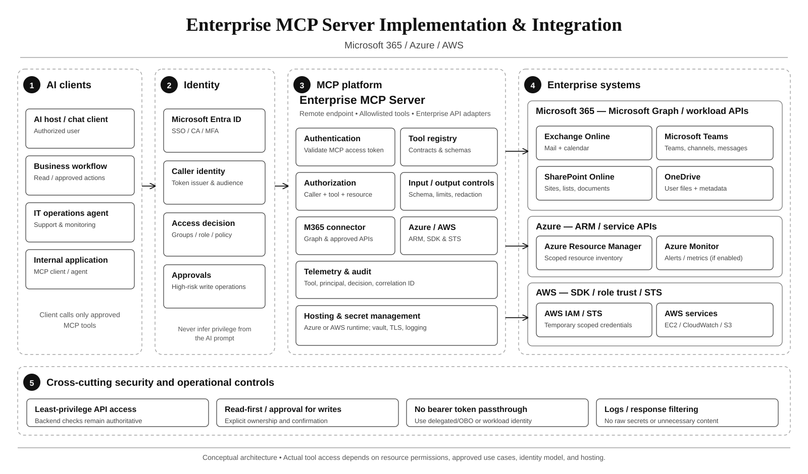
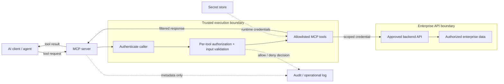
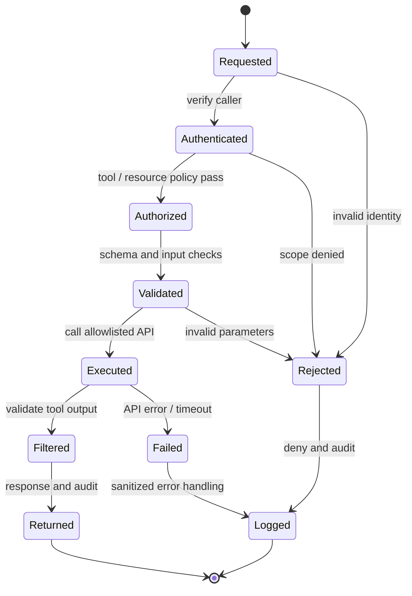

# Enterprise MCP Server Implementation & Integration

> **IP-09 | Repeatable Service Package**

**Expected Outcome:** ออกแบบและพัฒนา MCP Server เพื่อให้ AI Clients เรียกใช้งาน Enterprise APIs/ข้อมูลที่ได้รับอนุญาต

**Customer Brochure:** [Enterprise MCP Server — Microsoft 365, Azure & AWS, 15 Person-Days, Scope, Tools & Deliverables](brochures/ip-09-enterprise-mcp-server.md)

**Architecture Diagram:** [Black-and-white Enterprise MCP Architecture (SVG)](../assets/diagrams/ip-09-enterprise-mcp-architecture.svg)

## When to Engage

- ต้องการให้ AI Clients เรียกใช้งาน Enterprise Systems ผ่านเครื่องมือที่กำหนด
- กังวลว่า Tool Calls อาจข้าม Authorization หรือเปิดเผยข้อมูลผิด Scope
- ต้องการตัวอย่าง Integration ที่ตรวจสอบ Security และ Operations ได้

## Decisions & Outcomes

- มี MCP Architecture และ Tool Contracts ที่ชัดเจน
- ยืนยันสิทธิ์ของ Caller/Tool/Backend ก่อนลงมือเชื่อมต่อจริง
- ได้รับ MCP Server, Test Evidence และ Deployment Guidance ในขอบเขตที่ตกลง

## Scope

สร้าง MCP Server, Tools, Authentication/Authorization, Secrets/Logging และ Deployment สำหรับ Use Case ที่ตกลง โดยใช้ Enterprise API หรือ Data Source ที่มีอยู่

**Reference Pilot:** 15 Person-Days, 1 Microsoft 365 Tenant, 1 Azure Subscription, 1 AWS Account, MCP Tools ไม่เกิน 8 รายการ, Primary Hosting 1 Environment และ Read-only Operations เป็นค่าเริ่มต้น โดยมี Prerequisites และ Permissions พร้อมใช้งาน

### Target Enterprise Integrations

| Workload | Example MCP Tools | Backend Permission Boundary |
|---|---|---|
| **Exchange Online** | Search Mail, List Calendar Events | Microsoft Graph Delegated/OBO หรือ Workload-scoped App Identity, Exchange Application RBAC เมื่อเกี่ยวข้อง |
| **Microsoft Teams** | List Authorized Teams/Channels, Approved Message Reads | Graph/Teams API limitations, per-user/team permission, RSC เมื่อเกี่ยวข้อง |
| **SharePoint Online** | List Documents on Approved Site | Graph, Sites.Selected/Selected Operations และ SharePoint Resource Permissions |
| **OneDrive for Business** | List User Files/Metadata | Graph Delegated Identity and Drive/File Permissions |
| **Azure** | Resource Inventory, Azure Monitor Alerts | Azure Resource Manager/SDK and Azure RBAC Resource Scope |
| **AWS** | EC2 Inventory, CloudWatch Alarm List | AWS SDK with IAM Role Trust and STS Temporary Credentials |

**Read before Write:** ส่ง Mail, Post Teams Messages, Delete/Modify Files, Stop VMs และ Change Cloud Access ไม่เปิดเป็น Default; ต้องเพิ่ม Human Approval, Business Authorization, Idempotency และ Negative Tests ตาม SOW

## Delivery Scope & Key Decisions

| Area | Engineering Decision | Example Outcome |
|---|---|---|
| Use Case & Tool Contract | จำนวน Tools, Read/Write Sensitivity, JSON Schemas และ Data Owner | Approved Tool Catalog |
| Transport & Hosting | Local STDIO vs Remote Streamable HTTP, TLS, Hosting, Network Boundary | Supported Deployment Topology |
| Caller Authentication | Identity Provider, Token Issuer, Audience, Lifetime, Scope | Authentication Contract |
| Authorization | Per-tool **และ per-resource** policy, user delegation vs app identity | Principal-to-Tool/Resource Matrix |
| Enterprise API Boundary | Approved Backend, Error Handling, Timeouts, Idempotency, Rate Limits | Backend Integration Contract |
| Data & Operations | Secrets Vault, Data Minimization, Audit Correlation, Logging Retention, Monitoring | Audit & Operations Runbook |

**Security Design:** อย่าให้ AI Client หรือ Tool Descriptions เป็นผู้ตัดสินว่าผู้ใช้เข้าถึงข้อมูลได้หรือไม่ ทุก Tool Invocation ต้องตรวจ Authoritative Policy ฝั่ง Server และ Backend และต้องไม่ใช้ Untrusted Tool Output เป็นคำสั่งให้ขยายสิทธิ์

### Example Tool Access Controls

| Tool (Example) | Operation | Allowed Condition | Denied Scenario |
|---|---|---|---|
| `search_policy` | Read | Caller มี Read Scope และ Knowledge Domain Access | No Scope / Cross-domain |
| `get_case_status` | Read | Caller มีสิทธิ์ต่อ Case ID ที่ระบุ | Cross-tenant / Cross-owner |
| `create_case` | Write | Caller มี Write Scope, ผ่าน Schema/Business Validation | Read-only Caller / Invalid Parameters |

**Authentication Boundary:** MCP HTTP Authorization ตาม Specification แยก Token สำหรับ MCP Server ออกจาก Credential ที่ใช้ Backend API; ไม่ Forward MCP Access Token ไปยัง Backend โดยตรงโดยไม่มีการออกแบบ Delegation ที่ถูกต้อง ทั้งนี้ Local STDIO Transport มีรูปแบบ Credential Handling ต่างจาก HTTP

## Architecture Mental Model

**System question:** How is a natural-language tool request bounded before it reaches enterprise data?

## Standard Delivery

1. **Scope & API Readiness** — ยืนยัน Business Use Cases, Tool Names, Resource/Data Owners, API Contracts, Test Data และ Permission Model
2. **Design & Threat Review** — ออกแบบ Trust Boundary, Token Audience, AuthN/AuthZ, Input/Output Schema, Secrets, Audit และ Safe Error Paths
3. **Build & Integrate** — พัฒนา MCP Server/Tools สำหรับ Backend ที่ตกลง โดยแยก Read-only Operations ออกจาก Stateful/Write Operations
4. **Validate Controls** — ทดสอบ Authorized Calls, Missing Scope, Cross-resource Access, Invalid Tokens, Malformed Input, Injection Attempts และ Failure Handling
5. **Deploy & Handover** — ส่งมอบ Config, Operations/Security Evidence, Recovery Guidance และ Ownership ของ Tools/Endpoints

## Deliverables

MCP Server & Selected Tools, **Tool & Authorization Matrix**, Input/Output Contracts, Functional/Negative Security Test Evidence, Deployment Configuration และ Operations Runbook

**Service-specific Example:** [View Microsoft 365 / Azure / AWS Pilot Outcome — 8 Tools, 12 Test Scenarios](examples/enterprise-mcp-m365-azure-aws-outcome.md)

**Example Deliverable:** [View Sample Enterprise MCP Outcome — 3 Tools, 12 Security Tests](examples/enterprise-mcp-server-outcome.md)

**Test Evidence Example:** [Download 12 fictional Tool Test Cases (CSV)](../assets/examples/enterprise-mcp-test-evidence-demo.csv)

ตัวอย่างแสดงว่า Allowed Calls ถูกอนุญาตตามสิทธิ์ และ Unauthorized/Invalid Calls ถูกปฏิเสธหรือจัดการด้วย Error Handling ที่ปลอดภัย

## Engineering Assurance

- ทุก Tool Call ต้องตรวจ Caller, Tool Scope และ Resource Authorization
- Untrusted Tool Output ไม่สามารถขยายสิทธิ์หรือแทนที่นโยบายได้

- HTTP-based MCP ที่เปิด Authorization ต้อง Validate Token Issuer, Audience, Expiry และ Scopes ตาม Design; อาจต้องใช้ OAuth Protected Resource Metadata ตาม Protocol Version ที่เลือก
- ห้าม Token Passthrough จาก Caller ไปยัง Backend และห้ามใช้ Shared Backend Privilege เพื่อข้าม Resource-level Authorization
- ควบคุม Write Tools ด้วย Business Authorization, Input Validation, Rate Limit, Idempotency และ Approval ตามความเสี่ยงของ Use Case
- บันทึก Correlation IDs และ Allow/Deny/Error โดยไม่ Log Credentials, Full Tokens หรือเนื้อหาลับที่ไม่จำเป็น
- ทดสอบ Prompt Injection/Untrusted Tool Output และ Unsafe URI/Redirect Flows ตาม Threat Model; การทดสอบผ่านไม่ใช่หลักประกันว่าป้องกันการโจมตีได้ทั้งหมด

**Failure & Recovery:** หากคำขอไม่ผ่าน Authentication, Authorization หรือ Validation ให้ปฏิเสธก่อนเข้าถึง Backend และบันทึกเหตุการณ์อย่างเหมาะสม

### State & Decision Model

## Assumptions & Boundaries

จำนวน Tools, API Integrations, Auth Model, Hosting, Security Review และ Deployment Stages ต้องตกลงก่อนประเมิน Effort; ไม่รวมสร้าง Backend Business API ใหม่, Full-scale Data Migration, 24/7 Operations หรือ High Availability โดยอัตโนมัติ

การทำ Production Write Tools, Data Classification/Privacy Controls และ Identity Provider Integration อาจต้องมี Approval หรือ License เพิ่มตาม Environment

*Conceptual model only; detailed execution and estimates are maintained separately.*

## Acceptance & Operational Handover

- ทุก Tool มี Owner, Description, Schema, Read/Write Classification, Allowed Principals และ Denied Cases
- Positive Tests พิสูจน์ว่า Authorized Operations ทำงานได้ และ Negative Tests พิสูจน์ว่า Unauthorized Operations ไม่ไปถึง Backend
- มี Error/Timeout Handling, Audit Correlation, Secrets Protection และ Recovery/Disable Route
- Operations Team รับมอบ Deployment Configuration, Monitoring, Security Findings และ Open Risks

## References

- [Model Context Protocol — Authorization Specification](https://modelcontextprotocol.io/specification/2025-11-25/basic/authorization)
- [Model Context Protocol — Security Best Practices](https://modelcontextprotocol.io/docs/2025-11-25/tutorials/security/security_best_practices)

## Getting Started

เตรียม Use Cases, API Specifications, Data Owners, Authentication Requirements และ Hosting Environment

## Discuss Your Project Scope

หากองค์กรกำลังเผชิญปัญหาข้างต้น สามารถส่งภาพรวมระบบ จำนวน Workloads หรือ Accounts ที่เกี่ยวข้อง และผลลัพธ์ที่ต้องการ เพื่อร่วมกันกำหนด Scope และเกณฑ์รับมอบก่อนเริ่มงาน

**[ติดต่อทีม In the Cloud](mailto:info@inthecloud.co.th?subject=Service%20IP-09)**

---

*Architecture และ State Models เป็นภาพเชิงแนวคิด ไม่ใช่ Production Topology ของลูกค้ารายใด*

