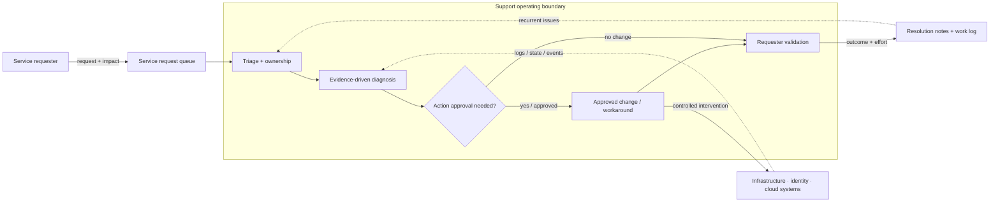

# Professional Support

*Reusable technical service package*

## Overview

บริการให้คำปรึกษาและแก้ไขปัญหาระบบ Infrastructure, Identity, Microsoft 365 และ Cloud ตามที่ร้องขอ

## Scope

Architecture/Design Review, Troubleshooting, Security Advisory, Configuration Review, Change Support, Health Check และ Knowledge Transfer ตาม Service Requests ที่ตกลง

## Architecture Mental Model

**System question:** How does a reported symptom become a verified system outcome without bypassing ownership?

## Standard Delivery

1. รับและจัดลำดับ Service Requests
2. วิเคราะห์ Incident/Problem และให้ Technical Recommendation
3. Review/Support การเปลี่ยนแปลง Configuration
4. บันทึก Effort, ผลดำเนินงาน และ Knowledge Transfer

## Deliverables

Work Log/Time Sheet, Technical Findings และ Recommendation ตามงานที่ดำเนินการ

## Expected Outcome

มี Service Records, Time Sheet และ Findings/Recommendations สำหรับคำขอที่ดำเนินการในรอบ

## Boundary

บริการตามการใช้จริงภายใน 100 ชั่วโมง (เทียบเท่า 12.5 Man-days); ไม่รวม 24×7 On-call หรือ Guaranteed SLA

*Conceptual model only; detailed execution and estimates are maintained separately.*
