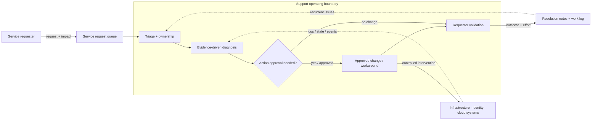
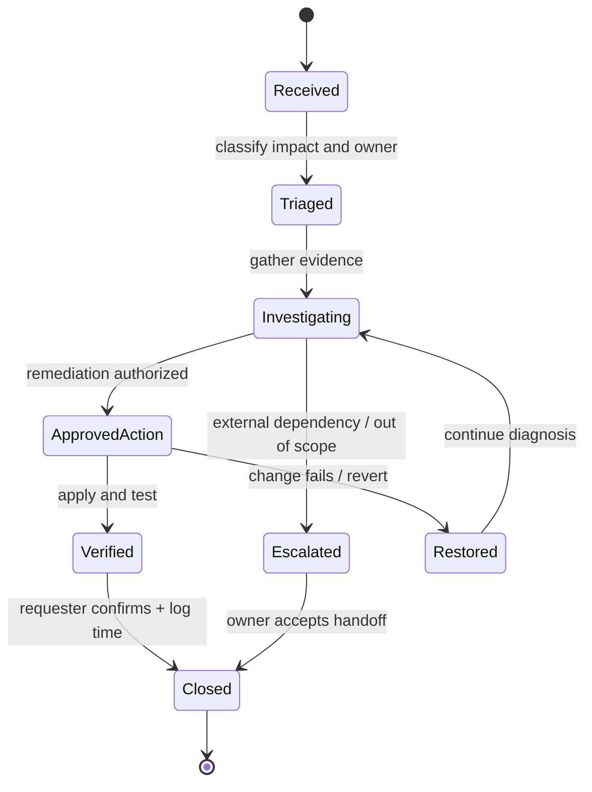

# Professional Support

> **IP-10 | Repeatable Service Package**

**ผลลัพธ์ที่มุ่งหวัง:** บริการให้คำปรึกษาและแก้ไขปัญหาระบบ Infrastructure, Identity, Microsoft 365 และ Cloud ตามที่ร้องขอ

## เมื่อใดควรใช้บริการนี้

- ทีมดูแลระบบต้องการกำลังเสริมในการวิเคราะห์ปัญหาที่ข้ามหลาย Technology Domains
- มี Change, Health Check หรือ Architecture Decision ที่ต้องการ Second Opinion
- ต้องการบันทึกงานและการส่งต่อความรู้ที่ติดตามได้

## Scope

Architecture/Design Review, Troubleshooting, Security Advisory, Configuration Review, Change Support, Health Check และ Knowledge Transfer ตาม Service Requests ที่ตกลง

## Architecture Mental Model

**System question:** How does a reported symptom become a verified system outcome without bypassing ownership?

## Standard Delivery

1. รับและจัดลำดับ Service Requests
2. วิเคราะห์ Incident/Problem และให้ Technical Recommendation
3. Review/Support การเปลี่ยนแปลง Configuration
4. บันทึก Effort, ผลดำเนินงาน และ Knowledge Transfer

## Deliverables

Work Log/Time Sheet, Technical Findings และ Recommendation ตามงานที่ดำเนินการ

## Decisions & Outcomes

- มี Findings และแนวทางแก้ปัญหาที่เชื่อมกับ Evidence
- ได้รับ Engineering Support และผลทดสอบหลังดำเนินการตาม Request
- มี Work Log และ Handover สำหรับงานที่ดำเนินการ

## Engineering Assurance

- ทุก Production Change ต้องมี Approval ตามกระบวนการองค์กร
- Escalation และ Resolution ต้องแยกสถานะกันอย่างชัดเจน

**Failure & Recovery:** หากไม่มี Access หรือ Authorization ที่เหมาะสม จะส่งต่อ Owner ที่รับผิดชอบพร้อม Evidence ไม่ดำเนินการเปลี่ยนแปลงโดยพลการ

### State & Decision Model

## Assumptions & Boundaries

บริการตามการใช้จริงภายใน 100 ชั่วโมง (เทียบเท่า 12.5 Man-days); ไม่รวม 24×7 On-call หรือ Guaranteed SLA

*Conceptual model only; detailed execution and estimates are maintained separately.*

## ก่อนเริ่มงาน

เตรียม Service Requests, Impact/Priority, เจ้าของระบบ และช่องทางอนุมัติ Change

---
*Architecture และ State Models เป็นแบบจำลองเชิงแนวคิด ไม่ใช่ Production Topology ขององค์กรใดองค์กรหนึ่ง*
