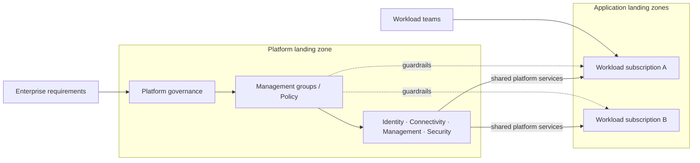

# Azure Landing Zones — Design & Implementation

*Reusable technical service package*

## Overview

ออกแบบและวางรากฐาน Azure ให้ Workload Teams นำระบบขึ้นใช้งานได้ภายใต้ Governance, Security, Connectivity และ Operations ที่กำหนดร่วมกัน

## Scope

ครอบคลุม Platform Landing Zone, Management Group / Subscription Topology, Identity & RBAC, Azure Policy, Connectivity, Logging/Monitoring, Security Baseline, IaC และ Application Landing Zone Pattern ตามขอบเขตที่ตกลง

## Architecture Mental Model

**Question:** How do platform guardrails enable independent workload teams?

## Standard Delivery

1. **Discover design areas** — ยืนยัน Tenant/Billing, Operating Model, Security, Connectivity, Subscription และ Workload Requirements
2. **Design the target foundation** — กำหนด Management Group Hierarchy, Platform/Application Landing Zones, RBAC, Policy และ Network Topology
3. **Define automation** — เลือก Azure Verified Modules / Bicep / Terraform ตามข้อกำหนด และออกแบบ deployment workflow
4. **Implement agreed platform scope** — ติดตั้ง Foundation Modules และ Shared Services ภายใต้ Change Control
5. **Validate and hand over** — ทดสอบ Subscription Onboarding, Policy Assignments, Access, Network Paths และ Operations Handover

## Deliverables

Landing Zone Architecture & Decision Record, Platform IaC/Configuration, Policy & RBAC Matrix, Validation Evidence และ Operational Handover

## Expected Outcome

ได้ Cloud Foundation และ Workload Onboarding Pattern สำหรับการขยาย Azure อย่างมีมาตรฐาน

## Boundary

ไม่รวมการย้ายทุก Application หรือค่าใช้จ่ายทรัพยากร Azure; จำนวน Subscriptions, Regions, Connectivity และ Shared Services ต้องตกลงก่อนประมาณงาน

## References

- [Azure landing zone design areas](https://learn.microsoft.com/en-us/azure/cloud-adoption-framework/ready/landing-zone/design-areas)
- [Azure landing zone concepts](https://learn.microsoft.com/en-us/azure/cloud-adoption-framework/ready/landing-zone/)
