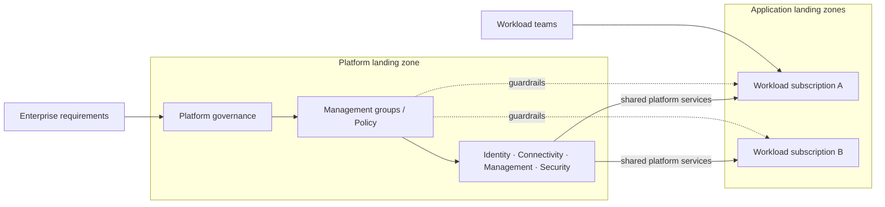
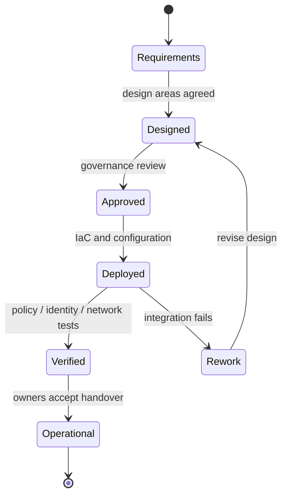

# Azure Landing Zones — Design & Implementation

> **IP-11 | Repeatable Service Package**

**Expected Outcome:** ออกแบบและวางรากฐาน Azure ให้ Workload Teams นำระบบขึ้นใช้งานได้ภายใต้ Governance, Security, Connectivity และ Operations ที่กำหนดร่วมกัน

## When to Engage

- กำลังเริ่มหรือขยาย Azure แต่ยังไม่มี Governance และ Subscription Standard
- หลายทีมต้องใช้ Network, Identity, Security และ Monitoring ร่วมกัน
- ต้องการ Foundation ที่สร้างซ้ำและรองรับ Workload Onboarding ได้

## Decisions & Outcomes

- กำหนด Platform vs Application Landing Zone Ownership ชัดเจน
- มี Policy, RBAC, Connectivity และ IaC Foundation ตาม Scope
- รู้กระบวนการ Onboard Workloads โดยไม่ข้าม Guardrails

## Scope

ครอบคลุม Platform Landing Zone, Management Group / Subscription Topology, Identity & RBAC, Azure Policy, Connectivity, Logging/Monitoring, Security Baseline, IaC และ Application Landing Zone Pattern ตามขอบเขตที่ตกลง

## Architecture Mental Model

**Question:** How do platform guardrails enable independent workload teams?

## Standard Delivery

1. **Discover design areas** — ยืนยัน Tenant/Billing, Operating Model, Security, Connectivity, Subscription และ Workload Requirements
2. **Design the target foundation** — กำหนด Management Group Hierarchy, Platform/Application Landing Zones, RBAC, Policy และ Network Topology
3. **Define automation** — เลือก Azure Verified Modules / Bicep / Terraform ตามข้อกำหนด และออกแบบ deployment workflow
4. **Implement agreed platform scope** — ติดตั้ง Foundation Modules และ Shared Services ภายใต้ Change Control
5. **Validate and hand over** — ทดสอบ Subscription Onboarding, Policy Assignments, Access, Network Paths และ Operations Handover

## Deliverables

Landing Zone Architecture & Decision Record, Platform IaC/Configuration, Policy & RBAC Matrix, Validation Evidence และ Operational Handover

## Engineering Assurance

- กำหนด Platform Controls ก่อนอนุญาตให้ Workload Teams ขยายการใช้งาน
- ทดสอบ Network, Access และ Policy ในวงจำกัดก่อนใช้จริง

**Failure & Recovery:** หาก Policy หรือ Connectivity ที่เพิ่มกระทบ Workloads ให้หยุด Rollout และแก้ไข Assignment/Configuration ภายใต้ Change Control

### State & Decision Model

## Assumptions & Boundaries

ไม่รวมการย้ายทุก Application หรือค่าใช้จ่ายทรัพยากร Azure; จำนวน Subscriptions, Regions, Connectivity และ Shared Services ต้องตกลงก่อนประมาณงาน

## Getting Started

เตรียม Azure Tenant/Subscription Model, Network/DNS Requirements, Security Policies และทีม Platform Owner

## Discuss Your Project Scope

หากองค์กรกำลังเผชิญปัญหาข้างต้น สามารถส่งภาพรวมระบบ จำนวน Workloads หรือ Accounts ที่เกี่ยวข้อง และผลลัพธ์ที่ต้องการ เพื่อร่วมกันกำหนด Scope และเกณฑ์รับมอบก่อนเริ่มงาน

**[ติดต่อทีม In the Cloud](mailto:info@inthecloud.co.th?subject=Service%20IP-11)**

## References

- [Azure landing zone design areas](https://learn.microsoft.com/en-us/azure/cloud-adoption-framework/ready/landing-zone/design-areas)
- [Azure landing zone concepts](https://learn.microsoft.com/en-us/azure/cloud-adoption-framework/ready/landing-zone/)

---

*Architecture และ State Models เป็นภาพเชิงแนวคิด ไม่ใช่ Production Topology ของลูกค้ารายใด*

