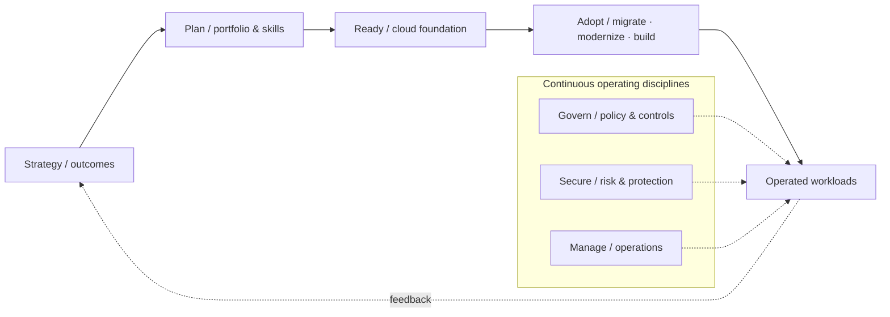
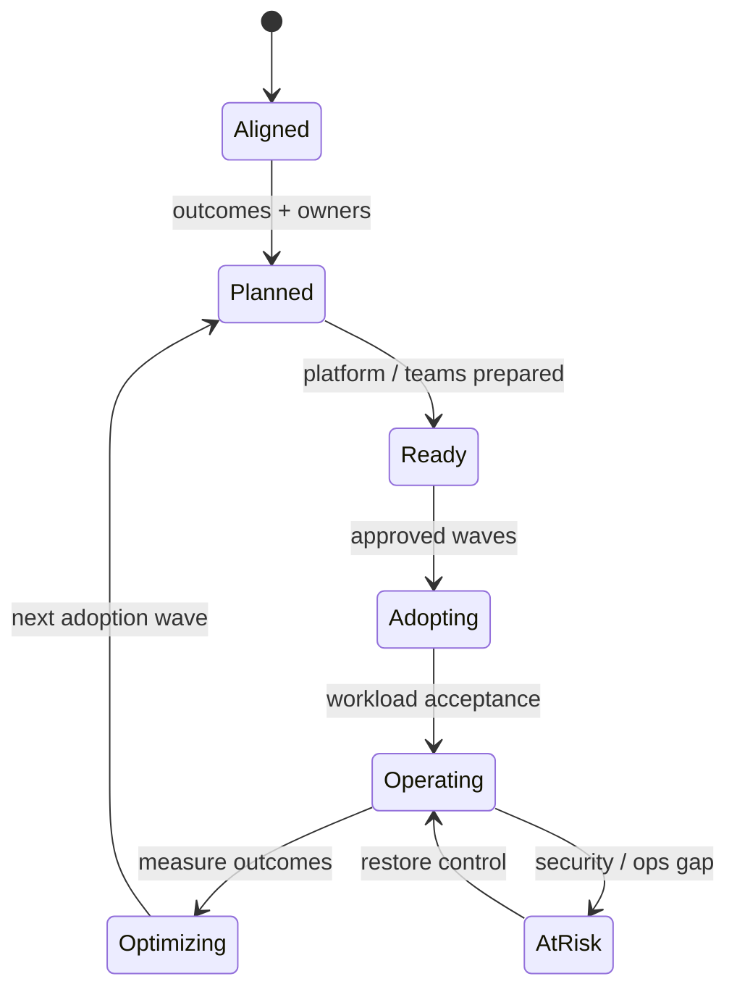

# Azure Cloud Adoption Framework — End-to-End Adoption Program

> **IP-12 | Repeatable Service Package**

**ผลลัพธ์ที่มุ่งหวัง:** ใช้ Microsoft Cloud Adoption Framework (CAF) ทั้ง 7 Methodologies เพื่อเชื่อม Business Outcomes กับการวางแผน Cloud, Platform Foundation, Workload Adoption และการดำเนินงานระยะยาว

## When to Engage

- ต้องการขับเคลื่อน Cloud Adoption แต่มีเพียงแผนย้ายเครื่องโดยยังขาด Business Outcomes
- แต่ละฝ่ายมี Cloud Decisions ที่ไม่สอดคล้องกันทั้ง Security, Finance และ Operations
- ต้องจัด Priorities และ Operating Model ให้รองรับการเติบโตหลายระยะ

## Decisions & Outcomes

- ได้ Roadmap ครบ Strategy, Plan, Ready, Adopt, Govern, Secure และ Manage
- ทราบ Decision Owners, Dependencies และ Readiness Gates
- วัด Adoption ด้วย Business & Operational Outcomes ไม่ใช่จำนวน VM ที่ย้าย

## Scope

ครอบคลุม Strategy, Plan, Ready, Adopt, Govern, Secure และ Manage; กำหนด Operating Model, Ownership, Workload Portfolio, Wave Plan, Landing Zone, Migration/Modernization Path, Governance, Security และ Day-2 Operations

## Architecture Mental Model

**Question:** How does business intent become operated cloud outcomes?

## Standard Delivery

1. **Strategy** — ยืนยัน Business Drivers, Target Outcomes, Stakeholders และ Business Case Assumptions
2. **Plan** — ประเมิน Portfolio, Skills, Dependencies, Workload Prioritization, Operating Model และ Adoption Backlog
3. **Ready** — กำหนด Azure Landing Zone Readiness, Identity, Network, Governance และ Foundation Gaps
4. **Adopt** — วางแผนและดำเนินการ Migration/Modernization/Cloud-native ใน Waves ที่ตกลง
5. **Govern** — ออกแบบ Policy, Ownership, Cost Governance และ Change/Compliance Controls
6. **Secure** — กำหนด Identity, Threat Protection, Data Protection, Detection และ Incident Readiness
7. **Manage** — ออกแบบ Monitoring, Reliability, Backup/DR, Change/Incident/Problem, FinOps และ Service Ownership

## Deliverables

Cloud Adoption Strategy, Portfolio & Wave Plan, Operating Model/RACI, Landing Zone Readiness, Governance & Security Framework, Day-2 Operations Model และ Multi-wave Roadmap

## Engineering Assurance

- Govern, Secure และ Manage ต้องดำเนินควบคู่กับ Adoption Waves
- Workload จะถือว่า Adopted เมื่อมีเจ้าของ Operations และ Acceptance ชัดเจน

**Failure & Recovery:** หาก Workload พร้อมเชิงเทคนิคแต่ขาด Operational Ownership ให้หยุดการรับมอบและแก้ RACI, Controls และ Runbook ก่อน Go-live

### State & Decision Model

## Assumptions & Boundaries

เป็น Program แบบ Iterative / Multi-workstream; คำว่า End-to-End หมายถึงครอบคลุมทั้ง 7 Methodologies ไม่ใช่รับประกันย้ายทุก Workload ในโครงการเดียว ระยะเวลาและ Implementation Scope ประเมินตาม Portfolio

## Getting Started

เตรียม Business Outcomes, Application Portfolio, Decision Makers, Platform Owners และ Operating Model ปัจจุบัน

## Discuss Your Project Scope

หากองค์กรกำลังเผชิญปัญหาข้างต้น สามารถส่งภาพรวมระบบ จำนวน Workloads หรือ Accounts ที่เกี่ยวข้อง และผลลัพธ์ที่ต้องการ เพื่อร่วมกันกำหนด Scope และเกณฑ์รับมอบก่อนเริ่มงาน

**[ติดต่อทีม In the Cloud](mailto:info@inthecloud.co.th?subject=Service%20IP-12)**

## References

- [Cloud Adoption Framework overview](https://learn.microsoft.com/en-us/azure/cloud-adoption-framework/overview)

---

*Architecture และ State Models เป็นภาพเชิงแนวคิด ไม่ใช่ Production Topology ของลูกค้ารายใด*

