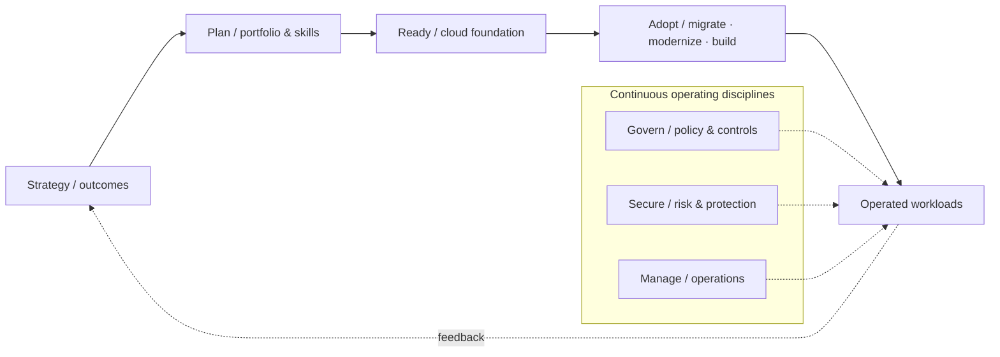

# Azure Cloud Adoption Framework — End-to-End Adoption Program

*Reusable technical service package*

## Overview

ใช้ Microsoft Cloud Adoption Framework (CAF) ทั้ง 7 Methodologies เพื่อเชื่อม Business Outcomes กับการวางแผน Cloud, Platform Foundation, Workload Adoption และการดำเนินงานระยะยาว

## Scope

ครอบคลุม Strategy, Plan, Ready, Adopt, Govern, Secure และ Manage; กำหนด Operating Model, Ownership, Workload Portfolio, Wave Plan, Landing Zone, Migration/Modernization Path, Governance, Security และ Day-2 Operations

## Architecture Mental Model

**Question:** How does business intent become operated cloud outcomes?

## Standard Delivery

1. **Strategy** — ยืนยัน Business Drivers, Target Outcomes, Stakeholders และ Business Case Assumptions
2. **Plan** — ประเมิน Portfolio, Skills, Dependencies, Workload Prioritization, Operating Model และ Adoption Backlog
3. **Ready** — กำหนด Azure Landing Zone Readiness, Identity, Network, Governance และ Foundation Gaps
4. **Adopt** — วางแผนและดำเนินการ Migration/Modernization/Cloud-native ใน Waves ที่ตกลง
5. **Govern** — ออกแบบ Policy, Ownership, Cost Governance และ Change/Compliance Controls
6. **Secure** — กำหนด Identity, Threat Protection, Data Protection, Detection และ Incident Readiness
7. **Manage** — ออกแบบ Monitoring, Reliability, Backup/DR, Change/Incident/Problem, FinOps และ Service Ownership

## Deliverables

Cloud Adoption Strategy, Portfolio & Wave Plan, Operating Model/RACI, Landing Zone Readiness, Governance & Security Framework, Day-2 Operations Model และ Multi-wave Roadmap

## Expected Outcome

เกิดแผนงานตลอดวงจร Cloud Adoption ที่เชื่อมตัวชี้วัดทางธุรกิจ การส่งมอบ Workloads และ Operating Model

## Boundary

เป็น Program แบบ Iterative / Multi-workstream; คำว่า End-to-End หมายถึงครอบคลุมทั้ง 7 Methodologies ไม่ใช่รับประกันย้ายทุก Workload ในโครงการเดียว ระยะเวลาและ Implementation Scope ประเมินตาม Portfolio

## References

- [Cloud Adoption Framework overview](https://learn.microsoft.com/en-us/azure/cloud-adoption-framework/overview)
