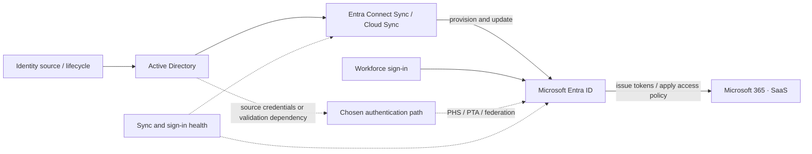

# Hybrid Identity Assessment & Remediation

*Reusable technical service package*

## Overview

ประเมินความถูกต้อง ความปลอดภัย และความต่อเนื่องของ Identity Flow ระหว่าง Active Directory กับ Microsoft Entra ID แล้วแก้ไขความเสี่ยงที่ตกลง

## Scope

ครอบคลุม Entra Connect Sync / Cloud Sync ตามที่ใช้งาน, Sign-in Method (PHS, PTA, Federation), Sync Scope & Attribute Flow, Identity Lifecycle, SSO, Agent/Server Health, Resilience และ Permissions

## Architecture Mental Model

**Question:** How do identities cross the on-premises and cloud trust boundary?

## Standard Delivery

1. **Discover identity topology** — สำรวจ Forests, Source Anchors, Sync Technology, Agent/Server Versions และ Authentication Methods
2. **Review identity lifecycle** — ตรวจสอบ OU/Group/Attribute Scope, Join/Match Rules, Privileges, Provisioning and Deprovisioning
3. **Assess sign-in and resilience** — ตรวจ SSO, Auth Dependencies, Agent Health, Backup/Staging, Monitoring และ Break-glass
4. **Plan & remediate** — จัดลำดับ Findings พร้อม Pilot Changes และ Rollback for scoped controls
5. **Validate** — ทดสอบ Create/Update/Disable, Group & Attribute Sync, Sign-in และ Failure Scenarios

## Deliverables

Hybrid Identity Topology, Identity Flow Matrix, Risk Register, Prioritized Remediation, Pilot Validation และ Handover

## Expected Outcome

ทราบว่าบัญชีถูกสร้าง ซิงก์ ตรวจสอบสิทธิ์ และยกเลิกสิทธิ์อย่างไร พร้อมลด Failure Modes ที่ตรวจพบ

## Boundary

ไม่รวมการย้าย Authentication Method หรือเปลี่ยน Federation ทั้งองค์กรโดยอัตโนมัติ; ต้องผ่าน Dependency Review และ Change Approval

## References

- [Hybrid identity authentication methods](https://learn.microsoft.com/en-us/azure/active-directory/hybrid/choose-ad-authn)
- [Hybrid authentication resilience](https://learn.microsoft.com/en-us/entra/architecture/resilience-in-hybrid)
