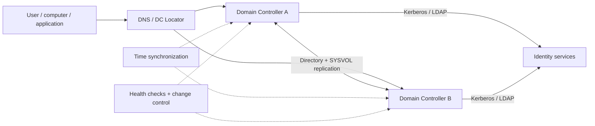

# Active Directory Domain Services Assessment & Remediation

*Reusable technical service package*

## Overview

ประเมิน AD DS ด้าน Health, Security, Resilience และ Operational Readiness พร้อมจัดลำดับ Remediation โดยใช้ข้อมูลจาก Domain Controllers และ Dependencies จริง

## Scope

ครอบคลุม Forest/Domain, Domain Controllers, Replication, DNS, SYSVOL, Sites & Services, Time/Kerberos, FSMO, Privilege Delegation, Legacy Protocol Exposure, Backup/Recovery และ Monitoring ตามขอบเขตที่อนุมัติ

## Architecture Mental Model

**Question:** What must remain consistent for directory authentication to work?

## Standard Delivery

1. **Discover forest and domain topology** — สำรวจ DCs, FSMO, Sites, Replication Links, DNS Zones และ Domain/Forest Functional Levels
2. **Assess health and dependencies** — ตรวจ Replication, DNS/DC Locator, SYSVOL, Time, Events, Backup/Recovery และ Service Dependencies
3. **Assess security and operations** — ตรวจ Privileged Access, Delegation, Legacy Configurations, Hardening และ Monitoring
4. **Prioritize remediation** — จัด Risk & Dependency Register, Change Plan และ Pilot Scope
5. **Remediate and verify** — แก้ไขรายการที่ได้รับอนุมัติ ทดสอบ Auth, Replication, Name Resolution และส่งมอบ Evidence

## Deliverables

AD DS Topology & Health Assessment, Risk Register, Remediation Plan, Change Evidence และ Post-change Validation

## Expected Outcome

ลดความเสี่ยงของ Directory Service Failure และเพิ่มความน่าเชื่อถือของ Authentication / Replication

## Boundary

ไม่รวม Forest/Domain Restructure, Functional Level Upgrade หรือ DC Migration หากไม่ได้กำหนดแยก; การแก้ไขอาจต้องใช้ Maintenance Window

## References

- [AD DS troubleshooting](https://learn.microsoft.com/en-us/windows-server/identity/ad-ds/manage/ad-ds-troubleshooting)
- [DCDIAG command](https://learn.microsoft.com/en-us/windows-server/administration/windows-commands/dcdiag)
