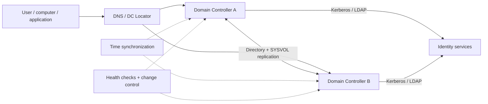
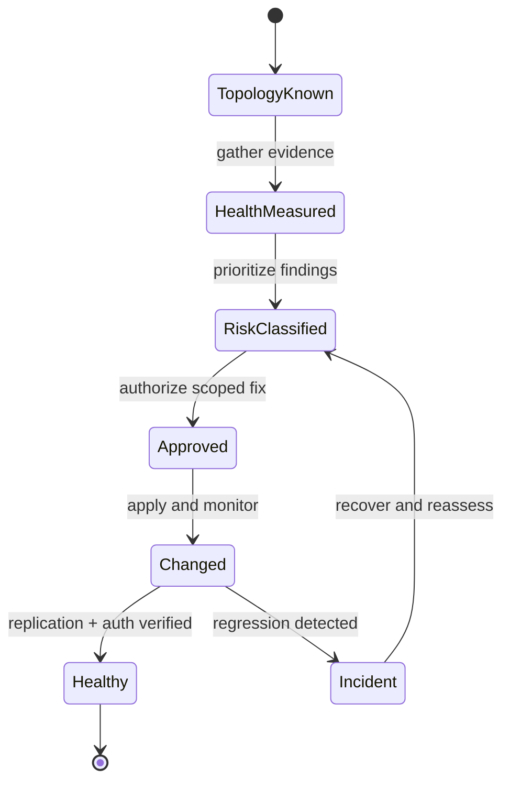

# Active Directory Domain Services Assessment & Remediation

> **IP-14 | Repeatable Service Package**

**Expected Outcome:** ประเมิน AD DS ด้าน Health, Security, Resilience และ Operational Readiness พร้อมจัดลำดับ Remediation โดยใช้ข้อมูลจาก Domain Controllers และ Dependencies จริง

## When to Engage

- AD DS มีปัญหา Replication, DNS/DC Locator หรือ Authentication เป็นระยะ
- ไม่ได้ประเมิน Backup/Restore และ Resilience หลังเปลี่ยนแปลง Domain Controllers
- มี Legacy Settings หรือ Privileged Access ที่ต้องจัดลำดับแก้ไข

## Decisions & Outcomes

- ทราบ Domain/Forest Health และ Root Causes ที่มีหลักฐาน
- เห็น Risk Register และ Remediation Priorities แยกจากสิ่งที่ต้องเปลี่ยนอย่างเร่งด่วน
- ตรวจสอบผล DNS, Replication และ Authentication หลังแก้ไขได้

## Scope

ครอบคลุม Forest/Domain, Domain Controllers, Replication, DNS, SYSVOL, Sites & Services, Time/Kerberos, FSMO, Privilege Delegation, Legacy Protocol Exposure, Backup/Recovery และ Monitoring ตามขอบเขตที่อนุมัติ

## Architecture Mental Model

**Question:** What must remain consistent for directory authentication to work?

## Standard Delivery

1. **Discover forest and domain topology** — สำรวจ DCs, FSMO, Sites, Replication Links, DNS Zones และ Domain/Forest Functional Levels
2. **Assess health and dependencies** — ตรวจ Replication, DNS/DC Locator, SYSVOL, Time, Events, Backup/Recovery และ Service Dependencies
3. **Assess security and operations** — ตรวจ Privileged Access, Delegation, Legacy Configurations, Hardening และ Monitoring
4. **Prioritize remediation** — จัด Risk & Dependency Register, Change Plan และ Pilot Scope
5. **Remediate and verify** — แก้ไขรายการที่ได้รับอนุมัติ ทดสอบ Auth, Replication, Name Resolution และส่งมอบ Evidence

## Deliverables

AD DS Topology & Health Assessment, Risk Register, Remediation Plan, Change Evidence และ Post-change Validation

## Engineering Assurance

- รักษา Directory Availability ระหว่างการแก้ไข Security และ Configuration
- ตรวจสอบ DNS/Network/Time และ Replication ก่อนสรุปว่าเป็นปัญหาที่ Application

**Failure & Recovery:** หาก Replication หรือ Authentication ผิดปกติหลังการเปลี่ยนแปลง ให้หยุดการเปลี่ยนต่อและแก้ไขด้วยขั้นตอน Recovery ที่รองรับ

### State & Decision Model

## Assumptions & Boundaries

ไม่รวม Forest/Domain Restructure, Functional Level Upgrade หรือ DC Migration หากไม่ได้กำหนดแยก; การแก้ไขอาจต้องใช้ Maintenance Window

## Getting Started

เตรียม Forest/Domain/DC Inventory, สิทธิ์ Read-only, Network/DNS Owners และข้อมูล Backup

## Discuss Your Project Scope

หากองค์กรกำลังเผชิญปัญหาข้างต้น สามารถส่งภาพรวมระบบ จำนวน Workloads หรือ Accounts ที่เกี่ยวข้อง และผลลัพธ์ที่ต้องการ เพื่อร่วมกันกำหนด Scope และเกณฑ์รับมอบก่อนเริ่มงาน

**[ติดต่อทีม In the Cloud](mailto:info@inthecloud.co.th?subject=Service%20IP-14)**

## References

- [AD DS troubleshooting](https://learn.microsoft.com/en-us/windows-server/identity/ad-ds/manage/ad-ds-troubleshooting)
- [DCDIAG command](https://learn.microsoft.com/en-us/windows-server/administration/windows-commands/dcdiag)

---

*Architecture และ State Models เป็นภาพเชิงแนวคิด ไม่ใช่ Production Topology ของลูกค้ารายใด*

