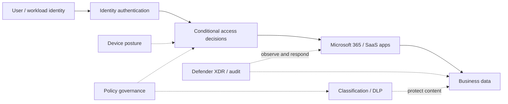

# Microsoft 365 Zero Trust — Integrated Security Program

*Reusable technical service package*

## Overview

ประเมินและยกระดับ Zero Trust สำหรับ Microsoft 365 ทั้ง Identity, Device, Apps, Threat Protection, Information Protection และ Governance โดยใช้การปรับใช้แบบเป็นระยะ

## Scope

ครอบคลุม Identity & Device Access, Entra Conditional Access, Intune Compliance, Defender XDR, Microsoft Purview, SaaS/AI App Governance และ Security Operations ตาม License และ Business Risk ขององค์กร

## Architecture Mental Model

**Question:** What must be verified before a user or app can access business data?

## Standard Delivery

1. **Assess Zero Trust maturity** — ประเมิน Identity, Device, App, Threat, Data และ Operations Current State
2. **Prioritize business scenarios** — กำหนด User Journeys, Risks, Licenses, Policy Boundaries และ Impact
3. **Secure identity and device access** — ออกแบบและ Pilot MFA, Conditional Access, Device Compliance และ Privileged Access
4. **Protect apps, threats and data** — ยกระดับ Defender, OAuth/App Governance, Purview Classification/DLP และ Auditing ใน Scope
5. **Operate and improve** — ทดสอบ Access Outcomes, Detection/Response, Exceptions, Monitoring และ Rolling Roadmap

## Deliverables

Zero Trust Gap Assessment, Policy Architecture, Pilot Evidence, Security Controls Matrix, Exception Register และ Adoption Roadmap

## Expected Outcome

ได้เส้นทางการปรับใช้ Zero Trust ที่เชื่อม Access, Device, Apps และ Data Protection โดยมีหลักฐานการทดสอบ

## Boundary

เป็น Umbrella Package: งาน Purview/AI Apps เชิงลึกแยกได้เป็น IP-07 และ IP-08; การปรับใช้นโยบายทุก User/Device ขึ้นกับ Scope, License และ Change Approval

## References

- [Zero Trust deployment with Microsoft 365](https://learn.microsoft.com/en-us/security/zero-trust/microsoft-365-zero-trust)
