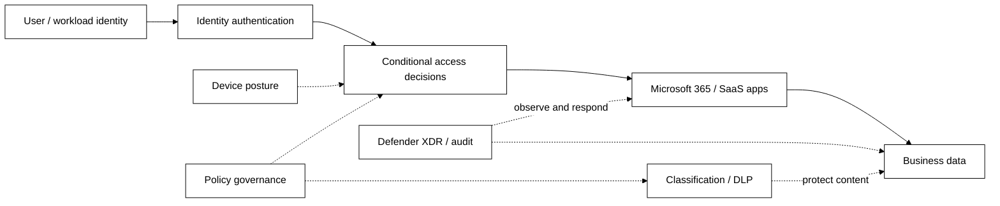
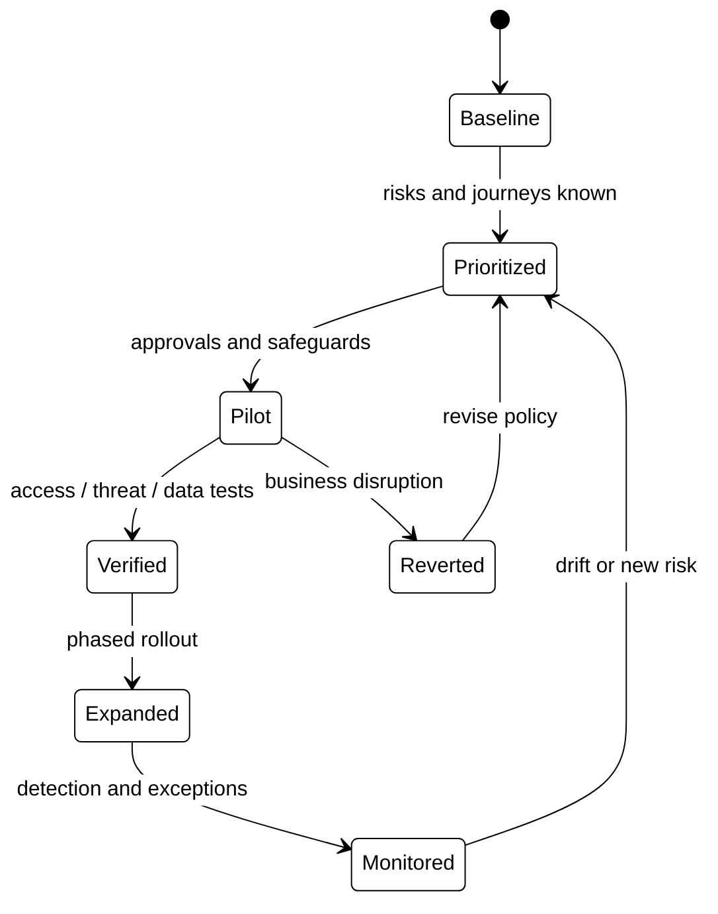

# Microsoft 365 Zero Trust — Integrated Security Program

> **IP-15 | Repeatable Service Package**

**Expected Outcome:** ประเมินและยกระดับ Zero Trust สำหรับ Microsoft 365 ทั้ง Identity, Device, Apps, Threat Protection, Information Protection และ Governance โดยใช้การปรับใช้แบบเป็นระยะ

## When to Engage

- มี Microsoft 365 หลาย Workloads แต่ Control เรื่อง Identity, Device, App และ Data ไม่สอดคล้องกัน
- ต้องการยกระดับ Zero Trust โดยไม่ Lockout ผู้ใช้หรือขัด Business Process
- ต้องการภาพรวมของ Roadmap มากกว่าการปรับ Secure Score เป็นรายการ ๆ

## Decisions & Outcomes

- ได้ Prioritized Zero Trust Roadmap ที่เชื่อม Policy กับ Business Risks
- มี Policy Pilot และผลทดสอบ Access / Data Protection ใน Scope
- เห็นความสัมพันธ์ของ Identity, Endpoint, Application และ Data Controls

## Scope

ครอบคลุม Identity & Device Access, Entra Conditional Access, Intune Compliance, Defender XDR, Microsoft Purview, SaaS/AI App Governance และ Security Operations ตาม License และ Business Risk ขององค์กร

## Architecture Mental Model

**Question:** What must be verified before a user or app can access business data?

## Standard Delivery

1. **Assess Zero Trust maturity** — ประเมิน Identity, Device, App, Threat, Data และ Operations Current State
2. **Prioritize business scenarios** — กำหนด User Journeys, Risks, Licenses, Policy Boundaries และ Impact
3. **Secure identity and device access** — ออกแบบและ Pilot MFA, Conditional Access, Device Compliance และ Privileged Access
4. **Protect apps, threats and data** — ยกระดับ Defender, OAuth/App Governance, Purview Classification/DLP และ Auditing ใน Scope
5. **Operate and improve** — ทดสอบ Access Outcomes, Detection/Response, Exceptions, Monitoring และ Rolling Roadmap

## Deliverables

Zero Trust Gap Assessment, Policy Architecture, Pilot Evidence, Security Controls Matrix, Exception Register และ Adoption Roadmap

## Engineering Assurance

- ต้องมี Emergency Access และ Staged Rollout ก่อนบังคับใช้ Access Policies
- Data Protection ต้องตรวจสอบที่ Source Permissions และ Effective Access

**Failure & Recovery:** หากนโยบาย Access Control กระทบผู้ใช้งานสำคัญ ให้ใช้ Recovery Access และปรับ Pilot Scope จากผลการทดสอบ

### State & Decision Model

## Assumptions & Boundaries

เป็น Umbrella Package: งาน Purview/AI Apps เชิงลึกแยกได้เป็น IP-07 และ IP-08; การปรับใช้นโยบายทุก User/Device ขึ้นกับ Scope, License และ Change Approval

## Getting Started

เตรียม Identity/Device/Application Inventory, License Matrix, Critical User Journeys และ Security Owners

## Discuss Your Project Scope

หากองค์กรกำลังเผชิญปัญหาข้างต้น สามารถส่งภาพรวมระบบ จำนวน Workloads หรือ Accounts ที่เกี่ยวข้อง และผลลัพธ์ที่ต้องการ เพื่อร่วมกันกำหนด Scope และเกณฑ์รับมอบก่อนเริ่มงาน

**[ติดต่อทีม In the Cloud](mailto:info@inthecloud.co.th?subject=Service%20IP-15)**

## References

- [Zero Trust deployment with Microsoft 365](https://learn.microsoft.com/en-us/security/zero-trust/microsoft-365-zero-trust)

---

*Architecture และ State Models เป็นภาพเชิงแนวคิด ไม่ใช่ Production Topology ของลูกค้ารายใด*

