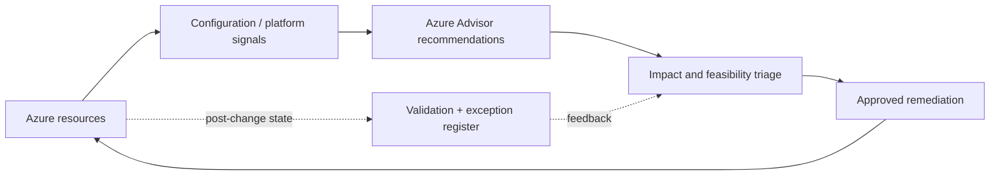
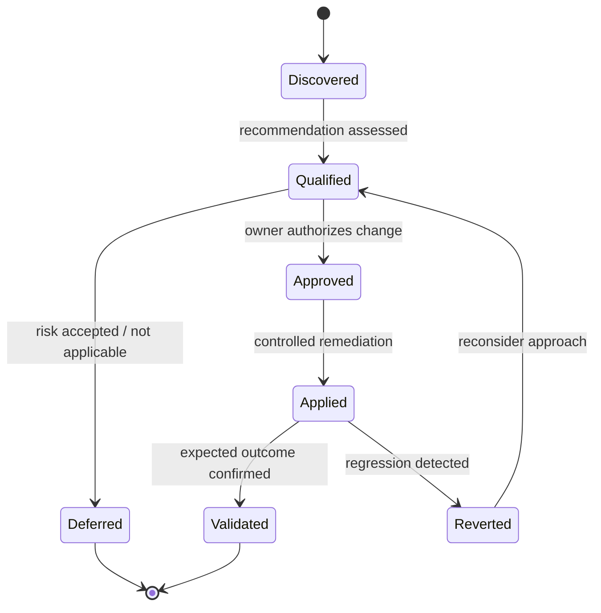

# Azure Advisor — Assessment & Remediation

> **IP-16 | Repeatable Service Package**

**ผลลัพธ์ที่มุ่งหวัง:** เปลี่ยน Recommendations ของ Azure Advisor ให้เป็นรายการปรับปรุงที่จัดลำดับตาม Business Risk, Impact, Effort และ Change Windows พร้อมหลักฐาน Before/After

## When to Engage

- Azure Advisor มี Recommendations จำนวนมากแต่ทีมไม่รู้ว่าควรเริ่มข้อไหน
- Optimization ด้าน Cost, Performance และ Reliability อาจมี Trade-offs
- ต้องการ Before/After Evidence และ Owner ของ Changes

## Decisions & Outcomes

- แยก Recommendations ที่ควรทำ, ควรรอ และไม่เหมาะกับสภาพแวดล้อมได้
- มีแผน Remediation ที่จัดลำดับตามผลกระทบและการอนุมัติ
- ได้หลักฐานผลลัพธ์และรายการที่ยังต้องติดตาม

## Scope

ครอบคลุม Azure Advisor ทั้ง Reliability, Security, Performance, Cost และ Operational Excellence โดยคัดเลือกและดำเนินการกับ Recommendations ที่ได้รับอนุมัติ

## Architecture Mental Model

**Question:** How does observed platform evidence become a safe optimization decision?

## Standard Delivery

1. **Collect recommendations** — กำหนด Subscription Scope และ Export Recommendation Inventory
2. **Qualify and prioritize** — ตรวจ Eligibility, Owners, Dependencies, Potential Impact และ Business Priority
3. **Plan scoped remediations** — กำหนด Change Strategy, Backup/Recovery และ Validation Tests
4. **Implement approved actions** — ปรับ Resource Configuration หรือ Operational Controls เฉพาะที่ตกลง
5. **Verify and report** — บันทึก Evidence, Remaining Exceptions, Advisor State Refresh และ Next-wave Backlog

## Deliverables

Advisor Recommendation Register, Prioritization & Risk Matrix, Remediation Plan, Change Log, Before/After Evidence และ Follow-up Backlog

## Engineering Assurance

- ไม่แก้ Recommendations เพียงเพื่อให้จำนวนแจ้งเตือนลดลง
- ทุกการเปลี่ยนต้องพิจารณา Availability, Cost, Performance และ Recovery

**Failure & Recovery:** หากการปรับ Optimization ทำให้ Performance หรือ Availability ลดลง ให้ย้อนกลับ Change ที่เกี่ยวข้องและประเมิน Trade-off ใหม่

### State & Decision Model

## Assumptions & Boundaries

ไม่รับประกันว่าทุก Recommendation จะเหมาะสมหรือแก้ไขได้ในครั้งเดียว; บางรายการต้องพิจารณา Cost/Architecture Trade-offs และมีการอัปเดตสถานะแบบล่าช้า

## Getting Started

เตรียม Subscription/Advisor Access, Owners, Service Targets, Baseline Metrics และ Change Windows

## Discuss Your Project Scope

หากองค์กรกำลังเผชิญปัญหาข้างต้น สามารถส่งภาพรวมระบบ จำนวน Workloads หรือ Accounts ที่เกี่ยวข้อง และผลลัพธ์ที่ต้องการ เพื่อร่วมกันกำหนด Scope และเกณฑ์รับมอบก่อนเริ่มงาน

**[ติดต่อทีม In the Cloud](mailto:info@inthecloud.co.th?subject=Service%20IP-16)**

## References

- [Azure Advisor overview](https://learn.microsoft.com/en-us/azure/advisor/advisor-overview)

---

*Architecture และ State Models เป็นภาพเชิงแนวคิด ไม่ใช่ Production Topology ของลูกค้ารายใด*

