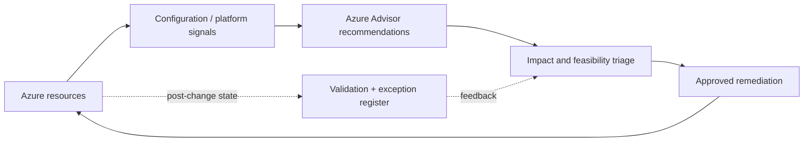

# Azure Advisor — Assessment & Remediation

*Reusable technical service package*

## Overview

เปลี่ยน Recommendations ของ Azure Advisor ให้เป็นรายการปรับปรุงที่จัดลำดับตาม Business Risk, Impact, Effort และ Change Windows พร้อมหลักฐาน Before/After

## Scope

ครอบคลุม Azure Advisor ทั้ง Reliability, Security, Performance, Cost และ Operational Excellence โดยคัดเลือกและดำเนินการกับ Recommendations ที่ได้รับอนุมัติ

## Architecture Mental Model

**Question:** How does observed platform evidence become a safe optimization decision?

## Standard Delivery

1. **Collect recommendations** — กำหนด Subscription Scope และ Export Recommendation Inventory
2. **Qualify and prioritize** — ตรวจ Eligibility, Owners, Dependencies, Potential Impact และ Business Priority
3. **Plan scoped remediations** — กำหนด Change Strategy, Backup/Recovery และ Validation Tests
4. **Implement approved actions** — ปรับ Resource Configuration หรือ Operational Controls เฉพาะที่ตกลง
5. **Verify and report** — บันทึก Evidence, Remaining Exceptions, Advisor State Refresh และ Next-wave Backlog

## Deliverables

Advisor Recommendation Register, Prioritization & Risk Matrix, Remediation Plan, Change Log, Before/After Evidence และ Follow-up Backlog

## Expected Outcome

มี Remediation ที่ตรวจสอบได้และลำดับการปรับปรุงที่สอดคล้องกับความเสี่ยงและผลกระทบต่อบริการ

## Boundary

ไม่รับประกันว่าทุก Recommendation จะเหมาะสมหรือแก้ไขได้ในครั้งเดียว; บางรายการต้องพิจารณา Cost/Architecture Trade-offs และมีการอัปเดตสถานะแบบล่าช้า

## References

- [Azure Advisor overview](https://learn.microsoft.com/en-us/azure/advisor/advisor-overview)
