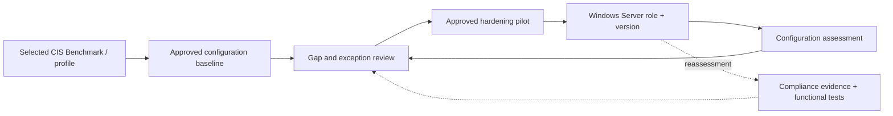
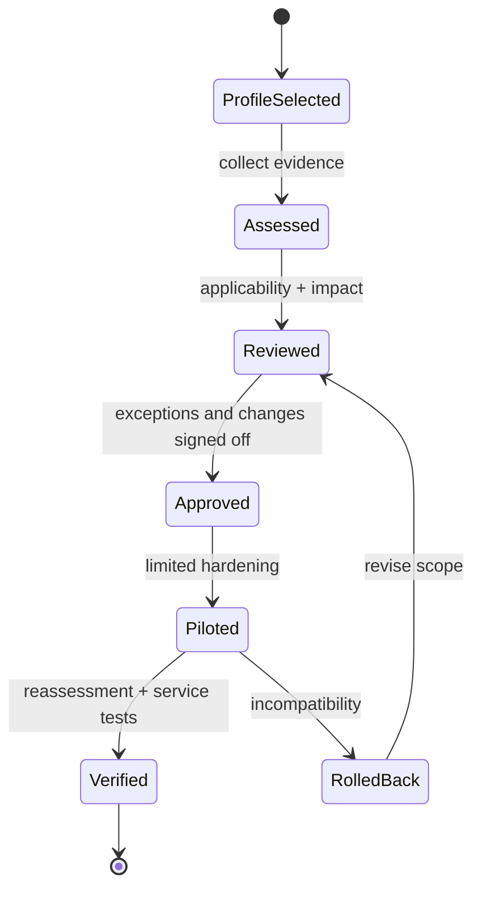

# Windows Server CIS Benchmark — Assessment & Remediation

> **IP-17 | Repeatable Service Package**

**ผลลัพธ์ที่มุ่งหวัง:** ประเมิน Windows Server Configuration เทียบกับ CIS Benchmark รุ่นที่ตกลง แล้วปรับปรุงรายการที่เหมาะสมโดยรักษา Application Compatibility และ Operations Access

## เมื่อใดควรใช้บริการนี้

- ต้องการทราบ Windows Server Security Baseline Gaps ที่ตรวจสอบได้
- มี Domain Controllers, Member Servers หรือ Stand-alone Roles ที่ต้องใช้ Policy ต่างกัน
- กังวล Hardening แล้วทำให้ Applications หรือ Management Tools ใช้งานไม่ได้

## Decisions & Outcomes

- ทราบ Applicable CIS Controls และ Findings ตาม Benchmark Version/Profile
- เลือก Priority Remediation และ Exceptions ตาม Server Role
- เห็น Compliance Delta พร้อม Functional Test Evidence

## Scope

ครอบคลุม Windows Server Versions, Roles, Domain Controller/Member/Stand-alone Profiles ที่ตกลง พร้อมหลักฐาน Assessment, Risk-based Exceptions, Pilot Hardening และ Post-change Validation

## Architecture Mental Model

**Question:** How does a desired security baseline safely constrain a running Windows server?

## Standard Delivery

1. **Select applicable benchmark** — กำหนด Windows Server Version, Role, Benchmark Release, Profile Level และ Exclusions
2. **Assess current configuration** — Collect Config Evidence และระบุ Pass/Fail/Not Applicable พร้อมจำแนก Role
3. **Evaluate impact** — จัดลำดับ Findings, ตรวจ GPO/Local Policy Impact, Service Dependencies และ Exception Approvals
4. **Pilot remediation** — ทำ Backup/GPO Rollback และ Hardening เฉพาะรายการที่ได้รับอนุมัติ
5. **Reassess & handover** — ทดสอบ Server Roles, Application, Authentication, Management และจัดทำ Compliance Delta

## Deliverables

Benchmark Scope/Profile Record, Control Assessment Results, Risk & Exception Register, Remediation Record, Reassessment Evidence และ Hardening Roadmap

## Engineering Assurance

- ไม่ใช้ Baseline เหมือนกันทั้งหมดโดยไม่ประเมิน Server Roles และ Dependencies
- ต้องทดสอบ Authentication, Management และ Applications หลัง Hardening

**Failure & Recovery:** หาก Hardening กระทบระบบสำคัญ ให้ย้อนกลับ GPO/Configuration ที่เกี่ยวข้องและทบทวน Applicability ของ Control

### State & Decision Model

## Assumptions & Boundaries

Benchmark Versions และ Profiles เปลี่ยนตาม Release; ไม่รับประกัน 100% Conformance และไม่เผยแพร่หรือคัดลอกข้อความ Benchmark/Build Kits ที่มีข้อจำกัดด้านลิขสิทธิ์หรือ Licensing

## ก่อนเริ่มงาน

เตรียม OS/Role Inventory, Benchmark Version/Profile, GPO Ownership, App Owners และ Recovery Access

## พูดคุยขอบเขตงาน

หากองค์กรกำลังเผชิญปัญหาข้างต้น สามารถส่งภาพรวมระบบ จำนวน Workloads หรือ Accounts ที่เกี่ยวข้อง และผลลัพธ์ที่ต้องการ เพื่อร่วมกันกำหนด Scope และเกณฑ์รับมอบก่อนเริ่มงาน

**[ติดต่อทีม In the Cloud](mailto:info@inthecloud.co.th?subject=Service%20IP-17)**

## References

- [Official CIS Windows Server Benchmarks](https://www.cisecurity.org/benchmark/microsoft_windows_server)

---

*Architecture และ State Models เป็นภาพเชิงแนวคิด ไม่ใช่ Production Topology ของลูกค้ารายใด*

