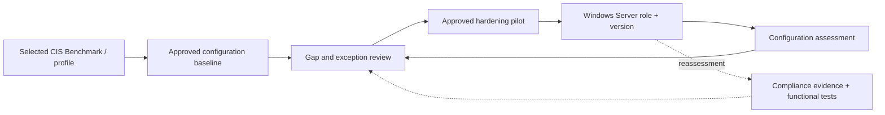

# Windows Server CIS Benchmark — Assessment & Remediation

*Reusable technical service package*

## Overview

ประเมิน Windows Server Configuration เทียบกับ CIS Benchmark รุ่นที่ตกลง แล้วปรับปรุงรายการที่เหมาะสมโดยรักษา Application Compatibility และ Operations Access

## Scope

ครอบคลุม Windows Server Versions, Roles, Domain Controller/Member/Stand-alone Profiles ที่ตกลง พร้อมหลักฐาน Assessment, Risk-based Exceptions, Pilot Hardening และ Post-change Validation

## Architecture Mental Model

**Question:** How does a desired security baseline safely constrain a running Windows server?

## Standard Delivery

1. **Select applicable benchmark** — กำหนด Windows Server Version, Role, Benchmark Release, Profile Level และ Exclusions
2. **Assess current configuration** — Collect Config Evidence และระบุ Pass/Fail/Not Applicable พร้อมจำแนก Role
3. **Evaluate impact** — จัดลำดับ Findings, ตรวจ GPO/Local Policy Impact, Service Dependencies และ Exception Approvals
4. **Pilot remediation** — ทำ Backup/GPO Rollback และ Hardening เฉพาะรายการที่ได้รับอนุมัติ
5. **Reassess & handover** — ทดสอบ Server Roles, Application, Authentication, Management และจัดทำ Compliance Delta

## Deliverables

Benchmark Scope/Profile Record, Control Assessment Results, Risk & Exception Register, Remediation Record, Reassessment Evidence และ Hardening Roadmap

## Expected Outcome

เห็น Security Baseline Gap ชัดเจน พร้อมปรับปรุง Controls ที่ผ่านการอนุมัติและตรวจสอบผลกระทบแล้ว

## Boundary

Benchmark Versions และ Profiles เปลี่ยนตาม Release; ไม่รับประกัน 100% Conformance และไม่เผยแพร่หรือคัดลอกข้อความ Benchmark/Build Kits ที่มีข้อจำกัดด้านลิขสิทธิ์หรือ Licensing

## References

- [Official CIS Windows Server Benchmarks](https://www.cisecurity.org/benchmark/microsoft_windows_server)
