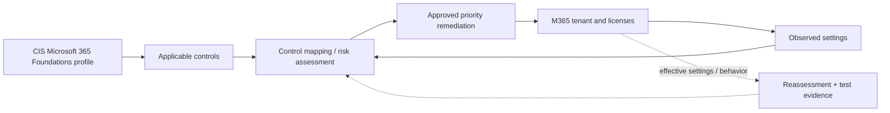

# Microsoft 365 CIS Benchmark — Assessment & Remediation

*Reusable technical service package*

## Overview

ตรวจสอบ Microsoft 365 Tenant เทียบกับ CIS Microsoft 365 Foundations Benchmark รุ่นที่ตกลง พร้อมแก้ไข Priority Gaps โดยประเมิน License และ Business Impact ก่อน

## Scope

ครอบคลุม Entra Identity Controls, Exchange Online, SharePoint/OneDrive, Teams, Defender/Purview และ Audit/Administration เฉพาะที่มีอยู่ใน Benchmark Version และ License ของ Tenant

## Architecture Mental Model

**Question:** How do tenant controls map from benchmark intent to verified service behavior?

## Standard Delivery

1. **Establish control baseline** — ระบุ CIS Benchmark Version/Profile, Tenant Licenses, Feature Applicability และ Test Users
2. **Assess tenant settings** — รวบรวม Read-only Evidence และระบุ Findings/Exceptions ตาม Control Applicability
3. **Review policy impacts** — ตรวจ Conditional Access, Data Sharing, Retention, Endpoint/Device Policies และ Dependencies
4. **Apply prioritized controls** — ดำเนินการ Pilot/Scoped Remediation ผ่าน Change Control และ Emergency Access Safeguards
5. **Validate and report** — ทำ Reassessment, User-impact Tests, Post-change Evidence และ Remaining Risks

## Deliverables

Versioned CIS Control Matrix, Tenant Assessment, Findings & Exceptions, Remediation Evidence, Compliance Delta และ Recommended Roadmap

## Expected Outcome

มีข้อมูล Baseline ที่ตรวจสอบได้และลดการตั้งค่าที่มีความเสี่ยงในขอบเขต Tenant ที่ตกลง

## Boundary

CIS Conformance ไม่เท่ากับ Security Assurance หรือ Certification; การใช้ Controls ขึ้นกับ Product Licensing และ Benchmark Release; ไม่นำ Benchmark Content ที่มี Licensing Restrictions มาเผยแพร่

## References

- [Official CIS Microsoft 365 Benchmark](https://www.cisecurity.org/benchmark/microsoft_365)
