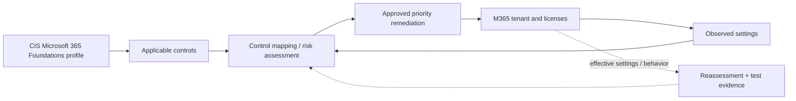
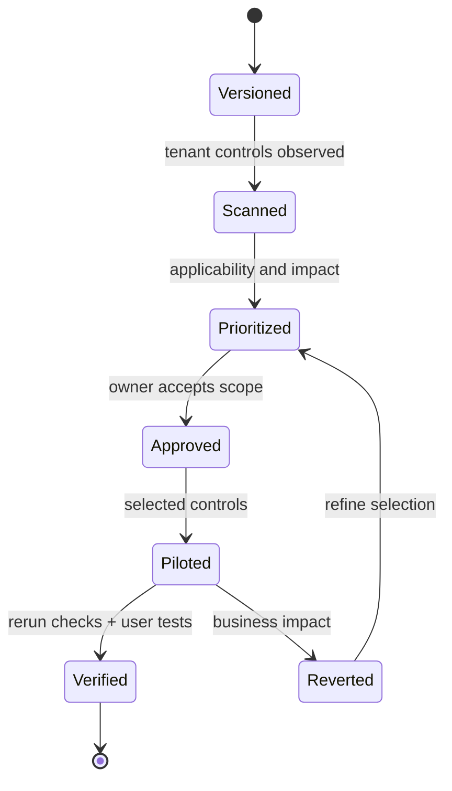

# Microsoft 365 CIS Benchmark — Assessment & Remediation

> **IP-18 | Repeatable Service Package**

**ผลลัพธ์ที่มุ่งหวัง:** ตรวจสอบ Microsoft 365 Tenant เทียบกับ CIS Microsoft 365 Foundations Benchmark รุ่นที่ตกลง พร้อมแก้ไข Priority Gaps โดยประเมิน License และ Business Impact ก่อน

## เมื่อใดควรใช้บริการนี้

- ต้องการตรวจสอบ Tenant Configuration กับ CIS Microsoft 365 Foundations Benchmark
- ยังไม่แน่ใจว่า Controls ใดใช้ได้ตาม License, Service และ Business Processes
- ต้องการลด Policy Gaps โดยไม่สร้าง Tenant-wide Access Issues

## Scope

ครอบคลุม Entra Identity Controls, Exchange Online, SharePoint/OneDrive, Teams, Defender/Purview และ Audit/Administration เฉพาะที่มีอยู่ใน Benchmark Version และ License ของ Tenant

## Architecture Mental Model

**Question:** How do tenant controls map from benchmark intent to verified service behavior?

## Standard Delivery

1. **Establish control baseline** — ระบุ CIS Benchmark Version/Profile, Tenant Licenses, Feature Applicability และ Test Users
2. **Assess tenant settings** — รวบรวม Read-only Evidence และระบุ Findings/Exceptions ตาม Control Applicability
3. **Review policy impacts** — ตรวจ Conditional Access, Data Sharing, Retention, Endpoint/Device Policies และ Dependencies
4. **Apply prioritized controls** — ดำเนินการ Pilot/Scoped Remediation ผ่าน Change Control และ Emergency Access Safeguards
5. **Validate and report** — ทำ Reassessment, User-impact Tests, Post-change Evidence และ Remaining Risks

## Deliverables

Versioned CIS Control Matrix, Tenant Assessment, Findings & Exceptions, Remediation Evidence, Compliance Delta และ Recommended Roadmap

## Decisions & Outcomes

- มี Versioned Assessment และ Control Applicability Matrix
- เลือก Priority Remediation/Exceptions พร้อม Owner ที่เกี่ยวข้อง
- ตรวจสอบ Configuration Delta และการใช้งานจริงหลังปรับนโยบาย

## Engineering Assurance

- การผ่าน Checklist ไม่เท่ากับ Security Assurance ทั้งหมด
- ต้องทดสอบ User Journeys, Collaboration และ Emergency Access ก่อน Enforcement

**Failure & Recovery:** หาก Control ใหม่ทำให้ Sign-in, Mail Flow หรือ Data Sharing ผิดปกติ ให้คืนการตั้งค่าที่ปลอดภัยและทดสอบใหม่ใน Scope ที่จำกัด

### State & Decision Model

## Assumptions & Boundaries

CIS Conformance ไม่เท่ากับ Security Assurance หรือ Certification; การใช้ Controls ขึ้นกับ Product Licensing และ Benchmark Release; ไม่นำ Benchmark Content ที่มี Licensing Restrictions มาเผยแพร่

## ก่อนเริ่มงาน

เตรียม Tenant License Inventory, Benchmark Version/Profile, Test Users และผู้รับผิดชอบแต่ละ Workload

## References

- [Official CIS Microsoft 365 Benchmark](https://www.cisecurity.org/benchmark/microsoft_365)

---
*Architecture และ State Models เป็นแบบจำลองเชิงแนวคิด ไม่ใช่ Production Topology ขององค์กรใดองค์กรหนึ่ง*
