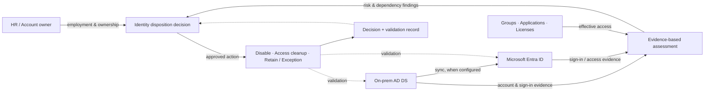
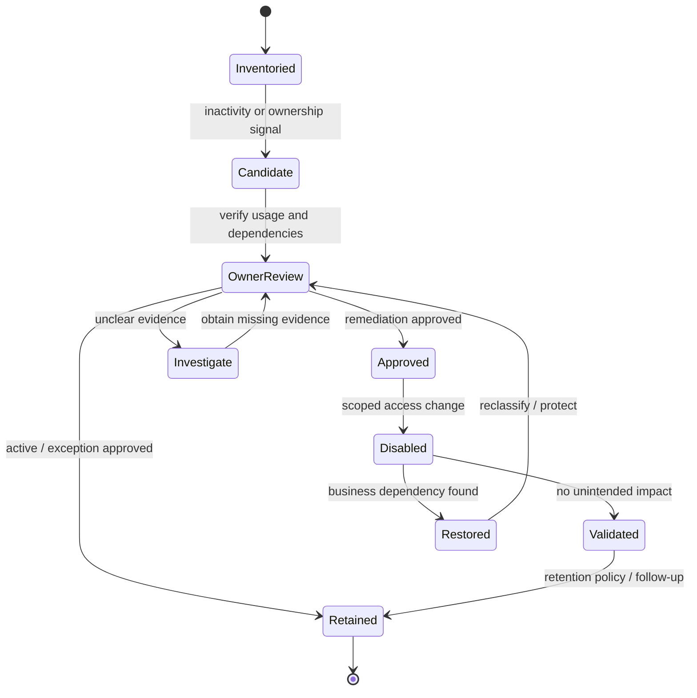

# AR-ID-UAH — User Account Hygiene Assessment & Remediation

> **AR-ID-UAH | Repeatable Service Package**

**Expected Outcome:** ระบุบัญชีผู้ใช้งานที่ไม่ได้ใช้งาน บัญชีที่ไม่มีเจ้าของ และสิทธิ์ที่ยังคงอยู่โดยไม่จำเป็นใน Active Directory และ Microsoft Entra ID แล้วจัดการเฉพาะรายการที่ผ่านการตรวจสอบและอนุมัติ โดยลดความเสี่ยงที่จะกระทบผู้ใช้งานจริง

**Customer Brochure:** [User Account Hygiene — 10 Capabilities, 6 Person-Days, Deliverables & Sample Report](brochures/ip-19-user-account-hygiene.md)

## When to Engage

- มี User Accounts สะสมจำนวนมาก แต่ไม่ทราบว่าใครยังใช้งานหรือเป็นเจ้าของบัญชี
- พนักงานลาออกหรือเปลี่ยนหน้าที่แล้ว แต่บัญชี กลุ่มสิทธิ์ หรือการเข้าถึง Applications ยังไม่ได้รับการทบทวน
- ต้องการแผน Cleanup ที่มีหลักฐาน ตรวจสอบย้อนหลังได้ และไม่ลบบัญชีที่ยังจำเป็น

## Decisions & Outcomes

- แยกบัญชีเป็น **Active, Review Required, Approved for Remediation และ Exception** ตามเกณฑ์ที่องค์กรกำหนด
- ระบุ Owner, Source of Authority, Last Activity Evidence และ Access Dependencies ของบัญชีใน Scope
- มีแนวทางจัดการบัญชีและสิทธิ์คงค้างพร้อม Approval, Validation และ Retention/Deletion Decision ที่ตรวจสอบได้

## Scope

ครอบคลุม Human User Accounts ใน **AD DS (On-premises), Microsoft Entra ID (Cloud-only) หรือ Hybrid Identity** ตามระบบที่ตกลง รวมถึง Inactive/Stale Accounts, Orphaned Accounts, Disabled Accounts, Group Membership และ License/Access Review

การจัดการอาจรวมถึงการยืนยัน Owner, ปิดการใช้งานบัญชี, ทบทวน Group/License และกำหนด Retention/Deletion Workflow **เฉพาะรายการที่ได้รับอนุมัติ**; บัญชี Privileged, Break-glass, Service/Automation และ Guest Accounts ต้องกำหนด Exception หรือ Scope แยกให้เหมาะสม

## Account Discovery & Evidence Model

| Data / Signal | Typical Source | Interpretation |
|---|---|---|
| Account ID, UPN, Status, Created Date | AD DS / Microsoft Entra ID | ระบุตัวตนและสถานะ ไม่ได้ยืนยันว่าเลิกใช้งานแล้ว |
| Source of Authority | AD DS, Entra ID หรือ Hybrid Sync | กำหนดจุดที่เปลี่ยนแปลง Account ได้อย่างถูกต้อง |
| Last Logon Evidence | AD `lastLogonTimestamp` / Per-DC Logs, Entra `signInActivity` | ต้องพิจารณา Freshness, Successful vs Failed Attempts และ Coverage |
| HR Employment & Owner Confirmation | HR/Business Owners ตามสิทธิ์ที่อนุมัติ | ยืนยันว่าบัญชียังต้องใช้งานหรือเป็น Offboarding Candidate |
| Group, App, License & Data Dependencies | AD Groups, Entra Assignments, M365, App Owners | ลดความเสี่ยงที่จะตัด Business Access หรือทำ Data Ownership หาย |
| Exceptions & Retention | Security/Identity/Compliance Owners | ระบุบัญชีที่ต้องเก็บไว้และเงื่อนไขการลบในอนาคต |

**Separation of concerns:** กำหนด **Inactivity Signal**, **Business Decision**, **Approved Action** และ **Post-change Verification** แยกจากกัน ผู้ใช้ที่ไม่ Sign in ช่วงเวลาหนึ่งอาจอยู่ระหว่างลางาน ใช้งานแบบไม่โต้ตอบ หรือใช้ Application ที่ไม่ได้ส่ง Logs มายังแหล่งข้อมูลที่กำลังตรวจ

### Remediation Decision Groups

| Group | Recommended Decision | Change Boundary |
|---|---|---|
| Active / Required | Retain พร้อม Owner/Review Date | No change |
| Owner Review Required | Verify HR & Application Dependencies | No disable |
| Approved Reversible Remediation | Pilot Disable / Group or License Cleanup | Approved Authoritative Source |
| Accepted Exception | บันทึก Risk Owner และ Reassessment Date | No automated deletion |
| Retention / Deletion Candidate | ส่งต่อ HR/Data Owner/Legal for retention decision | Separate approval/workstream |

## Architecture Mental Model

**System question:** How can an organization identify unnecessary access without mistaking inactivity for a safe-to-delete account?

## Standard Delivery

1. **Discovery & Inventory** — สำรวจบัญชีผู้ใช้ใน Scope, Identity Source, Owner, Account Status และสิทธิ์ที่เกี่ยวข้อง
2. **Inactivity & Ownership Assessment** — ประเมิน Activity Signals ร่วมกับ HR/Owner Confirmation และข้อจำกัดของข้อมูล
3. **Risk Classification & Approval** — แยกกลุ่ม Remediation Candidates, Exceptions และบัญชีที่ต้องตรวจสอบเพิ่ม
4. **Controlled Remediation** — ดำเนินการ Pilot/Disable/Access Cleanup เฉพาะรายการที่ได้รับอนุมัติ ตาม Source of Authority
5. **Validation & Reporting** — ตรวจผลการเปลี่ยนแปลง บันทึก Exceptions และส่งมอบแผน Retention/Deletion ขั้นต่อไป

## Deliverables

User Account Inventory (Excel-compatible), **Inactivity & Ownership Evidence Register**, Candidate Disposition Dashboard, Proposed Remediation/Exception Register, Approved Before/After Validation Evidence และ Account Lifecycle Improvement Roadmap

**Example Deliverable:** [View User Account Hygiene Sample Outcome — 1,000 Users / 134 Candidates](examples/user-account-hygiene-assessment-outcome.md)

**Raw Review Register:** [Download 134 fictional Candidate Decisions (CSV)](../assets/examples/user-account-hygiene-candidates-demo.csv)

ตัวอย่างรายงานแยก **Account Population, Review Candidates, Owner Confirmation, Approved Actions และ Completed Actions** เพื่อไม่สื่อว่าบัญชีที่ไม่ค่อยใช้งานถูกปิดหรือลบไปทั้งหมดแล้ว

## Engineering Assurance

- **Inactivity is a signal, not a deletion rule:** ต้องประเมินหลายแหล่งข้อมูลและยืนยัน Owner ก่อนดำเนินการ
- **Source-of-authority aware:** บัญชี Hybrid ต้องกำหนดจุดที่อนุญาตให้แก้ไข เช่น AD DS หรือ Entra ID ให้ถูกต้อง
- **Recoverable change first:** เริ่มจากการทบทวน/ปิดการเข้าถึงที่กู้คืนได้ พร้อมตรวจผลกระทบ ก่อนพิจารณาการลบถาวร
- **Protection of exceptional identities:** ยกเว้นหรือแยกกระบวนการสำหรับ Emergency, Privileged และ Automation Identities

**Failure & Recovery:** หากพบว่าบัญชีที่ถูก Disable ยังจำเป็นต่อธุรกิจ ให้ใช้ขั้นตอน Re-enable/Restore Access ที่ได้รับอนุมัติ ตรวจสอบการเข้าถึง แล้วปรับ Exception Rules ก่อนขยายผล

### State & Decision Model

## Example Outcome & Decision Evidence

**Illustrative scope:** สมมติมี Human Users 1,000 บัญชี พบ 134 Review Candidates ตรวจสอบ Owner/HR แล้ว 76 บัญชี ได้รับอนุมัติ Disable แบบกู้คืนได้ 38 บัญชี (ดำเนินการ Pilot/Validation เสร็จ 10 และรอ Change Window อีก 28) ส่วน 21 บัญชีเป็น Retain/Exception, 17 บัญชีต้องหาหลักฐานเพิ่ม และ 58 บัญชียังรอ Owner Review

| Validation | Acceptance Evidence |
|---|---|
| Completeness | Population Count, Source of Authority, Scope Exclusions และ Data Coverage |
| Classification | Inactivity Signal + HR/Owner Confirmation + Dependencies ต่อ Candidate |
| Approval | Approved Action, Change Owner, Affected Users และ Recovery Method |
| Reversible Change | Pre/Post Account Status, Group/App Access และ Business Validation |
| Exceptions | Risk Owner, Retention Requirements, Reassessment Date และ Open Items |

**Reporting Rule:** นับจำนวน `Candidates`, `Approved`, `Applied`, `Validated` และ `Exception` แยกจากกัน เพื่อไม่ให้ผู้บริหารเข้าใจผิดว่าทุก Candidate สามารถ Cleanup ได้ทันที

## Assumptions & Boundaries

- ไม่ใช้จำนวนวัน Inactivity เพียงค่าเดียวเป็นเกณฑ์ลบบัญชี และไม่รับประกันจำนวนบัญชีที่ต้อง Cleanup
- ระยะเวลาย้อนหลังของ Sign-in Evidence, ความพร้อมของ Licensing/Permissions, Retention Policies และ Hybrid Sync จะกำหนดขอบเขตการประเมิน
- การลบบัญชีถาวร การส่งผลต่อ Mailbox/OneDrive การกำหนด Legal Hold และการเปลี่ยนระบบ HR Provisioning ไม่รวมโดยอัตโนมัติ ต้องตกลงเพิ่มเติม

## Getting Started

เตรียม AD DS/Entra ID Scope, ผู้รับผิดชอบ HR และ Identity, นโยบาย Inactivity/Retention ที่ใช้อยู่ (ถ้ามี), Licensing, การเข้าถึงแบบ Read-only และกระบวนการ Approve Change

## Discuss Your Project Scope

สามารถส่งข้อมูลภาพรวมจำนวน User Accounts, Identity Model (AD-only / Cloud-only / Hybrid) และเป้าหมายการปรับปรุง Account Lifecycle เพื่อกำหนด Scope และ Acceptance Criteria ที่เหมาะสม

**[ติดต่อทีม In the Cloud](mailto:info@inthecloud.co.th?subject=AR-ID-UAH%20User%20Account%20Hygiene)**

## References

- [Microsoft Learn — Detect and investigate inactive user accounts](https://learn.microsoft.com/en-us/entra/identity/monitoring-health/howto-manage-inactive-user-accounts)
- [Microsoft Graph — signInActivity resource](https://learn.microsoft.com/en-us/graph/api/resources/signinactivity)

---

*Architecture และ State Models เป็นภาพเชิงแนวคิด ไม่ใช่ข้อมูลบัญชีหรือ Production Topology ของลูกค้าจริง*
