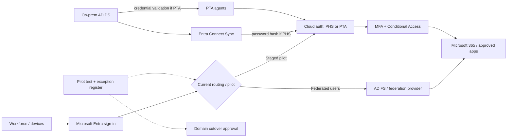
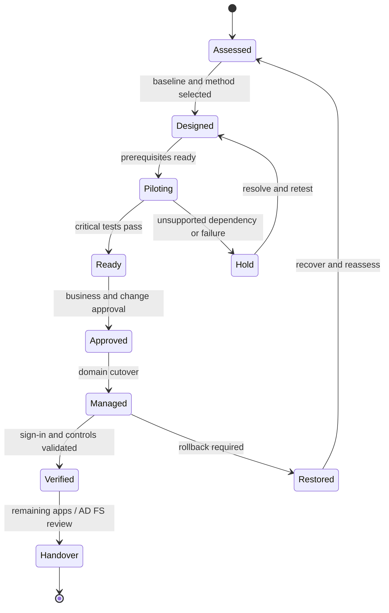

# IM-ID-FCA — Federation to Cloud Authentication Migration

> **IM-ID-FCA (IP-20) | Repeatable Service Package**

**Expected Outcome:** ย้าย Microsoft Entra Sign-in ของ Domain ที่ใช้ AD FS หรือ Federation Provider อื่นไปสู่ Cloud Authentication อย่างมีขั้นตอน โดยเลือก Password Hash Synchronization (PHS) หรือ Pass-through Authentication (PTA) ให้เหมาะกับองค์กร ทดสอบ User/Device/Application Sign-in ก่อน Cutover และเตรียมวิธีกลับสู่ Federation ที่ผ่านการทบทวน

## When to Engage

- ใช้ AD FS หรือ Third-party Federation เพื่อ Sign in Microsoft 365 / Microsoft Entra ID และต้องการลด Operational Dependency ของระบบ Federation
- ต้องการเปิดใช้ Microsoft Entra MFA, Conditional Access และ Identity Protection โดยลดความซับซ้อนของ Sign-in Architecture
- กังวลผลกระทบกับ Microsoft 365 Apps, Hybrid Devices, Windows Hello for Business, VDI, Legacy Applications หรือ Federation Claims
- ต้องการ Migration Plan ที่มี Pilot, **Go/No-Go Criteria**, Maintenance Window และ Rollback แทนการเปลี่ยน Domain โดยไม่ทดสอบ

## Decisions & Outcomes

- ได้ **Current Federation & Sign-in Dependency Baseline** แสดง Domains, Federation Configuration, Claims/Access Rules, Identity Sync และ Application/Device Requirements
- มี Architecture Decision สำหรับ **PHS หรือ PTA** พร้อมเหตุผลด้าน Security, Availability, Compliance และ Supportability
- ผ่านการทดสอบ **Staged Rollout Pilot** ตาม Supported Scenarios พร้อม Sign-in/MFA/CA/SSO Evidence และ Exceptions
- ตัดสินใจ **Go/No-Go** สำหรับ Domain Cutover โดยอิง Test Results, Business Owners, Emergency Access และ Recovery Readiness
- หลัง Cutover ที่อนุมัติแล้ว มี Validation/Handover และ AD FS/IdP Dependency Review ก่อนวางแผน Decommission

## Authentication Method Decision

| Option | Architecture Consideration | Best Fit / Boundary |
|---|---|---|
| **PHS — Password Hash Synchronization** | Microsoft Entra ID ตรวจ Credentials ที่ Cloud โดยใช้ Hash ที่ผ่านกระบวนการ Sync ที่ปลอดภัย | Microsoft แนะนำโดยทั่วไป; ตรวจ Sync Health, Password Changes และ Authentication Policies |
| **PTA — Pass-through Authentication** | Microsoft Entra ID ส่งการตรวจ Password ผ่าน PTA Agents ไปยัง On-prem AD DS | เมื่อมี Business/Compliance Requirement ที่ต้องตรวจ Credentials กับ On-prem; ต้องวาง Agent HA และ Availability |
| **Remain Federated / Exception** | เก็บ Federation ไว้สำหรับ Dependency ที่ Cloud Auth ไม่รองรับหรือยังแก้ไม่ได้ | Explicit Exception และ Migration Prerequisite ไม่ใช่เป้าหมายอัตโนมัติ |

**Important:** PHS Password Synchronization Scope และ Staged Rollout Authentication Pilot เป็นคนละเรื่อง การเพิ่ม Pilot Group ไม่ได้แปลว่า PHS จะ Sync เฉพาะ Password ของ Pilot Users

## Scope

### Current-State Assessment

- Federated Domains, Tenant/Entra Connect Configuration, Identity Source, UPN/Alternate ID และ Password Hash/Agent Health
- AD FS / Third-party IdP Federation Settings, Claims Rules, MFA Behaviors, Certificates, Endpoints และ Microsoft 365 Sign-in Dependencies
- Inventory Applications, Devices และ Protocols ที่ต้อง Authenticate ผ่าน Federation โดยเฉพาะ Nonpersistent VDI, Smartcard, WHfB Certificate Trust และ Apps ที่ใช้ Federation-only Claims
- Conditional Access, Entra MFA, Emergency Cloud-only Accounts และ Existing Monitoring / Sign-in Evidence

### Migration & Pilot

- Select PHS/PTA, Validate Prerequisites, Identity Sync และ Password Change Behavior
- ออกแบบ Staged Rollout โดยใช้ Pilot Security Groups ที่รองรับ พร้อม Cohorts, Success/Failure Criteria และ Support Communications
- ทดสอบ Microsoft 365 Browser/Desktop/Mobile, Entra/Hybrid-joined Device SSO, MFA/CA, Legacy Protocol Denial, Critical Apps และ Recovery Path ตาม Customer Environment
- Document Authentication/Sign-in Baseline ก่อน Cutover และ Change Approval สำหรับ Domain Conversion

### Cutover & Transition

- Convert Domain จาก **Federated เป็น Managed** โดยวิธีที่รองรับกับรูปแบบ Federation ที่ใช้งาน หลังผ่าน Go/No-Go Gate เท่านั้น
- Monitor Sign-in Results, User Impact, Support Incidents, Synchronization/Agent Health และ Contingency Decisions
- ตรวจสอบ Remaining AD FS Relying Parties และ Federation Dependencies ก่อนเสนอ Decommission Workstream

## Architecture Mental Model

**System question:** Which authentication dependencies still require federation, and when is a domain safe to become managed?

*Conceptual illustration only. The exact PHS/PTA implementation and authentication routing depend on the selected design, supported scenarios and domain state.*

## Migration Readiness & Decision Gates

| Gate | Required Evidence | Decision if Missing |
|---|---|---|
| Federation Baseline | Current Domain Federation Settings, Claims and Sign-in Dependencies recorded | Hold until recoverable |
| PHS / PTA Readiness | Sync or Agent Health, Password Change/Sign-in Tests | Hold |
| Business Application Mapping | App Owner sign-off including Federation-specific Claims and Device Dependencies | Hold critical scenarios |
| Security Readiness | CA/MFA, Break-glass Access, Legacy Authentication Controls validated | Hold |
| Pilot Exit | Representative Sign-in Scenarios pass, failures triaged, Support Plan ready | No-Go for unresolved critical risks |
| Cutover Authorization | Approved Change Window, Monitoring and Rollback Procedure | No-Go |

**Microsoft Staged Rollout Considerations:** เป็น Temporary Testing Mechanism ไม่ใช่ Final Domain Conversion; Nested/Dynamic Groups ไม่รองรับ และควรใช้ Pilot Group ขนาดที่เอกสารรองรับ (ตัวอย่าง Microsoft แนะนำไม่เกิน 200 Members ในการเพิ่มครั้งแรก) ต้องตรวจ Supported/Unsupported Device, Smartcard, WHfB และ VDI Scenarios ทุกครั้ง

## Standard Delivery

1. **Discover & Baseline** — ตรวจ Federation Settings, Identity Sync, Current MFA/Claims และแหล่ง Sign-in Evidence
2. **Assess & Design** — เลือก PHS/PTA, ทบทวน Federation-only Dependencies, Pilot Cohorts และ Risk Register
3. **Pilot & Validate** — เปิด Staged Rollout ตาม Scope, ทดสอบ Sign-in/SSO/CA/MFA/Applications และรวบรวม Evidence
4. **Approve & Cut Over** — ทำ Go/No-Go, Change Approval, Back up Current Federation Config และ Convert Domain ด้วยวิธีที่รองรับ
5. **Monitor & Handover** — ตรวจผลหลัง Cutover, Open Incidents, Rollback Readiness และ Handover Decommission Prerequisites

## Deliverables

Current Federation Baseline, Application/Device Sign-in Dependency Matrix, Authentication Method Decision Record, Pilot Results & Exceptions, **Go/No-Go Dashboard**, Domain Cutover & Rollback Plan, Post-Cutover Validation Record และ AD FS Retirement Readiness Checklist

**Example Deliverable:** [View Federation to Cloud Authentication Sample Outcome — 50 Pilot Users, 12 Tests](examples/federation-cloud-auth-migration-outcome.md)

**Raw Validation Example:** [Download fictional 12-scenario Sign-in Test Register (CSV)](../assets/examples/federation-cloud-auth-validation-demo.csv)

ตัวอย่างแสดง **11/12 Scenarios ผ่าน แต่ยัง No-Go** เพราะ Critical Dependency คงค้าง เพื่อแสดงว่า Acceptance Criteria ใช้ประกอบการตัดสินใจจริง ไม่ใช่รายงานว่าต้อง Cutover สำเร็จเสมอ

## Engineering Assurance

- **No premature Cutover:** ไม่เปลี่ยนทั้ง Domain หาก Critical Users/Apps/Devices ยังไม่มี Supported Sign-in Path
- **No unsupported fallback assumptions:** Staged Rollout ไม่ใช่ Rollback ของ Managed Domain; ต้องออกแบบ Conversion Back to Federation แยกพร้อม Configuration/Claims ที่สำรองไว้
- **Cloud-only Emergency Access:** ยืนยัน Emergency Account ที่เป็นอิสระจาก Federation ก่อนเปลี่ยนระบบ
- **CA/MFA parity:** ประเมิน Access Control Rules ที่เคยอยู่ใน AD FS และเตรียม Policy/Exceptions ฝั่ง Entra ให้เหมาะสมก่อนเปลี่ยน
- **Maintain supported sign-in:** ตรวจ Nonpersistent VDI/Smartcard/Certificate Trust, UPN Routing และ Legacy Claims ก่อน Cutover
- **Decommission separately:** ห้าม Shutdown/Delete AD FS โดยอัตโนมัติ จนกว่า Relying Parties อื่นและ Recovery Obligations ได้รับการตรวจและอนุมัติ

**Failure & Recovery:** หาก Conversion ทำให้ผู้ใช้หรือ Workloads เข้าสู่ระบบไม่ได้ ให้ใช้ Incident/Change Process ที่อนุมัติ ตรวจ Sign-in Telemetry, Pause Follow-on Changes และใช้วิธี Restore Federation Configuration/Claims และ Domain Federation State ที่ซักซ้อมไว้หากจำเป็น

### State & Decision Model

## Assumptions & Boundaries

- ขอบเขตแต่ละ Engagement ต้องระบุ Tenant, จำนวน Federated Domains, User Population, Federation Provider, Apps, Device Types, Authentication Methods และ Time/Change Windows ก่อนประเมิน Effort
- ไม่รวมการแก้ Federation-only Workloads/Claims ทุกระบบ, การย้าย Third-party App Federation ทั้งองค์กร, การย้าย AD FS Relying Parties ทุกตัว, การเลิกใช้ AD FS หรือการเปลี่ยน WHfB Trust Architecture โดยอัตโนมัติ
- Microsoft ระบุ Domain Conversion อาจใช้เวลาถึง **60 นาที** ต้องเตรียม Maintenance Window, User Communications และ Monitoring อย่างเหมาะสม
- PTA Agent Deployment, CA/Identity Protection, External IdP Dependencies, Licensing และ Legacy Device Compatibility ต้องตรวจตาม Environment จริง

*Architecture และ State Models เป็นภาพเชิงแนวคิด ไม่ใช่ Production Topology หรือการรับประกันผลลัพธ์*

## Getting Started

เตรียมชื่อและจำนวน Federated Domains, AD FS/IdP & Entra Connect Overview, Sign-in Method Preference, Application/Device Owners, Critical Authentication Scenarios, Tenant Read Access และ Change Approval Process

## References

- [Microsoft Learn — Migrate from Federation to Cloud Authentication](https://learn.microsoft.com/en-us/entra/identity/hybrid/connect/migrate-from-federation-to-cloud-authentication)
- [Microsoft Learn — Staged Rollout, Supported and Unsupported Scenarios](https://learn.microsoft.com/en-us/entra/identity/hybrid/connect/how-to-connect-staged-rollout)
- [Microsoft Learn — Password Hash Synchronization](https://learn.microsoft.com/en-us/entra/identity/hybrid/connect/how-to-connect-password-hash-synchronization)

## Discuss Your Project Scope

แจ้งจำนวน Domains, User Population, Critical Applications, Device Sign-in Scenarios และข้อจำกัดเรื่อง Cutover/Recovery เพื่อกำหนด Pilot, Acceptance Criteria และ Delivery Waves ที่เหมาะสม

**[ติดต่อทีม In the Cloud](mailto:info@inthecloud.co.th?subject=IP-20%20Federation%20to%20Cloud%20Authentication)**

---

*Service package content is generic; no customer credentials, directory settings or production diagrams are published.*
